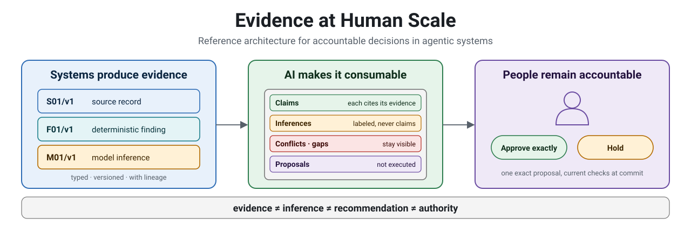

# Evidence at Human Scale

**Reference architecture for accountable decisions in agentic systems**

When several systems and AI assistants feed one decision, the person who decides cannot easily tell what is a source record, what is a model's inference and what is missing. This repository shows, with one invented invoice, how to give that person one decision packet that keeps them apart, and how to keep advice, approval and execution separate. **[Start with the ten-minute path](#ten-minute-path).**

<!-- banner:start -->
<p align="center">
<picture>
<source media="(min-width: 900px) and (prefers-color-scheme:dark)" srcset="figures/banner-wide-dark.svg">
<source media="(min-width: 900px)" srcset="figures/banner-wide-light.svg">
<source media="(prefers-color-scheme: dark)" srcset="figures/banner-dark.svg">

</picture>
</p>
<!-- banner:end -->

## Ten-minute path

Five steps, about ten minutes, all on this page. Each answers one question, from the problem to what you can do on Monday. The links inside the steps lead to optional detail.

<a id="the-problem-in-one-invoice"></a>
## 1. The problem, in one invoice

A supplier invoice is ready to pay, and the goods receipt disagrees with it. The accounts-payable controller has to decide whether to hold or release the payment. The material in front of them comes from several systems and two AI assistants, and part of it is missing, restricted or about to be corrected.

- **The records disagree.** The invoice says 100 units, EUR 18,400. The goods receipt, version 1, says 60 units received.
- **The cause is unknown.** Two AI summaries offer the same explanation, a receiving delay, but both read the same receipt, so they are one opinion. The treasury service did not answer, and part of the requested scope is outside the requestor's read permissions.
- **A person decides.** The controller owns the decision: hold the payment, or release it. A bounded grant lets the system place holds, and releasing this payment needs the controller's approval of one exact proposal.
- **Then the facts change.** The warehouse finds a second pallet and corrects the receipt to 100 units. Everything built on version 1 stops being current, the summaries and the approval included, and the controller reviews the corrected material before approving again.

Every name, amount and system in this example is invented. [The full story](examples/README.md#the-story), with times and record numbers, is in the examples.

<a id="what-the-architecture-does-about-it"></a>
## 2. The architecture's answer: one decision packet

The architecture gives the controller one versioned **decision packet** instead of a pile of agent output:

- **Each item says what it is.** A source record, a deterministic finding and a model inference are kept apart. A claim cites an exact record version, and two summaries of one receipt count as one origin.
- **What is unknown stays visible.** A conflict, a gap or an unavailable source stays in the packet with its reason, in the wording the requestor's permissions allow.
- **Authority stays separate.** A proposal is not an approval, and an approval is not execution. At commit, a gateway rechecks the grant, the evidence, the preconditions and the limits against the current state.
- **Corrections travel.** When a record is superseded, everything built on the old version, a pending approval included, stops being current.

More agents give the controller more interpretations to read. The unit of design here is the decision context rather than the agent hierarchy, and [the paper](docs/paper/README.md) argues why.

## 3. What the controller reviews

The controller reviews the decision packet, not the agents' output. Its first view states the task and the as-of time, shows what could change the decision, and shows where the basis is weak or incomplete. From there the controller can follow a claim back to its source, inspect a conflicting account, challenge a claim and review a revised version.

Version 1 of the packet, produced at 10:00, holds:

| Part of the packet | What this one holds |
|---|---|
| Supported claims | Seven, among them the invoice, the goods receipt (60 units) and the failed three-way match. Each cites an exact record version. |
| Labeled inferences | Two, one for each AI summary. Each states its method and its limits, including that both rest on the same receipt. Neither is a claim. |
| Conflicts and gaps | The quantity conflict, with its cause not established, and seven labeled gaps, among them the treasury service that did not answer, a screening that is out of date and the part of the scope the requestor may not read. |
| Recommendations | Hold the invoice. Release at 16:00 only if the match passes, the screening is current and the invoice is held. |
| Action proposals | The hold and the release, each marked proposed, not executed. |

The example shows that every claim can be followed to a source and that inference, conflict, gap and proposal stay separate. It does not show that a reader finds such a packet readable or quicker than the current process, or that its size is right; a real packet would be much larger, and usability is an open evaluation question. A claim is checked against its sources only mechanically: statuses and figures must match, and the check does not read free text for meaning. [The full packet](examples/05-decision-packet/README.md) lists every reference and the checks that run on it.

## 4. Approval and execution stay separate

The controller reviewed packet version 1 at 10:35 and gave an exact approval, at 10:40, for a conditional release of the payment at the 16:00 payment run. At 13:40 the warehouse corrected the receipt. At 13:45 the packet and the summaries stopped being current and the approval was revoked.

At 16:00 the queued release ran under the old approval, and the gateway refused it at commit. It rechecked what an approval cannot vouch for and found four independent reasons: the approval had been revoked; the evidence the proposal cites had been superseded; the screening it cites was 56 hours old against a 24-hour policy; and the proposal cites no current passing match result and no current fresh screening. By 14:10 the corrected receipt matched the invoice, and the approval was still unusable. It was given for a proposal built on evidence that had since been replaced, and a new proposal needs a new approval.

The receipt keeps three things apart:

- **Rejected before submission.** The gateway checked the action at commit and submitted nothing. This says nothing about the target: another route, system or person could still have paid the invoice.
- **Verified no effect.** An authoritative check of the target, made after the attempt, found no effect for this attempt, target and scope (`not_executed_verified`). This receipt rests on the rejection and on that separate check.
- **Outcome unknown.** Nobody has an authoritative answer yet. The release under the second approval went out at 16:00:05 and the bank interface timed out, so that receipt stayed unknown, with the allowance reserved, until reconciliation at 16:20 showed the payment completed.

Four decisions stay with named people, and the architecture decides none of them: whether a source record is true (the source owner); what the evidence means for this case and what to do (the Decision Owner); whether one exact proposal goes ahead (the approver); and policy, thresholds, safe states and source authority (the domain owners).

The commit check in the example is a small reference function with no state, no concurrency control and no connection to a target; it is not an implementation of a gateway. The example does not show that a real system would notice the correction in time, or that blocking is the right business outcome. [The full blocked action](examples/08-blocked-action/README.md) lists all 21 commit-time reason codes.

<a id="the-smallest-useful-experiment"></a>
## 5. What to do on Monday

Choose one recurring, consequential decision in which people already struggle to absorb the available evidence. Before you write any agent code:

- **Name the decision and its people.** Write down the decision question, the Decision Owner and the actions that could follow, and record separately who may read, who may approve and who may execute.
- **Inventory the sources.** Record producer, evidence kind, version, owner and freshness requirement for each, and give every mandatory signal a notification route that does not depend on the assistant.
- **Draft the first packet.** Supported claims with exact references, labeled inferences, conflicts and gaps, and walk a recent case through it with the Decision Owner.
- **Put a gateway before every consequential action.** It rechecks permission, evidence, policy, target state and limits at commit, and its receipt is verified against the authoritative target.
- **Compare simpler baselines.** Run the current workflow, a deterministic template and a zero-specialist synthesis on the same fixed cases before you consider any specialist agent.

[Paper chapter 14](docs/paper/14-start-monday.md) gives the reasons for each of the five.

### Where the path ends

- **You can now explain** why source records, deterministic findings and model inference are kept apart, what the person who decides reviews, and why approval and execution stay separate.
- **Reusable.** The seven contracts and their JSON Schemas, the structure of the decision packet, the commit-time recheck and the templates in the implementation guide. A domain supplies its own owners, sources, policies and parameters.
- **Implemented.** A JSON Schema bundle, validators and a reference commit check, with tests, on one invented example. The [Quickstart](#quickstart) runs them.
- **Reference pattern only.** Everything else. The commit check has no state, no concurrency control and no connection to a target, and permission-bound output is a reference projection, not an authorization service. Nothing has been deployed, and real-world effectiveness has not been evaluated. [Claims and limits](docs/claims-and-limits.md) has the full statement.
- **Best first step.** Pick one recurring decision and replay one recent case on paper with the person who owns it. The [implementation guide](docs/implementation-guide.md) has a template for each step.

## Quickstart

Optional, and not needed for the path above. Two commands validate the invented examples on your machine.

```bash
python -m pip install -r requirements.txt   # one package: jsonschema
python scripts/validate_examples.py         # validate the synthetic examples
```

You need Python 3.9 or later. It is tested on Windows and Linux (nothing in it is platform-specific, so macOS should work too), uses no network, and starts no service or model. `validate_examples.py`, the second command, should print:

```text
Evidence at Human Scale 1.0.7: example validation
Synthetic data only. A pass is not evidence about any real system.

[1/6] Schema bundle ...           PASS          102 evaluated
[2/6] Example instances ...       PASS          37 evaluated
[3/6] Scenario semantics ...      PASS          37 evaluated
[4/6] Gateway scenarios ...       PASS          24 evaluated
[5/6] Assistant responses ...     PASS          3 evaluated
[6/6] Evaluation cases ...        PASS          37 evaluated

Result: PASS. All 6 stages passed, each after evaluating at least one item (240 items in all).
```

A stage passes only if it evaluated something, and a failing check names its code, the file and the contract page to read. The [examples guide](examples/README.md#run-the-checks) has the exit states and how to break something on purpose, and [`scripts/README.md`](scripts/README.md) documents every script.

<a id="where-to-go-next"></a>
## Go deeper

The path ends at step 5. Everything here is optional.

| Goal | Where |
|---|---|
| **Read the argument** | [The paper](docs/paper/README.md): 15 short chapters, from the problem to the first decision to build. |
| **Check the detail** | [Architecture reference](architecture/README.md) · [seven contracts](contracts/README.md) · [JSON Schema bundle](schemas/README.md). |
| **Run the examples** | [Examples](examples/README.md): one invented supplier-payment story in 13 folders, and a command that validates it. |
| **Evaluate** | [Evaluation guide](evaluation/README.md): 12 tests, 70 fixtures and 47 parameters. The tests are defined and none has been run, and every parameter is UNSET. |
| **See the figures** | [Figures](figures/README.md): F01–F11, each with a caption, alt text and a text description. |
| **Look something up** | [Glossary](docs/glossary.md) · [Claims and limits](docs/claims-and-limits.md) · [Sources](references/README.md). |
| **Follow a route for your role** | [Guided reading paths](docs/README.md) for architects, implementers, evaluators and anyone checking the claims. |

<a id="status-and-limits"></a>
<a id="what-a-pass-means-and-what-it-does-not"></a>
## What this shows, and what it does not

A pass means the invented examples are structurally valid, that their records agree with one another wherever the checks compare them, and that the deterministic checks behave as documented. It says nothing about any real system, model or process. These checks are not the evaluation programme (the twelve evaluation tests, EV01–EV12, all NOT ASSESSED), and they are not model evaluation or human-outcome evaluation. [Claims and limits](docs/claims-and-limits.md) lists what a pass does not establish.

- **A reference architecture, not a deployment.** This is a reference architecture, not a production deployment or benefit claim. The contracts and synthetic examples are tested; real-world effectiveness has not been evaluated. The evaluation programme is defined and none of it has been run ([why](evaluation/README.md#which-tests-can-be-run-today)). The proposed benefit is more inspectable context, not a measured gain in speed, accuracy, cost or decision quality.
- **All example data is invented.** The buyer, the supplier, the amounts and the systems describe no real organization, person or system.
- **Case-based, not a client commission.** The design comes from an architecture engagement on a written case about a public-sector fisheries-control authority in Iceland. The authority took no part, and nothing here is a statement by, about or on behalf of it. The observations that came out of the engagement are single dated cases and one internal, AI-assisted test; none measures this architecture's benefit ([claims and limits](docs/claims-and-limits.md) gives their limits).

## Citing, contributing, security

- **Cite.** [`CITATION.cff`](CITATION.cff) lets GitHub offer *Cite this repository*. Cite the release by its version, `v1.0.7`, 26 November 2026.
- **Contribute.** [`CONTRIBUTING.md`](CONTRIBUTING.md) says what is welcome and how to run the checks before you open a pull request.
- **Report a security concern.** [`SECURITY.md`](SECURITY.md) explains what counts and how to report it privately.
- **Changes.** [`CHANGELOG.md`](CHANGELOG.md) lists what each release contains.

## License

This repository is licensed under the [MIT License](LICENSE).

## Author

Andy Georgi. This is a personal project, not an official Microsoft publication.
