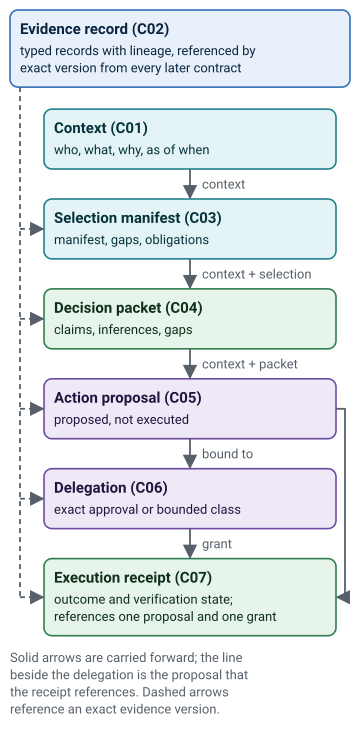

# Contracts

Seven documentation contracts carry the responsibilities of the architecture: C01 Context, C02 Evidence, C03 Selection, C04 Decision packet, C05 Action proposal, C06 Delegation and C07 Execution receipt. A documentation contract states what a unit of information must carry and how it is referenced; it is documentation, not a deployable interface. Together they define 41 field groups. This section is the human-readable reference; the machine-readable form is the [JSON Schema bundle](../schemas/README.md).

> **A contract here is documentation with a schema, not an implementation.** Structural validity is not truth, effective authorization or workflow safety.

| Contract | `contract_id` | Schema definition | Groups | Essential architectural meaning |
| --- | --- | --- | --- | --- |
| [C01 Context](c01-context.md) | `C01` | `#/$defs/context` | 4 | The requesting principal, permitted task and purpose, relevant entities, scope, time and policy constraints. The workload identity is separate. |
| [C02 Evidence](c02-evidence.md) | `C02` | `#/$defs/evidence` | 13 | An attributable, scoped assertion with stable identity, immutable version, registered producer and permitted kind, source locator, scope, timing, method, lineage and qualifications. |
| [C03 Selection](c03-selection.md) | `C03` | `#/$defs/selection` | 6 | What the system actually considered and retained: authorized retrieval coverage, dispositions, obligations, conflicts, missingness and coverage. A selected scope is not whole-corpus coverage. |
| [C04 Decision packet](c04-decision-packet.md) | `C04` | `#/$defs/decision_packet` | 9 | A versioned review context tied to evidence and selection. Not action authorization. |
| [C05 Action proposal](c05-action-proposal.md) | `C05` | `#/$defs/action_proposal` | 3 | The exact versioned action to consider. Advice is not approval or commit. |
| [C06 Delegation](c06-delegation.md) | `C06` | `#/$defs/delegation` | 3 | An exact approval of one proposal version, or a bounded grant for a predefined action class. Current rights, evidence, policy, target state and shared limits still govern commit. |
| [C07 Execution receipt](c07-execution-receipt.md) | `C07` | `#/$defs/execution_receipt` | 3 | Verified outcome. Unknown is unresolved; partial effects count. |

## Notation

In every contract page, `1` means exactly one required value; `0..n` means a required array that may be empty; `1..n` means a required nonempty array. Required singleton objects are neither null nor omitted. IDs and versions are nonempty strings. Every contract carries the constant `contract_id` and a required `schema_version`. References identify exact identities and versions, not an unspecified latest object. The full notation, the two reference alternatives (`claim_reference` and `payload_reference`) and the tagged `known` / `unknown` / `not_applicable` objects are described in [evidence semantics](../architecture/evidence-semantics.md#normative-notation-and-reference-alternatives).

The group tables below list the local group property and emitted field names or referenced definition. Full nested formal structure is in the JSON Schema bundle. Local paths are `#/$defs/{definition}/properties/{group_property}`; a referenced `#/$defs` path is stated when a group uses a shared definition.

## How the contracts relate

<!-- figure:F11:start -->
<!-- Generated by scripts/sync_figures.py from figures/figures.json and the figure source. Edit those, not this block. -->

**Figure F11.** Context, selection, packet, proposal, delegation and receipt chain forward; evidence is referenced by exact version from the others.

<p align="center">
<picture>
<source media="(prefers-color-scheme: dark)" srcset="../figures/F11-dark.svg">

</picture>
</p>

<details>
<summary>Text description of Figure F11</summary>

C01 context is referenced by C03 selection. C03 is referenced by C04 decision packet, together with the context. C04 is referenced by C05 action proposal, together with the context. A C06 delegation is bound to an exact C05 proposal or to a bounded class. A C07 execution receipt references one proposal and one grant: a solid arrow runs from C05 to C07 beside C06, and C06 points to C07. C02 evidence records are referenced, by exact version, claim or pointer, from the selection, the packet, the proposal, the delegation and the receipt; these references are drawn as dashed arrows from the C02 card at the top. Solid arrows carry forward; dashed arrows reference an exact evidence version.

[All figures and their descriptions](../figures/README.md#f11-how-the-seven-contracts-refer-to-each-other)

</details>
<!-- figure:F11:end -->

Evidence (C02) is referenced by exact record version from selections, packets, proposals and grants. A packet (C04) binds one context and one selection. A proposal (C05) binds a context and a packet. A delegation (C06) is either bound to an exact proposal (an approval) or to a bounded class of actions. A receipt (C07) binds a proposal and a grant and records the authoritatively verified outcome; execution records return through admission as C02 evidence.

## All 41 groups

| Contract | Groups |
| --- | --- |
| [C01](c01-context.md) | C01-G01 Identity/principal · C01-G02 Task/purpose/entity · C01-G03 Time/risk/policy · C01-G04 Authorization |
| [C02](c02-evidence.md) | C02-G01 Identity/schema · G02 Producer/admission · G03 Content · G04 Scope · G05 Original source · G06 Method · G07 Times · G08 Lineage · G09 Coverage/uncertainty · G10 Validation · G11 Disclosure/permissions · G12 Lifecycle · G13 Integrity |
| [C03](c03-selection.md) | C03-G01 Identity/scope · G02 Retrieval · G03 Disposition · G04 Obligations · G05 Conflicts/gaps · G06 Coverage |
| [C04](c04-decision-packet.md) | C04-G01 Decision context/as-of · G02 Supported claims/references · G03 Labeled inferences · G04 Recommendations · G05 Conflicts/uncertainty · G06 Coverage/omissions/gaps · G07 Priority/mandatory obligations · G08 Action proposal, not executed · G09 Review/history |
| [C05](c05-action-proposal.md) | C05-G01 Identity/binding · G02 Action · G03 Assessment |
| [C06](c06-delegation.md) | C06-G01 Identity/principals · G02 Scope/binding · G03 Limits/lifecycle |
| [C07](c07-execution-receipt.md) | C07-G01 Identity/binding · G02 Outcome · G03 Verification/recovery |

## Validate and explore

```bash
python scripts/validate_examples.py
```

The command validates the 38 valid and 64 invalid documentation examples embedded in the schema bundle and every contract instance in [`examples/`](../examples/README.md), then runs the deterministic semantic checks on the synthetic scenario. See the [schema README](../schemas/README.md) and the [change log](CHANGES.md).
