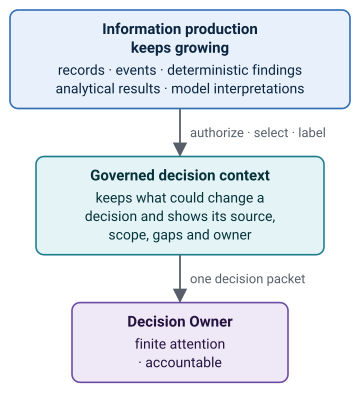

# 1. The scarce resource is human attention

[← Overview](00-overview.md) · [Paper contents](README.md) · [Next: what the engagement showed →](02-engagement.md)

Before a consequential decision, a person receives records, events, deterministic findings, analytical results and model interpretations, each in its own form and through its own interface. There may be enough information to decide and still no reliable way to see which statements share an origin, where they disagree and which expected inputs never arrived. What runs short is the person's attention, not output.

Adding agents does not fix this by itself. Two agents can restate the same weak source and look like corroboration: in the [worked example](../../examples/README.md#the-story), two summaries of one goods receipt both suggest a receiving delay. Additional summaries can hide disagreement beneath a smoother narrative. An impressive answer can also place a recommendation beside an execution control, so that advice appears to carry authority it was never granted.

## Why more output does not help

The second summary of the same goods receipt adds an opinion and no independent evidence. A shorter packet can drop the one gap that matters. An automated action is legitimate only if someone with the authority granted it. Each can help within a defined task. None replaces knowing the source, the scope, the omissions and who owns the decision.

<!-- figure:F01:start -->
<!-- Generated by scripts/sync_figures.py from figures/figures.json and the figure source. Edit those, not this block. -->

**Figure F01.** Information production keeps growing, while the Decision Owner has finite attention. Between them, the decision context keeps what could change a decision, shows its source, scope, gaps and owner, and hands over one decision packet.

<picture>
<source media="(prefers-color-scheme: dark)" srcset="../../figures/F01-dark.svg">

</picture>

Text description of Figure F01

Three cards are drawn top to bottom, each narrower than the one above. The top card says that information production keeps growing. It lists records, events, deterministic findings, analytical results and model interpretations. An arrow labeled authorize, select, label leads to the middle card, the decision context. This card keeps what could change a decision and shows its source, scope, gaps and owner. An arrow labeled one decision packet leads to the bottom card. The bottom card is the Decision Owner, labeled finite attention and accountable.

[All figures and their descriptions](../../figures/README.md#f01-information-production-can-outgrow-human-inspection)

<!-- figure:F01:end -->

The design therefore starts from the decision question rather than an agent roster. What must the owner inspect? Which signals are mandatory? What information is authorized for this purpose? What uncertainty could change the choice? Which actions require fresh authority? These questions constrain production before the system spends money or the reader spends attention.

The architecture is suitable where evidence comes from different kinds of sources, permissions can be enforced, a Decision Owner can be identified, the domain sets obligations of its own and outcomes can be evaluated. It is unsuitable as a service that certifies truth, as a way around native safety controls, or as a basis for unrestricted autonomous action. Human presence alone is not a safety guarantee.

[← Overview](00-overview.md) · [Paper contents](README.md) · [Next: what the engagement showed →](02-engagement.md)
