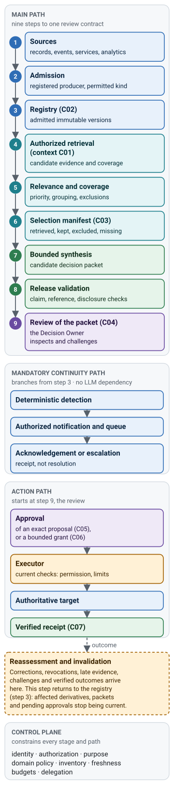

# 3. A governed context, not an agent hierarchy

[← 2. The engagement](02-engagement.md) · [Paper contents](README.md) · [Next: evidence and lineage →](04-evidence-and-lineage.md)

The logical architecture begins with sources. Registered sources, events, deterministic services, and analytics submit records or results through admission. A governed registry retains admitted immutable versions. Authorized retrieval produces candidate evidence and coverage; relevance, priority, grouping, and coverage produce a selected set and a selection manifest.

Bounded orchestration and synthesis turn that selection into a candidate decision packet. Claim, reference, and disclosure checks permit its release for review. The checks certify neither source truth nor the correctness of every interpretation. One assistant workspace lets the Decision Owner inspect, challenge, and compare the released context.

<!-- figure:F02:start -->
<!-- Generated by scripts/sync_figures.py from figures/figures.json and the figure source. Edit those, not this block. -->

**Figure F02.** Nine steps on the main path lead to one review contract; mandatory continuity and execution authority retain separate, governed paths.

<picture>
<source media="(prefers-color-scheme: dark)" srcset="../../figures/F02-dark.svg">

</picture>

*Open at full size: [light](../../figures/F02-light.svg) · [dark](../../figures/F02-dark.svg).*

Text description of Figure F02

The main path, on the left, has nine steps: sources, admission, the registry of immutable versions (C02), authorized retrieval (C01), relevance and coverage, the selection manifest (C03), bounded synthesis, release validation, and review of the decision packet (C04) by the Decision Owner. A separate mandatory continuity path leaves the registry and runs through deterministic detection and an authorized notification queue to acknowledgement or escalation; acknowledgement is receipt, not resolution, and the path has no LLM dependency. A separate action path starts from the review step: an exact approved proposal (C05) or bounded grant (C06) reaches an executor that performs current checks, then an authoritative target, then a verified receipt (C07). The outcome returns to a reassessment and invalidation step, which also receives corrections, revocations, late evidence and challenges, and returns to the registry. A control plane constrains every stage and path: identity, authorization, purpose, domain policy, inventory, freshness, budgets and delegation.

[All figures and their descriptions](../../figures/README.md#f02-reference-architecture)

<!-- figure:F02:end -->

## Responsibilities, not new layers

Admission, registry, retrieval, selection, synthesis, release validation, review, and the action gateway are logical responsibilities. They may be physically colocated without collapsing their contracts. The control plane constrains every stage and path: identity, authorization, purpose, domain policy, source/model/tool inventory, freshness, budgets, and delegation. Azure products are implementation options, not logical boxes.

Optional specialists receive an authorized, bounded task. Their results return through admission; they cannot publish directly to the workspace, self-declare source authority, or widen their own permissions. The zero-specialist baseline remains a complete architecture. Removing a specialist must not remove a required control or continuity route.

The independent mandatory path runs from the registry through deterministic detection to an authorized notification and queue, then acknowledgement or escalation. Acknowledgement is receipt, not resolution. Existing native deterministic safety controls may use their established authorized routes outside assistant-mediated admission. Neither path acquires an LLM availability dependency.

The action path is separate again: an exact approved proposal or valid bounded grant reaches an executor that performs current checks and verifies outcomes. Corrections, revocations, late evidence, and challenges return to reassessment and invalidation. Figure F02 simplifies the presentation; the [architecture reference](../../architecture/README.md) carries the detailed controls behind it.

Seven documentation contracts carry these responsibilities: [C01 Context](../../contracts/c01-context.md), [C02 Evidence](../../contracts/c02-evidence.md), [C03 Selection](../../contracts/c03-selection.md), [C04 Decision packet](../../contracts/c04-decision-packet.md), [C05 Action proposal](../../contracts/c05-action-proposal.md), [C06 Delegation](../../contracts/c06-delegation.md) and [C07 Execution receipt](../../contracts/c07-execution-receipt.md). The following sections explain each; the [contract reference](../../contracts/README.md) lists all 41 field groups.

[← 2. The engagement](02-engagement.md) · [Paper contents](README.md) · [Next: evidence and lineage →](04-evidence-and-lineage.md)
