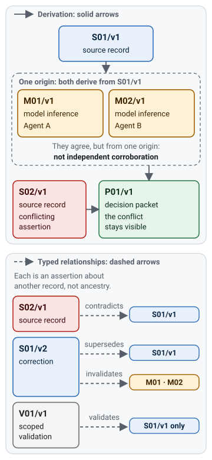

# 4. Evidence keeps its type and its ancestry

[← 3. The reference architecture](03-governed-context.md) · [Paper contents](README.md) · [Next: context and selection →](05-context-and-attention.md)

Evidence is an attributable, scoped assertion, not guaranteed truth. A source record establishes what that source asserted in a specified version and scope. A deterministic finding reports a declared rule over stated inputs. An analytical result depends on its method and assumptions. A model inference establishes that an interpretation was produced, not that it is true.

A recommendation proposes what someone might do. A decision record documents a choice; an execution record documents observed effects. Those records do not retrospectively validate the original observations. What a source asserted, what a model inferred from it, what someone recommends and what someone is authorized to do are four different things. The difference must survive admission, ranking, synthesis, presentation, review and execution.

## A reference leads back to the exact record version

A C02 evidence record has a stable identity and an immutable version. It carries its registered producer and permitted kind, a source locator, scope, timing, method and any relevant qualifications. Admission establishes that the envelope and kind are admissible. Scoped validation records who assessed which target, by which method, when and within what scope. Neither establishes universal correctness.

A supported claim points to the exact record version and claim identifier, with its original locator. A payload-only reference instead identifies the exact version and an explicit payload location or pointer; it must not receive an invented claim identifier. Both preserve source type, scope and provenance. A readable link is useful only if it resolves to the evidence actually used.

<!-- figure:F03:start -->
<!-- Generated by scripts/sync_figures.py from figures/figures.json and the figure source. Edit those, not this block. -->

**Figure F03.** Two model inferences derived from the same source record agree, but from one origin, so their agreement is not independent corroboration. Solid arrows show derivation; dashed arrows show what one record asserts about another: that it contradicts, supersedes, invalidates or validates it.

<picture>
<source media="(prefers-color-scheme: dark)" srcset="../../figures/F03-dark.svg">

</picture>

Text description of Figure F03

Solid arrows show derivation. Source record S01/v1 is the only parent of two model inferences: M01/v1, from Agent A, and M02/v1, from Agent B. Both derive from S01/v1, so they have one origin. They agree, but their agreement is not independent corroboration. Both feed decision packet P01/v1. So does a conflicting source record, S02/v1, and the conflict stays visible in the packet. Dashed arrows show typed relationships. Each is an assertion about another record and does not show ancestry. Each is recorded with the actor who asserted it, which the figure does not draw. S02/v1 contradicts S01/v1. A correction, S01/v2, supersedes S01/v1 and invalidates M01 and M02. A scoped validation, V01/v1, validates S01/v1 only. In the worked example, which the figure does not label, S01 is the goods receipt, S02 is the invoice, and M01 and M02 are the two model summaries.

[All figures and their descriptions](../../figures/README.md#f03-common-source-agreement-is-not-corroboration)

<!-- figure:F03:end -->

In the worked example, S01 is the goods receipt and S02 the invoice. Two summaries derived from S01/v1 share a root, so their agreement is not independent corroboration, even if different agents produced them. The conflicting S02/v1 stays visible beside them. When the correction S01/v2 supersedes S01/v1, it invalidates the affected derivatives, here both summaries. A scoped validation belongs only to the target and scope it actually assessed.

Derivation ancestry is directed and acyclic. Contradiction, supersession, validation and invalidation are separate, typed relationships rather than extra ancestry edges, and each names the actor who asserted it. A majority or a newer timestamp does not automatically settle an authority conflict. The rules for groups, types, cardinality and fields are in the [evidence semantics](../../architecture/evidence-semantics.md), the [lineage, selection and disclosure](../../architecture/lineage-selection-disclosure.md) reference and the [contract reference](../../contracts/README.md).

**See it working:** [example 03](../../examples/03-lineage-and-common-origin/README.md) has a source record, two common-origin summaries and a conflicting record, and [example 11](../../examples/11-late-correction/README.md) adds a late correction. The schema validates the structure of every record, and the repository's checks test the semantics.

[← 3. The reference architecture](03-governed-context.md) · [Paper contents](README.md) · [Next: context and selection →](05-context-and-attention.md)
