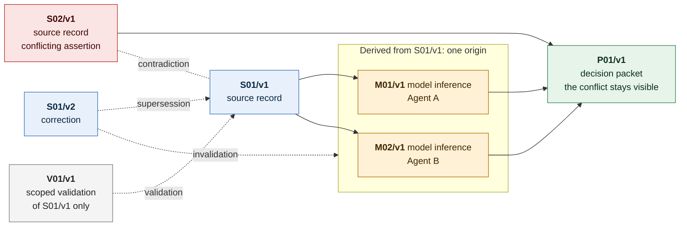

# 4. Evidence keeps its type and its ancestry

[← 3. A governed context](03-governed-context.md) · [Paper contents](README.md) · [Next: context and attention →](05-context-and-attention.md)

Evidence is an attributable, scoped assertion, not guaranteed truth. A source record establishes what that source asserted in a specified version and scope. A deterministic finding reports a declared rule over stated inputs. An analytical result depends on its method and assumptions. A model inference establishes that an interpretation was produced, not that it is true.

A recommendation proposes what someone might do. A decision record documents a choice; an execution record documents observed effects. Those records do not retrospectively validate the original observations. **Evidence ≠ inference ≠ recommendation ≠ authority.** The distinction must survive admission, ranking, synthesis, presentation, review, and execution.

## A reference is a way back, not a badge of truth

C02 Evidence has a stable identity and immutable version, registered producer and permitted kind, source locator, scope, timing, method, and relevant qualifications. Admission establishes admissibility of the envelope and kind. Scoped validation records who assessed which target, by which method, when, and within what scope. Neither establishes universal correctness.

A supported claim points to the exact record version and claim identifier, with its original locator. A payload-only reference instead identifies the exact version and explicit payload location or pointer; it must not receive an invented claim identifier. Both preserve source type, scope, and provenance. A readable link is useful only if it resolves to the evidence actually used.

<!-- figure:F03:start -->
<!-- Generated by scripts/sync_figures.py from figures/figures.json and the figure source. Edit those, not this block. -->

**Figure F03.** Common-source agreement is not corroboration; conflicts, corrections and the scope of validation stay visible. Solid lines show derivation; dotted lines are assertions about another record.

*Open at full size: [light](../../figures/F03-light.svg) · [dark](../../figures/F03-dark.svg).*

Text description of Figure F03

Solid arrows are derivation ancestry. Source record S01/v1 is the only parent of two model inferences, M01/v1 from Agent A and M02/v1 from Agent B, which together form one origin. Both feed the decision packet P01/v1. A conflicting source record, S02/v1, also reaches the packet, so the conflict stays visible. Dashed arrows are typed relationships, not ancestry, and each names the actor who asserted it: S02/v1 contradicts S01/v1; a correction, S01/v2, supersedes S01/v1 and invalidates what was derived from it; and a scoped validation, V01/v1, assesses S01/v1 only. In the worked example, S01 is the goods receipt, S02 the invoice, and M01 and M02 the two model summaries.

[All figures and their descriptions](../../figures/README.md#f03-common-source-agreement-is-not-corroboration)

<!-- figure:F03:end -->

Two summaries derived from S01/v1 share a root. Their agreement is not independent corroboration, even if different agents produced them. A conflicting S02/v1 remains visible. A correction S01/v2 supersedes the earlier source version and invalidates affected derivatives. A scoped validation belongs only to the target and scope it actually assessed.

Derivation ancestry is directed and acyclic. Contradiction, supersession, validation, and invalidation are separately typed relationships, not extra ancestry edges; each names the asserting actor. A majority or newer timestamp does not automatically settle an authority conflict. Detailed group, type, cardinality, and field rules are in the [evidence semantics](../../architecture/evidence-semantics.md), the [lineage, selection and disclosure](../../architecture/lineage-selection-disclosure.md) reference and the [contract reference](../../contracts/README.md).

**See it working:** the [worked example](../../examples/README.md) contains a source record, two common-origin summaries, a conflicting record and a late correction, all validated against the schema.

[← 3. A governed context](03-governed-context.md) · [Paper contents](README.md) · [Next: context and attention →](05-context-and-attention.md)
