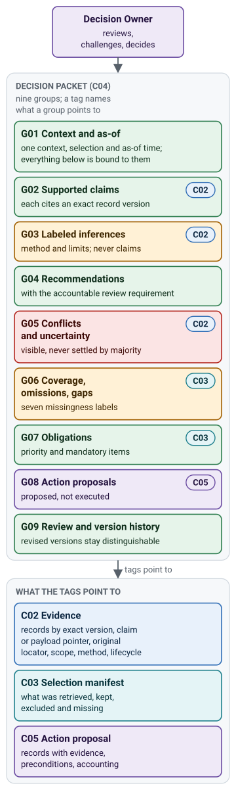

# 6. The decision packet

[← 5. Context and selection](05-context-and-attention.md) · [Paper contents](README.md) · [Next: one interaction →](07-one-interaction.md)

The decision packet (C04) is a versioned review object bound to the exact context and selection manifest. It shortens what the Decision Owner has to read. It never shortens the provenance of a claim or the uncertainty around it, and it keeps advice separate from authority.

The packet presents supported claims with evidence references, separately labeled inferences, recommendations, conflicts, uncertainty, missingness, limitations and review requirements. It is not an action authorization, and it does not replace the registry, which is the evidence ledger.

<!-- figure:F04:start -->
**Figure F04.** A decision packet (C04) has nine groups, among them supported claims, labeled inferences, conflicts, gaps, obligations and action proposals that are not executed. Tags show which groups point to evidence records, the selection manifest and action proposal records.

<picture>
<source media="(prefers-color-scheme: dark)" srcset="../../figures/F04-dark.svg">

</picture>

Text description of Figure F04

At the top, the Decision Owner reviews, challenges and decides. Below is one decision packet (C04) with nine groups. The first binds the packet to one context, selection and as-of time, and everything below is bound to them. Supported claims each cite an exact record version. Labeled inferences carry method and limits. They are never claims. Recommendations carry the accountable review requirement. Conflicts and uncertainty stay visible and are never settled by majority. Coverage, omissions and gaps use seven missingness labels. Obligations carry priority and mandatory items. Action proposals are proposed and not executed. The review and version history keeps revised versions distinguishable. A tag on a group names what it points to. Supported claims, labeled inferences and conflicts point to evidence records (C02), by exact version, claim or payload pointer, original locator, scope, method and lifecycle. Coverage and obligations point to the selection manifest (C03), which records what was retrieved, kept, excluded and missing. Action proposals point to action proposal records (C05), with evidence, preconditions and accounting. A band under the packet shows the three contracts that the tags name.

[All figures and their descriptions](../../figures/README.md#f04-anatomy-of-a-decision-packet)

<!-- figure:F04:end -->

## What the owner needs to see

The first view should state the task and the as-of basis, show the information that could change the decision, and show where the basis is weak or incomplete. From there the Decision Owner can drill back to the original evidence, inspect a conflicting account, challenge a claim and review a revised version. The packet may be shortened only while each of those routes stays usable.

A recommendation is offered for consideration. It is not an instruction, and nothing executes silently because of it. The packet can explain why an action may merit attention. It never claims that an approver has approved the action or that the executor has completed it. Separate contracts keep advice, approval and outcome apart:

| Contract | What it is |
| --- | --- |
| [Decision packet (C04)](../../contracts/c04-decision-packet.md) | A versioned review object tied to evidence and selection. It is not an action authorization. |
| [Action proposal (C05)](../../contracts/c05-action-proposal.md) | The exact versioned action to consider. Advice is not approval or commit. |
| [Delegation (C06)](../../contracts/c06-delegation.md) | An exact approval of one proposal version, or a bounded grant for a predefined action class. Current rights, evidence, policy, target state and shared limits still govern commit. |
| [Execution receipt (C07)](../../contracts/c07-execution-receipt.md) | The verified outcome. An unknown outcome is unresolved, and partial effects count. |

A review is meaningful only if it is more than a confirmation click. It needs an identifiable Decision Owner, enough time, inspection of the evidence, visible dissent and recourse, and an explicit account of what the system did not obtain or assess. The design cannot create those conditions merely by naming a person in a workflow.

A challenged packet is not overwritten. The affected lineage is reassessed, the revised version stays distinguishable from the earlier one, and a pending approval that relied on invalidated evidence stops being current. Review history is kept only within permission and retention limits. The [decision packet contract page (C04)](../../contracts/c04-decision-packet.md) defines every group of the packet.

**See it working:** [a complete decision packet](../../examples/05-decision-packet/README.md) and [the assistant response rendered from it](../../examples/06-assistant-response/README.md).

[← 5. Context and selection](05-context-and-attention.md) · [Paper contents](README.md) · [Next: one interaction →](07-one-interaction.md)
