# 8. Uncertainty is part of the result

[← 7. One interaction](07-one-interaction.md) · [Paper contents](README.md) · [Next: authority →](09-authority.md)

Absence has several meanings, and collapsing them changes decisions. An expected input may not arrive; a completed retrieval may return no relevant record; a principal may lack access; a dependency may fail; an explicit observation may report absence. These are different states with different remedies and different implications for action.

## Seven labels that must not collapse

| State | Meaning the reader must retain |
| --- | --- |
| `missing` | Expected input was not obtained; the reason may be unknown. |
| `not_retrieved` | A completed scoped retrieval found no relevant record. This is not evidence of absence. |
| `inaccessible` | The current principal lacks permission. Existence and reason are disclosed only when permitted. |
| `unavailable` | A source or dependency could not provide data, distinct from permission denial. |
| `negative` | An explicit, adequately scoped absence observation, with method, time, and coverage. |
| `not_assessed` | A check or assessment was not performed. |
| `stale` | An available record fails its applicable freshness requirement. |

Partial coverage, exclusions, and omissions remain visible with each applicable state. In evaluation and publication, the status NOT ASSESSED (in capitals) means insufficient assessment coverage. It is not the label `not_assessed` above, which says that a check or assessment of an input was not performed. Neither is a negative source finding or a completed test. A gap limits any conclusion that rests on its missing basis and blocks any action that depends on it; a low-confidence severe signal can still require attention. The system must not manufacture a negative, or disclose protected existence to explain an omission.

<!-- figure:F09:start -->
<!-- Generated by scripts/sync_figures.py from figures/figures.json and the figure source. Edit those, not this block. -->

**Figure F09.** Seven labels, six questions, asked in order: an expected input that is not in front of the reader gets exactly one label.

<picture>
<source media="(prefers-color-scheme: dark)" srcset="../../figures/F09-dark.svg">

</picture>

Text description of Figure F09

For an expected input that is not in front of the reader, ask six questions in order. One: is a record available but failing the freshness requirement? If yes, the label is stale. Two: was the check or assessment performed? If not, not_assessed. Three: may the reader's principal read the source? If not, inaccessible, and the reason and existence are disclosed only when permitted. Four: did the source or dependency answer? If not, unavailable, which is not the same as denied. Five: did a scoped retrieval complete? If not, missing: expected, not obtained, reason may be unknown. Six: was absence observed with method, time and complete coverage? If yes, negative. If not, not_retrieved: a completed retrieval found nothing, which is not evidence of absence. Only negative is evidence of absence: its label is drawn in green, and the other six labels in amber.

[All figures and their descriptions](../../figures/README.md#f09-which-missingness-label-applies)

<!-- figure:F09:end -->

An explicit uncertainty model also makes recovery accountable. It directs the relevant recovery owner (the [failure table](../../architecture/action-and-degradation.md#full-failure-response-and-recovery-ownership) assigns them) toward the actual reason for the limitation. That does not guarantee recovery. It prevents a smooth summary from disguising why a consequential choice remains unsupported.

**See it working:** one synthetic decision packet ([example 05](../../examples/05-decision-packet/README.md)) carries all seven labels, each with the reference the contract requires, and the [selection it rests on](../../examples/04-selection-and-missingness/README.md) does too. The schema rejects, for instance, a `not_retrieved` entry that does not point to a completed retrieval.

[← 7. One interaction](07-one-interaction.md) · [Paper contents](README.md) · [Next: authority →](09-authority.md)
