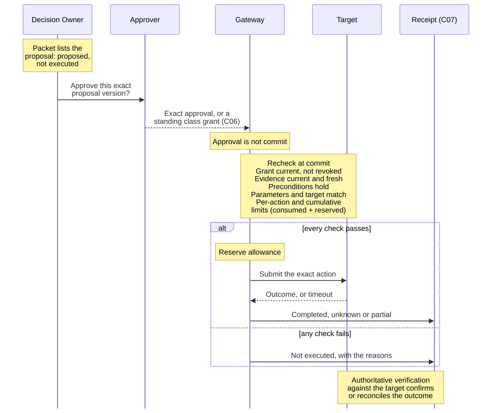

# 9. Authority remains a separate boundary

[← 8. Uncertainty](08-uncertainty.md) · [Paper contents](README.md) · [Next: degraded operation →](10-degraded-operation.md)

Reading, synthesis, approval, and execution are different permissions. Separate the requestor and accountable approver, read-authorized context service, workload or orchestration identity, executor or action gateway, and authoritative target verifier. A service identity never grants the requestor rights to every underlying source or the assistant permission to perform every action.

Source documents, tool responses, and model outputs are untrusted data. They cannot alter permissions, priorities, obligations, controls, or delegation. Authorization applies before model context and throughout derived disclosure: claims, summaries, relationships, counts, selection manifests, limitation messages, caches, and history can all reveal protected information.

<!-- figure:F05:start -->
<!-- Generated by scripts/sync_figures.py from figures/figures.json and the figure source. Edit those, not this block. -->

**Figure F05.** Approval is not commit: at commit the gateway rechecks the grant, the evidence, the preconditions and the limits, and an authoritative verification confirms the outcome.

*Open at full size: [light](../../figures/F05-light.svg) · [dark](../../figures/F05-dark.svg).*

Text description of Figure F05

Five participants: the Decision Owner, the approver or grant issuer, the gateway and executor, the target system and the receipt (C07). The packet lists a proposal as proposed, not executed. The Decision Owner asks the approver to approve this exact proposal version, or a standing class grant already covers it; the approval or grant (C06) names scope, limits and expiry. Approval is not commit: at commit the gateway rechecks that the grant is current and not revoked, the evidence is current and fresh, the preconditions hold, the parameters and target are permitted, and the per-action and cumulative limits hold, counting consumed plus reserved capacity. If every check passes, it reserves allowance, submits the exact action to the target, receives an outcome or a timeout and records a receipt: completed, unknown or partial. If any check fails, it records a receipt that says not executed, with the reasons. An authoritative verification against the target then confirms or reconciles the outcome.

[All figures and their descriptions](../../figures/README.md#f05-from-proposal-to-commit)

<!-- figure:F05:end -->

## Approval is not commit

Approval binds an exact versioned proposal within stated limits. A valid bounded grant can authorize a predefined action class without a fresh approval for each instance, but only within its explicit scope. Neither approval nor delegation substitutes for the executor's current checks. The [action and degradation reference](../../architecture/action-and-degradation.md) retains the full proposal, grant, and receipt requirements.

At commit, the executor rechecks current permission and revocation, evidence, policy, target state, and per-action and cumulative limits, including consumed and reserved capacity. Where supported, these checks, shared reservation or consumption, and commit are atomic. An atomic target-version check alone does not prevent concurrent grant-limit overspend.

Unknown execution retains its reservation or equivalent conservative accounting until authoritative reconciliation. Timeout or lease expiry does not restore allowance. Known partial effects count against cumulative limits and require reconciliation or compensation under policy. Allowance is restored only under a documented confirmed-effect policy, not by assuming silence means no effect.

A verified completion requires authoritative evidence of the outcome. Unknown and partial outcomes remain unresolved and require reconciliation. Verified no-effect means authoritative confirmation that the action caused no business effect, not merely that a response was absent. The full terminal-state and verification requirements remain in the [action and degradation reference](../../architecture/action-and-degradation.md).

<!-- figure:F06:start -->
<!-- Generated by scripts/sync_figures.py from figures/figures.json and the figure source. Edit those, not this block. -->

**Figure F06.** An unknown outcome keeps its reservation: only authoritative reconciliation settles it, and a timeout never restores allowance.

<picture>
<source media="(prefers-color-scheme: dark)" srcset="../../figures/F06-dark.svg">

</picture>

*Open at full size: [light](../../figures/F06-light.svg) · [dark](../../figures/F06-dark.svg).*

Text description of Figure F06

An action starts as submitted, after the gateway has passed every check and reserved allowance. It leads to four states. Unknown (a timeout or no response) and partial (some effects verified, others not; known effects stay charged) are unresolved: allowance stays reserved or charged, there is no blind retry, and a timeout or lease expiry never restores allowance. Completed_verified (an authoritative outcome confirms the effect) and not_executed_verified (authoritatively verified: no business effect) are terminal. Unknown leaves only by authoritative reconciliation, to completed_verified or not_executed_verified. Partial leaves by reconciliation or compensation under policy, to completed_verified. Allowance is restored only on authoritative reconciliation, never by assuming that silence means no effect.

[All figures and their descriptions](../../figures/README.md#f06-receipt-states-and-recovery)

<!-- figure:F06:end -->

External targets may not support atomic checks and business commit. Declare the weaker guarantees, race windows, reservation and reconciliation behavior, and residual risk. Local idempotency is not exactly-once business execution. If shared atomic grant-limit enforcement is unsupported, disable unattended operations that the domain owner has not explicitly accepted; irreversible effects cannot be undone by software rollback.

**See it working:** [example 07](../../examples/07-authority-and-delegation/README.md) has a bounded delegation, an exact approval, and a proposal the delegation does not cover; [example 08](../../examples/08-blocked-action/README.md) has a blocked action with a verified no-effect receipt; and [example 09](../../examples/09-unknown-outcome/README.md) has an unknown outcome that keeps its reservation.

[← 8. Uncertainty](08-uncertainty.md) · [Paper contents](README.md) · [Next: degraded operation →](10-degraded-operation.md)
