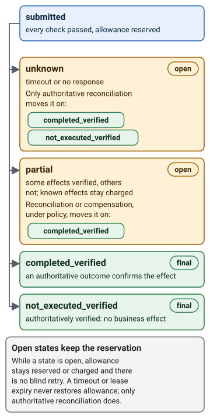

# 9. Authority remains a separate boundary

[← 8. Uncertainty](08-uncertainty.md) · [Paper contents](README.md) · [Next: 10. Degraded operation →](10-degraded-operation.md)

Reading, synthesis, approval and execution are different permissions, and different roles hold them. The **requestor** asks for the packet. The **Decision Owner**, also called the accountable reviewer, reviews it and owns the decision. The **approver** authorizes one exact proposal or issues a bounded grant. The **executor**, which is the action gateway, rechecks and performs the action, and an authoritative target confirms what happened. Beside them sit the read-authorized context service and the workload or orchestration identity. One person may hold more than one of these roles only where the domain's policy explicitly allows it; in the worked example the controller is both Decision Owner and approver, and the example's `registry.json` records that. No contract treats the roles as the same. A service identity never grants the requestor rights to every underlying source, and never gives the assistant permission to perform every action.

Source documents, tool responses and model outputs are untrusted data. They cannot alter permissions, priorities, obligations, controls or delegation. Authorization applies before evidence enters model context, and again wherever something derived from that evidence is disclosed. Claims, summaries, relationships, counts, selection manifests, limitation messages, caches and history can each reveal protected information.

<!-- figure:F05:start -->
**Figure F05.** An approver approves one exact proposal, or a grant already covers it. At commit, the executor rechecks the grant, the evidence, the preconditions and the limits. A failed check rejects the action before submission, and that rejection alone is not proof about every external effect: only a verification against the target confirms the outcome, or that there was no effect, for this attempt, target and scope.

<picture>
<source media="(prefers-color-scheme: dark)" srcset="../../figures/F05-dark.svg">

</picture>

Text description of Figure F05

At the top, the packet lists the proposal, marked proposed, not executed. Below it, joined by the word or, are an exact approval and a bounded grant. The exact approval is of this proposal version, given by the approver, a role distinct from the requestor. The bounded grant is a grant for a class of actions that already covers the proposal. Both are recorded in a delegation (C06). A divider reads Approval is not commit. Below the divider, the executor, also called the action gateway, checks the current state at commit against six conditions. The grant is current and not revoked. The evidence is current and fresh. The preconditions hold. The parameters and target match. The per-action limit holds. The cumulative limit holds, counting consumed and reserved capacity. If every check passes, allowance is reserved and the exact action is submitted to the target. The outcome, or a timeout, is recorded. If a check fails, the action is rejected before submission and nothing is submitted. The receipt (C07) records the outcome. After a pass, the receipt records the outcome, such as completed and verified, unknown, partly verified, or verified no effect. The receipt's own values are submitted (business completion not yet established), completed_verified, unknown, partial and not_executed_verified. After a failed check, the receipt keeps the rejection and its reasons. A rejection by itself is only what the gateway did, so it is not proof about every external effect. The receipt records verified no effect (not_executed_verified) only after an authoritative verification against the target confirms no effect for this attempt, target and scope. An authoritative verification against the target also confirms or reconciles every other outcome.

[All figures and their descriptions](../../figures/README.md#f05-from-proposal-to-commit)

<!-- figure:F05:end -->

## Approval is not commit

An approval binds one exact version of a proposal, within stated limits. A valid bounded grant can authorize a predefined action class without a fresh approval for each instance, but only within its explicit scope. Neither an approval nor a grant replaces the executor's current checks at commit. The [action and degradation reference](../../architecture/action-and-degradation.md) holds the full requirements for proposals, grants and receipts.

At commit, the executor rechecks current permission and revocation, evidence, policy, target state, and the per-action and cumulative limits, including consumed and reserved capacity. Each check is made as of the attempt: only evidence that had been admitted, and only revocation checks that had been made, by that moment count. A later admission or a later "not revoked" result cannot authorize an earlier attempt, and a required time that is missing or unknown blocks. Where supported, these checks, the shared reservation or consumption of that capacity, and the commit itself are atomic. An atomic check of the target version does not, on its own, stop concurrent actions from overspending a grant limit.

An unknown outcome keeps its reservation, or equivalent conservative accounting, until authoritative reconciliation. A timeout or lease expiry does not restore allowance. Known partial effects count against the cumulative limits and need reconciliation or compensation under policy. Allowance is restored only under a documented confirmed-effect policy, never because silence is assumed to mean no effect.

A verified completion needs authoritative evidence of the outcome. Unknown and partial outcomes remain unresolved and require reconciliation. The receipt state `not_executed_verified` (a verified no-effect) means authoritative confirmation that the action caused no business effect for this attempt, target and scope. Three things stay apart: a rejection before submission is what the gateway did; a verified no-effect is what an authoritative check of the target found; an unknown outcome is what nobody has yet found out. The absence of a response is not that confirmation, and a gateway rejection alone is not proof about every external effect. The [action and degradation reference](../../architecture/action-and-degradation.md) holds the full terminal-state and verification requirements.

<!-- figure:F06:start -->
**Figure F06.** A submitted action can reach four outcome states: an unknown outcome and a partly verified one are open, and a completed and verified outcome and a verified no-effect are final. While a state is open, allowance stays reserved or charged until authoritative reconciliation, and a timeout never restores it. The receipt names these states unknown, partial, completed_verified and not_executed_verified; submitted is the state before any of them.

<picture>
<source media="(prefers-color-scheme: dark)" srcset="../../figures/F06-dark.svg">

</picture>

Text description of Figure F06

An action is submitted after every check has passed and allowance has been reserved. Four cards follow, each reached by an arrow from submitted. Each card names the outcome in words and, under it, the receipt state that records it. Outcome unknown, the state unknown, means a timeout or no response. Partly verified, the state partial, means that some effects are verified and others are not, and the known effects stay charged. Both are open, tagged open and drawn in amber. Completed and verified, the state completed_verified, means that an authoritative outcome confirms the effect. Verified no effect, the state not_executed_verified, means that an authoritative verification finds no effect for this attempt, target and scope. Both are final, tagged final and drawn in green. Inside the unknown card, green labels show where it can go. Only authoritative reconciliation moves it to completed and verified or to verified no effect. Inside the partly verified card, a label shows that reconciliation or compensation, under policy, moves it to completed and verified. A note at the bottom says that while a state is open, allowance stays reserved or charged and there is no blind retry. A timeout or lease expiry never restores allowance. Only authoritative reconciliation does.

[All figures and their descriptions](../../figures/README.md#f06-receipt-states-and-recovery)

<!-- figure:F06:end -->

An external target may not support atomic checks and business commit. If it does not, declare the weaker guarantees, the race windows, the reservation and reconciliation behavior, and the residual risk. Local idempotency is not exactly-once business execution. If atomic enforcement of the shared grant limit is unsupported, disable any unattended operation that the domain owner has not explicitly accepted. A software rollback cannot undo an irreversible effect.

**See it working:** [example 07](../../examples/07-authority-and-delegation/README.md) has a bounded delegation, an exact approval and a proposal the delegation does not cover; [example 08](../../examples/08-blocked-action/README.md) has a blocked action with a `not_executed_verified` receipt; and [example 09](../../examples/09-unknown-outcome/README.md) has an unknown outcome that keeps its reservation.

[← 8. Uncertainty](08-uncertainty.md) · [Paper contents](README.md) · [Next: 10. Degraded operation →](10-degraded-operation.md)
