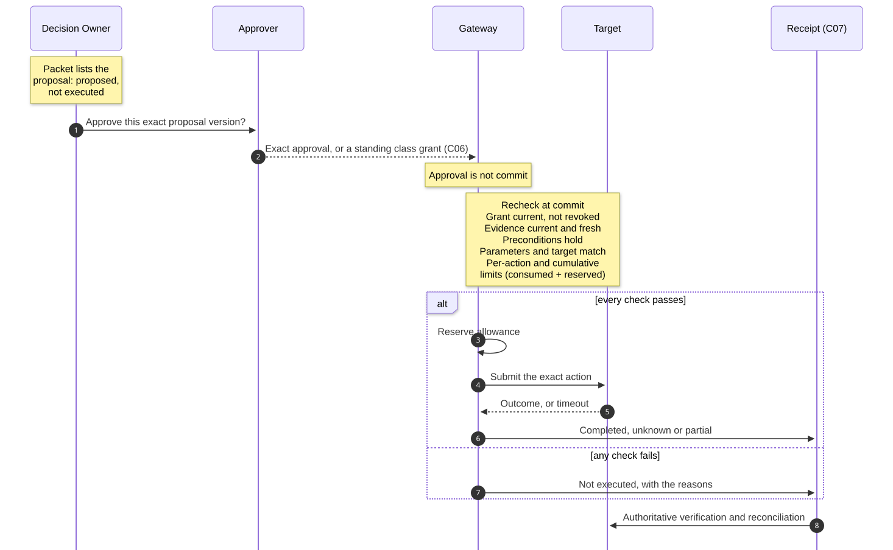

# 9. Authority remains a separate boundary

[← 8. Uncertainty](08-uncertainty.md) · [Paper contents](README.md) · [Next: degraded operation →](10-degraded-operation.md)

Reading, synthesis, approval and execution are different permissions, and different roles hold them. The **requestor** asks for the packet. The **Decision Owner**, also called the accountable reviewer, reviews it and owns the decision. The **approver** authorizes one exact proposal or issues a bounded grant. The **executor**, which is the action gateway, rechecks and performs the action, and an authoritative target confirms what happened. Beside them sit the read-authorized context service and the workload or orchestration identity. One person may hold more than one of these roles only where the domain's policy explicitly allows it; in the worked example the controller is both Decision Owner and approver, and the registry records that. No contract treats the roles as the same. A service identity never grants the requestor rights to every underlying source, and never gives the assistant permission to perform every action.

Source documents, tool responses, and model outputs are untrusted data. They cannot alter permissions, priorities, obligations, controls, or delegation. Authorization applies before model context and throughout derived disclosure: claims, summaries, relationships, counts, selection manifests, limitation messages, caches, and history can all reveal protected information.

<!-- figure:F05:start -->
<!-- Generated by scripts/sync_figures.py from figures/figures.json and the figure source. Edit those, not this block. -->

**Figure F05.** Approval is not commit: at commit the gateway rechecks the grant, the evidence, the preconditions and the limits, and an authoritative verification confirms the outcome.

<picture>
<source media="(prefers-color-scheme: dark)" srcset="../../figures/F05-dark.svg">

</picture>

Text description of Figure F05

Top to bottom: the packet lists a proposal as proposed, not executed. Either the approver approves this exact proposal version, a role distinct from the requestor, or a bounded grant already covers it; both are recorded in a delegation (C06) that names scope, limits and expiry. A divider says that approval is not commit. At commit, the executor, or action gateway, rechecks six conditions: the grant is current and not revoked, the evidence is current and fresh, the preconditions hold, the parameters and target match, the per-action limit holds, and the cumulative limit holds, counting consumed and reserved capacity. If every check passes, it reserves allowance, submits the exact action to the target and records the outcome or a timeout. If a check fails, nothing is submitted. The receipt (C07) then records the outcome as completed_verified, unknown, partial or not_executed_verified after a pass, and not_executed_verified, with the reasons, after a failed check. An authoritative verification against the target confirms or reconciles the outcome.

[All figures and their descriptions](../../figures/README.md#f05-from-proposal-to-commit)

<!-- figure:F05:end -->

## Approval is not commit

Approval binds an exact versioned proposal within stated limits. A valid bounded grant can authorize a predefined action class without a fresh approval for each instance, but only within its explicit scope. Neither approval nor delegation substitutes for the executor's current checks. The [action and degradation reference](../../architecture/action-and-degradation.md) retains the full proposal, grant, and receipt requirements.

At commit, the executor rechecks current permission and revocation, evidence, policy, target state, and per-action and cumulative limits, including consumed and reserved capacity. Where supported, these checks, shared reservation or consumption, and commit are atomic. An atomic target-version check alone does not prevent concurrent grant-limit overspend.

Unknown execution retains its reservation or equivalent conservative accounting until authoritative reconciliation. Timeout or lease expiry does not restore allowance. Known partial effects count against cumulative limits and require reconciliation or compensation under policy. Allowance is restored only under a documented confirmed-effect policy, not by assuming silence means no effect.

A verified completion requires authoritative evidence of the outcome. Unknown and partial outcomes remain unresolved and require reconciliation. The receipt state `not_executed_verified` (a verified no-effect) means authoritative confirmation that the action caused no business effect, not merely that a response was absent. The full terminal-state and verification requirements remain in the [action and degradation reference](../../architecture/action-and-degradation.md).

<!-- figure:F06:start -->
<!-- Generated by scripts/sync_figures.py from figures/figures.json and the figure source. Edit those, not this block. -->

**Figure F06.** An unknown outcome keeps its reservation: only authoritative reconciliation settles it, and a timeout never restores allowance.

<picture>
<source media="(prefers-color-scheme: dark)" srcset="../../figures/F06-dark.svg">

</picture>

Text description of Figure F06

An action starts as submitted, after the gateway has passed every check and reserved allowance. Four cards follow, with an arrow from submitted to each. Unknown (a timeout or no response) and partial (some effects verified, others not; known effects stay charged) are open, tagged open and drawn in amber: allowance stays reserved or charged, there is no blind retry, and a timeout or lease expiry never restores allowance. Completed_verified (an authoritative outcome confirms the effect) and not_executed_verified (authoritatively verified: no business effect) are final, tagged final and drawn in green. Inside the unknown card, green labels show where it can go: only authoritative reconciliation moves it to completed_verified or not_executed_verified. Inside the partial card, a label shows that reconciliation or compensation, under policy, moves it to completed_verified. Allowance is restored only on authoritative reconciliation, never by assuming that silence means no effect.

[All figures and their descriptions](../../figures/README.md#f06-receipt-states-and-recovery)

<!-- figure:F06:end -->

External targets may not support atomic checks and business commit. Declare the weaker guarantees, race windows, reservation and reconciliation behavior, and residual risk. Local idempotency is not exactly-once business execution. If shared atomic grant-limit enforcement is unsupported, disable unattended operations that the domain owner has not explicitly accepted; irreversible effects cannot be undone by software rollback.

**See it working:** [example 07](../../examples/07-authority-and-delegation/README.md) has a bounded delegation, an exact approval, and a proposal the delegation does not cover; [example 08](../../examples/08-blocked-action/README.md) has a blocked action with a `not_executed_verified` receipt; and [example 09](../../examples/09-unknown-outcome/README.md) has an unknown outcome that keeps its reservation.

[← 8. Uncertainty](08-uncertainty.md) · [Paper contents](README.md) · [Next: degraded operation →](10-degraded-operation.md)
