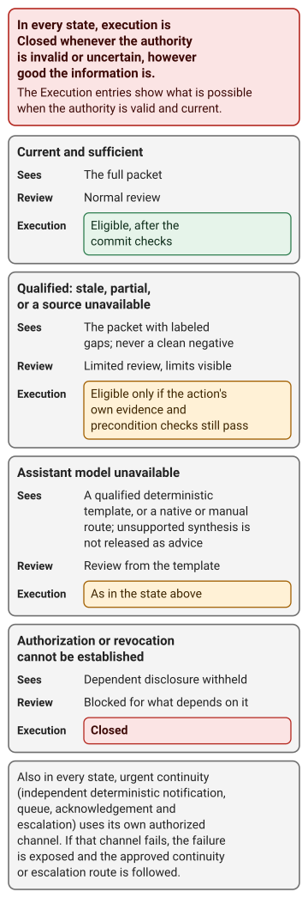

# 10. Information can degrade without widening authority

[← 9. Authority](09-authority.md) · [Paper contents](README.md) · [Next: costs and adaptation →](11-costs-and-adaptation.md)

Information and authority can fail separately. A source can be stale, partial or unavailable while authority is still valid, and authority can be invalid while the information is available. When the evidence is current and sufficient and the authority is valid and current, review is normal and an action is eligible to proceed once the commit checks pass. Qualified information (available, but stale, partial, or from a source that did not answer) can still support a limited review. Invalid or uncertain authority closes execution, even when the information is available and the recommendation sounds compelling.

<!-- figure:F07:start -->
<!-- Generated by scripts/sync_figures.py from figures/figures.json and the figure source. Edit those, not this block. -->

**Figure F07.** Four information states show what the reader sees, what review is possible and whether execution is eligible. In every state, execution is closed when authority is invalid or uncertain, and urgent continuity uses its own authorized channel.

<picture>
<source media="(prefers-color-scheme: dark)" srcset="../../figures/F07-dark.svg">

</picture>

Text description of Figure F07

A note at the top says that in every state execution is closed whenever the authority is invalid or uncertain, however good the information is. It adds that the Execution entries show what is possible when the authority is valid and current. Four information states follow, from top to bottom. Each one gives what the reader sees, what review is possible and whether execution is eligible. The states are current and sufficient; qualified, meaning stale, partial or a source unavailable; assistant model unavailable; and authorization or revocation cannot be established. In the last state, where authorization or revocation cannot be established, the execution entry is Closed. A note at the bottom says that urgent continuity (independent deterministic notification, queue, acknowledgement and escalation) uses its own authorized channel in every state. If that channel fails, the failure is exposed and the approved continuity or escalation route is followed. The table below gives the same content.

| Information state | What the reader sees | Review | Execution |
|---|---|---|---|
| Current and sufficient | The full packet | Normal review | Eligible, after the commit checks |
| Qualified: stale, partial, or a source unavailable | The packet with labeled gaps; never a clean negative | Limited review, limits visible | Eligible only if the action's own evidence and precondition checks still pass |
| Assistant model unavailable | A qualified deterministic template, or a native or manual route; unsupported synthesis is not released as advice | Review from the template | As in the state above |
| Authorization or revocation cannot be established | Dependent disclosure withheld | Blocked for what depends on it | **Closed** |

In every state, execution is **Closed** whenever the authority is invalid or uncertain, however good the information is. The Execution entries show what is possible when the authority is valid and current.

Also in every state, urgent continuity (independent deterministic notification, queue, acknowledgement and escalation) uses its own authorized channel. If that channel fails, the failure is exposed and the approved continuity or escalation route is followed.

[All figures and their descriptions](../../figures/README.md#f07-degraded-information-closed-execution)

<!-- figure:F07:end -->

## Responses to failure and recovery owners

When a source fails, the affected input is marked unavailable or partial, never a clean negative. When the assistant model fails, the system can fall back to a qualified deterministic template or to a permitted native or manual route. Malformed or unsupported synthesis is not released as reliable advice. When an authorization check fails, the disclosure and the execution that depend on it are blocked, and the model is not asked to work around the boundary.

Mandatory notification, queueing, acknowledgement and escalation are deterministic and independent of the assistant. They keep running wherever their own authorized channel is available. If that channel fails, the system exposes the failure and follows its approved continuity or escalation route. Existing native safety controls keep their own routes, and this paper does not promise that they stay available when their dependencies fail.

A correction or a revocation invalidates the affected derivatives that are still current, and the affected pending grants and approvals. Release, every later view, every cache hit and every access to history each require current disclosure, authorization and freshness checks. Permissions and retention limits apply to old versions as well. A record kept for accountability gives no permission to keep serving a revoked disclosure.

Late evidence and challenges start a reassessment. Neither becomes ground truth or triggers training on its own. Recovery belongs to the named owners that the failure table in the [action and degradation reference](../../architecture/action-and-degradation.md#full-failure-response-and-recovery-ownership) assigns, failure by failure: source and registry, admission, access and policy, synthesis, gateway and target, lifecycle, orchestration and obligation, executor and reconciliation, and escalation owners, with the domain owner where a domain parameter decides the matter. The reference keeps the full table: for each failure, the visible response, the treatment of authority and the recovery owner.

**See it working:** the [degraded-mode example](../../examples/10-degraded-modes/README.md) runs the same decision with a dependency down and shows what the packet, the assistant and the gateway each do.

[← 9. Authority](09-authority.md) · [Paper contents](README.md) · [Next: costs and adaptation →](11-costs-and-adaptation.md)
