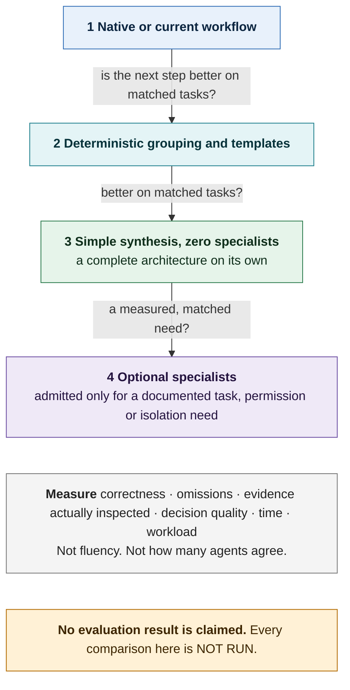

# 12. Evaluate simpler baselines before multi-agent value

[← 11. Costs and adaptation](11-costs-and-adaptation.md) · [Paper contents](README.md) · [Next: implementation options →](13-implementation-options.md)

The architecture proposes a finite evaluation programme, not completed results. The twelve evaluation tests EV01–EV12 and all 70 synthetic test fixtures remain NOT RUN. Every fixture requires fixed inputs, an explicit expected oracle, accountable owner, metrics, and a gate. Human evaluation, operational performance, cost, latency, and ROI are also NOT RUN.

Compare the native/current workflow, deterministic grouping and templates, and simple synthesis with zero specialists before measuring additional specialists. Match tasks, risks, scope, and acceptance criteria. Measure correctness, omissions, actual evidence inspection, decision quality, time, and workload rather than fluency or how many agents participated.

<!-- figure:F08:start -->
<!-- Generated by scripts/sync_figures.py from figures/figures.json and the figure source. Edit those, not this block. -->

**Figure F08.** Complexity must earn its place against matched native, deterministic and zero-specialist baselines; no evaluation result is claimed.

Text description of Figure F08

Four steps, each compared with the one before on matched tasks, risks, scope and acceptance criteria. First the native or current workflow; then deterministic grouping and templates; then simple synthesis with zero specialists, which is a complete architecture on its own; and only then optional specialists, admitted only for a documented task, permission or isolation need that has been measured on a matched comparison. The measures are correctness, omissions, evidence actually inspected, decision quality, time and workload: not fluency, and not how many agents agree. No evaluation result is claimed; every comparison is not run.

[All figures and their descriptions](../../figures/README.md#f08-complexity-must-earn-its-place)

<!-- figure:F08:end -->

## Coverage is part of the verdict

Fixture targets require 100% valid evidence links, critical retention, material expected conflict and gap coverage, prescribed deterministic outcomes, correct required missingness, and zero observed prohibited events. Ratios need positive declared oracle denominators and labeled coverage. Empty or unlabelled coverage is NOT ASSESSED, never automatic PASS.

Zero prohibited events without evaluated adversarial opportunities is also NOT ASSESSED. Structural schema validity cannot establish reference existence, version currentness, permission, lineage, lifecycle behavior, races, or source truth. The evaluation must inspect those facts separately, with denominators and uncertainty visible rather than hidden behind a single assurance score.

Before deployment, declare the task time budget B_time (critical path) and cost budget B_cost (full task lifecycle), freshness, workload, domain thresholds, and task/risk acceptance. Preregister the comparisons. The [evaluation oracles](../../evaluation/oracles.md) hold every EV oracle and fixture metric; human measures such as evidence actually inspected, decision quality and workload still need study-specific definitions (open question OQ06 in the [ownership, parameters and tradeoffs reference](../../architecture/ownership-and-tradeoffs.md)); the [evaluation catalogue](../../evaluation/catalogue/README.md) lists the twelve evaluation tests, the twelve matched baseline records, the 70 synthetic fixtures and the 47 domain parameters, each with its status.

**Start here:** the [evaluation guide](../../evaluation/README.md) separates schema checks, deterministic functional checks, model evaluation, human outcome evaluation, operational validation and production evidence, and states which of them exist today.

[← 11. Costs and adaptation](11-costs-and-adaptation.md) · [Paper contents](README.md) · [Next: implementation options →](13-implementation-options.md)
