# 12. Evaluate simpler baselines before multi-agent value

[← 11. Costs and adaptation](11-costs-and-adaptation.md) · [Paper contents](README.md) · [Next: implementation options →](13-implementation-options.md)

The evaluation programme is defined, and none of it has been run. The twelve tests, EV01 to EV12, and their 70 synthetic fixtures are NOT ASSESSED: each applies fixed inputs to an implementation, and none exists. Every fixture has fixed inputs, an expected oracle, metrics and a gate, and it needs an accountable owner, who is not yet assigned. Human evaluation and measures of operational performance, cost, latency and return are NOT ASSESSED as well, because they need participants and an environment that do not exist. What the repository does test is its contracts, its synthetic examples and its tooling. The [evaluation guide](../../evaluation/README.md) keeps these checks apart from the evaluation programme.

Compare the native or current workflow, deterministic grouping and templates, and simple synthesis with zero specialists before measuring any additional specialist. Match tasks, risks, scope and acceptance criteria. Measure correctness, omissions, evidence actually inspected, decision quality, time and workload. Do not score fluency or how many agents took part.

<!-- figure:F08:start -->
<!-- Generated by scripts/sync_figures.py from figures/figures.json and the figure source. Edit those, not this block. -->

**Figure F08.** Each step up, from the native or current workflow to optional specialists, is to be compared with the step before it on matched tasks. No evaluation result is claimed, and no comparison has been run.

<picture>
<source media="(prefers-color-scheme: dark)" srcset="../../figures/F08-dark.svg">

</picture>

Text description of Figure F08

Four numbered steps are drawn top to bottom. The first is the native or current workflow. The second is deterministic grouping and templates. The third is simple synthesis with zero specialists, which is a complete architecture on its own. The fourth is optional specialists, admitted only for a documented task, permission or isolation need. An arrow between two steps carries a question. The first two arrows ask whether the next step is better on matched tasks. The third asks whether there is a measured, matched need. A card lists the measures: correctness, omissions, evidence actually inspected, decision quality, time and workload. Fluency and how many agents agree are not measures. A last card says: No evaluation result is claimed. No comparison has been run.

[All figures and their descriptions](../../figures/README.md#f08-simpler-baselines-before-specialists)

<!-- figure:F08:end -->

## Denominators and coverage

Fixture targets require 100% valid evidence links, critical retention, coverage of the expected material conflicts and gaps, prescribed deterministic outcomes and correct missingness labels. They also require zero observed prohibited events. Ratios need positive declared oracle denominators and labeled coverage. Empty or unlabeled coverage is NOT ASSESSED, never an automatic PASS.

Zero prohibited events without any evaluated adversarial opportunity is also NOT ASSESSED. Structural schema validity cannot establish whether a reference exists, whether a version is current, whether permission holds, how lineage and lifecycle behave, whether races occur, or whether a source is true. The evaluation has to inspect those facts separately and show the denominators and the uncertainty, not a single assurance score.

Before deployment, declare the task time budget B_time (critical path), the cost budget B_cost (full task lifecycle), freshness, workload, domain thresholds, and task and risk acceptance. Preregister the comparisons. The [evaluation oracles](../../evaluation/oracles.md) hold every EV oracle and fixture metric. Human measures such as evidence actually inspected, decision quality and workload still need study-specific definitions (open question OQ06 in the [ownership, parameters and tradeoffs reference](../../architecture/ownership-and-tradeoffs.md)). The [evaluation catalogue](../../evaluation/catalogue/README.md) lists the twelve evaluation tests, the twelve matched baseline records, the 70 synthetic fixtures and the 47 domain parameters, each with its status.

**Start here:** the [evaluation guide](../../evaluation/README.md) separates schema checks, deterministic functional checks, model evaluation, human outcome evaluation, operational validation and production evidence, and states which of them exist today.

[← 11. Costs and adaptation](11-costs-and-adaptation.md) · [Paper contents](README.md) · [Next: implementation options →](13-implementation-options.md)
