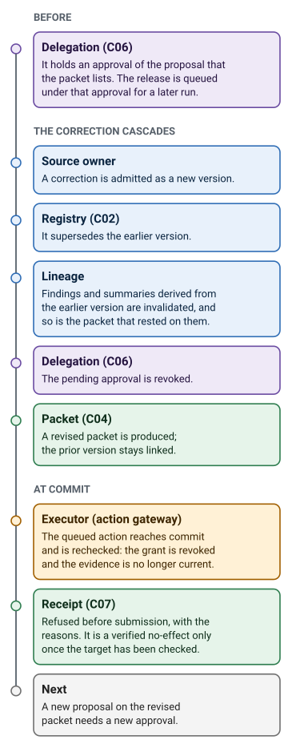

# 14. Starting with one decision

[← 13. Implementation options](13-implementation-options.md) · [Paper contents](README.md)

## What adoption needs

Adoption needs approved owners and parameters, working authorization, defined failure and continuity routes, executed fixtures and a recorded deployment acceptance. Unresolved source authority, shared accounting, external-effect guarantees, synchronization, thresholds or safe states block the dependent deployment decision or operation. A published paper is not operational approval.

## On Monday: five things before any agent code

An architect can start applying this design on Monday without building the full contract set. Choose one recurring, consequential decision in which people already struggle to absorb the available evidence. Before writing any agent code, do five things.

1. Write down the decision question, the accountable Decision Owner and the actions that could follow, and record separately who may read, who may approve and who may execute.
2. Inventory the sources behind that decision by producer, evidence kind, version, owner and freshness requirement. Mark the mandatory signals and give them a deterministic notification route that does not depend on the assistant.
3. Draft the first view of the decision packet: supported claims with exact references, labeled inferences, conflicts, and the missingness labels that apply. Walk it through a recent case with the Decision Owner.
4. Put a gateway in front of every consequential action. It rechecks permission, evidence, policy, target state and limits at commit, and its receipt is verified against the authoritative target, not the executor's own status.
5. Run the current workflow, a deterministic template and a zero-specialist synthesis on the same fixed fixtures. Record omissions, evidence actually inspected, time and cost with declared denominators before considering any specialist agent.

The [implementation guide](../implementation-guide.md) turns each step into a short working checklist with the matching contract, example and evaluation material.

## One late correction

This illustration was not run. Take the sequence behind EN02, without any claim about the authority's systems. A fee decision rests on version 1 of a landing record; months later, version 2 corrects the landing date. The correction is admitted as new C02 evidence that supersedes version 1. The original decision is not rewritten. It rested on version 1, which was the current record when the decision was made, and the correction changes what is current from now on. Lineage shows that the decision packet (C04) and any pending approval (C06) of an action proposal (C05) depend on version 1, so both are invalidated. The case returns to reassessment. The Decision Owner sees which claim changed, the superseded and current records, and the decision that relied on them. Whether to reopen the decision remains the owner's call: the architecture shows the conflict and does not decide. If a new action is approved, the gateway rechecks permission and evidence at commit, and the execution receipt (C07) is verified against the authoritative target system. Evaluation test EV12 is defined to check this behavior; it is NOT ASSESSED, because there is no implementation to run it against.

The repository works through the same pattern as data. Its [synthetic late-correction example](../../examples/11-late-correction/README.md) walks a corrected record through the contracts and checks the result with deterministic repository tests. Those checks run on invented data. They are not the EV12 evaluation test, which has not been run, and they say nothing about any real system.

<!-- figure:F10:start -->
<!-- Generated by scripts/sync_figures.py from figures/figures.json and the figure source. Edit those, not this block. -->

**Figure F10.** A correction to a source record invalidates what was derived from the earlier version and revokes a pending approval. At commit, the executor rechecks the queued action, finds the grant revoked and the evidence no longer current, and refuses it before submission.

<picture>
<source media="(prefers-color-scheme: dark)" srcset="../../figures/F10-dark.svg">

</picture>

Text description of Figure F10

A vertical timeline in three phases. Each event is headed by the actor or record that performs it. Before: the packet (C04) and the delegation (C06) hold an approval that is queued for a later run. The correction cascades. The source owner admits a correction as a new version. The registry (C02) records that it supersedes the earlier version. Lineage invalidates the findings and summaries derived from the earlier version, and the packet that rested on them. The packet (C04) is revised, and the prior version stays linked. The delegation (C06) revokes the pending approval. At commit: the executor, also called the action gateway, rechecks the queued action. It finds that the grant is revoked and the evidence is no longer current. The action is refused before submission, and the receipt (C07) records the reasons. The receipt is a verified no-effect only once the target has been checked. A last card says that a new proposal on the revised packet needs a new approval.

[All figures and their descriptions](../../figures/README.md#f10-a-late-correction-reaches-a-pending-approval)

<!-- figure:F10:end -->

## Where the architecture stops

The architecture admits, selects, synthesizes, checks and presents evidence. It can carry a proposed action to a gateway and verify the outcome. Four kinds of decision stay with named people and institutions, and the architecture supplies controls for them without making them:

| Decision | Stays with | Controls that support it |
| --- | --- | --- |
| Whether a source record is true | The source owner | Typed provenance and exact versions, scoped validation records, and conflicts and corrections that stay visible |
| What the evidence means for this case, and what to do | The Decision Owner | The decision packet: claims with exact references, labeled inferences, conflicts, gaps and obligations |
| Whether one exact proposal goes ahead | The approver | An exact approval bound to one proposal version, and the gateway's recheck of grant, evidence, preconditions and limits at commit |
| Policy, thresholds, safe states and source authority | The domain owners | Domain parameters, which stay UNSET until approved and block the decision that depends on them |

The architecture does not decide any of these, and it does not set domain policy.

## Technical scrutiny and sources

The [architecture reference](../../architecture/README.md) and the [contract reference](../../contracts/README.md) hold the detail behind this paper, and the [question index](../../architecture/question-index.md) maps questions to sections. The [JSON Schema bundle](../../schemas/README.md) (Draft 2020-12) documents the contracts and checks their structure, and the [evaluation catalogue](../../evaluation/catalogue/README.md) holds the evaluation tests, fixtures and parameters. The figures in this paper are simplified versions of the same architecture, not separate specifications. Every cited source, its passage scope and its limits are listed in the [sources](../../references/README.md).

[← 13. Implementation options](13-implementation-options.md) · [Paper contents](README.md)
