# Evaluation guide

[Evaluation oracles](oracles.md) · [Catalogue](catalogue/README.md) · [Human-outcome evaluation](human-outcome-evaluation.md)

This repository proposes an evaluation programme. **It contains no results.** Everything that would show the architecture works, in a model, with people, in operation or in production, is **NOT RUN**. What does exist is a set of deterministic checks on invented examples. This guide keeps the two apart, so that a green check is never read as evidence it is not.

## Six kinds of evidence

| Kind | What it can show | What it cannot show | Status today |
|---|---|---|---|
| **Schema and structural checks** | A document has the shape a contract requires. | That it is true, that a reference resolves, that a producer is trustworthy. | **Exist.** The [schema bundle](../schemas/README.md) and its 38 valid and 64 invalid embedded examples; run by `scripts/validate_examples.py` and in CI. |
| **Deterministic functional checks** | That a documented rule can be implemented and behaves consistently on a small, fixed input. | That a real system, model or person behaves that way. | **Two parts.** (1) The repository's own checks on the [synthetic examples](../examples/README.md): they exist and run. (2) The 70 fixtures of the **EV01–EV12** programme, to be run against an implementation: **NOT RUN**. |
| **Model evaluation** | How a particular model and prompt perform on grounded tasks, against gold answers. | Whether the architecture is worthwhile. | **NOT RUN.** No model has been evaluated. |
| **Human-outcome evaluation** | Whether people using the architecture inspect more evidence, decide better and carry a reasonable workload, compared with matched baselines. | Anything about safety or correctness of the system alone. | **NOT RUN.** See [human-outcome evaluation](human-outcome-evaluation.md). |
| **Operational validation** | Whether it works in a real environment: latency, cost, failure behavior, change control. | Whether the outcomes are good for people. | **NOT RUN.** |
| **Production evidence** | What actually happened in use, over time. | | **None.** |

The status words are used strictly:

- **NOT RUN**: execution was not attempted.
- **NOT ASSESSED**: there is not enough declared assessment coverage to say. An empty denominator is never a pass. Zero prohibited events over zero evaluated adversarial opportunities is also NOT ASSESSED.
- **UNSET**: a domain parameter that has not been given a value.
- **PASS / FAIL**: used only for a check that actually ran, over a positive denominator, with its scope stated.

## What this repository checks today

| Check | Command | Covers | Does not cover |
|---|---|---|---|
| Schema bundle | `python scripts/validate_examples.py` (stage 1) | The bundle is valid Draft 2020-12; the 102 embedded examples behave as labeled. | Anything about the contracts' meaning. |
| Example instances | stage 2 | Every example validates against its contract. | |
| Scenario semantics | stage 3 | References resolve to exact versions; lineage is acyclic; corrections propagate; missingness labels are justified; approvals end with their basis; receipts agree with the commit check; disclosure. | Real data, real producers, scale. |
| Gateway scenarios | stage 4 | 19 stored what-if evaluations of the reference commit check; every reason code is exercised. | A real gateway: state, concurrency, a live target. |
| Assistant responses | stage 5 | Attribution, figures, labeling, completeness and withdrawal of stored responses. | What a real model would write. |
| Evaluation cases | stage 6 | 32 mutated copies of the example set each produce exactly their declared codes. | The EV01–EV12 fixtures. |
| Unit tests | `python -m unittest discover -s tests` | The checks themselves, including negative cases. | |
| Contract surface | `python scripts/schema_surface_hash.py --check` | No unrecorded change to what validates. | |
| Links and alt text | `python scripts/check_links.py` | Relative links, anchors, images, alt text. | Whether the prose is right. |
| Figures | `python scripts/check_figures.py` | Figures in the documents match their sources. | Whether a figure is clear to a reader. |
| Repository hygiene | `python scripts/check_hygiene.py` | No credentials, tenant URLs, local paths or internal terms. | |
| Public sources | `python scripts/check_urls.py` | The public URLs cited still resolve (network needed). | That the sources say what is claimed. |

All of these are checks on text and on invented data. None is an evaluation of the architecture.

## How the example checks relate to EV01–EV12

Some example checks touch the same failure area as an EV test. That is a relationship, not an equivalence: an EV fixture needs fixed inputs fixed in advance, an accountable owner, a positive declared denominator and a gate. The example checks have none of these, and running them is **not** running the test.

| Test | Failure area | Related example checks |
|---|---|---|
| EV01 Types and source fidelity | A producer promoting its output; a reference that does not resolve | `KIND001`, `KIND002`, `REF001`–`REF003`; cases `CASE-KIND-*`, `CASE-REF-*`; [01](../examples/01-source-records/README.md) |
| EV02 Rule reproducibility | A rule version changing silently | Only in part: when the match result is recomputed after the correction, the earlier result stays as version 1 with its own method and inputs; the rule version itself does not change in the example. [11](../examples/11-late-correction/README.md) |
| EV03 Correlated agents | Agreement treated as corroboration | `COR001`, `COR002`, `LIN001`–`LIN003`; [03](../examples/03-lineage-and-common-origin/README.md) |
| EV04 Conflict retention | A conflict dropped in shortening | `MISS005`; [04](../examples/04-selection-and-missingness/README.md), [05](../examples/05-decision-packet/README.md) |
| EV05 Missingness | A wrong or unjustified gap label | `MISS001`–`MISS005`; cases `CASE-MISS-*`; [04](../examples/04-selection-and-missingness/README.md) |
| EV06 Derived and authorised disclosure | A summary that leaks | `DISC001`; `CASE-DISC-01`. Counts, relationships and caches are not modelled. |
| EV07 Revocation | Acting on a revoked grant or a corrected record | `GRANT_REVOKED`, `LIFE005`, `REVOCATION_UNVERIFIED`; [08](../examples/08-blocked-action/README.md), [10](../examples/10-degraded-modes/README.md). View-time revocation is not modelled. |
| EV08 Prompt injection | Untrusted content changing controls | **No example check.** |
| EV09 Obligation overload | Obligations dropped or silently capped | **No example check** beyond one obligation carried through a selection. |
| EV10 Degradation | Silent substitution when something fails | [06](../examples/06-assistant-response/README.md), [10](../examples/10-degraded-modes/README.md) |
| EV11 Race, duplicate and unknown action | A blind retry; allowance restored by a timeout | `CUMULATIVE_LIMIT`, `ACC001`–`ACC004`; [09](../examples/09-unknown-outcome/README.md). Races and concurrency are not modelled. |
| EV12 Late or corrected evidence | A pending approval surviving a correction | `LIFE001`–`LIFE005`; [11](../examples/11-late-correction/README.md) |

## The programme

12 tests, 70 synthetic fixtures, 12 matched baseline records and 47 domain parameters, all NOT RUN or UNSET. The [oracles](oracles.md) page states what each test requires. The [catalogue](catalogue/README.md) holds the machine-readable tables.

| Topic | What the programme defines |
|---|---|
| **Tests** | EV01 Types and source fidelity · EV02 Rule reproducibility · EV03 Correlated agents · EV04 Conflict retention · EV05 Missingness · EV06 Derived and authorised disclosure · EV07 Revocation · EV08 Prompt injection · EV09 Obligation overload · EV10 Degradation · EV11 Race, duplicate and unknown action · EV12 Late or corrected evidence |
| **Gates** | 100% over a positive denominator for the ratio metrics; zero for prohibited events, only over positive adversarial opportunities. Finite fixture targets, not production safety guarantees. |
| **Owners** | Unassigned. Source and domain owners own fidelity and rules; lifecycle and selection owners own lineage, conflict and missingness; access and security owners own disclosure, revocation and injection; obligation and operations owners own continuity; executor and target owners own races and outcomes. |

## Matched baselines before multi-agent value

Before any claim that a specialist, an additional agent or a richer synthesis adds value, compare against simpler baselines on matched tasks, risks, scope and acceptance criteria. Preregister the comparisons in this order:

1. the native or current workflow;
2. deterministic grouping and templates;
3. simple synthesis with zero specialists;
4. only then, optional specialists justified by a measured, matched need for permission or isolation.

<!-- figure:F08:start -->
<!-- Generated by scripts/sync_figures.py from figures/figures.json and the figure source. Edit those, not this block. -->

**Figure F08.** Complexity must earn its place against matched native, deterministic and zero-specialist baselines; no evaluation result is claimed.

<p align="center">
<picture>
<source media="(prefers-color-scheme: dark)" srcset="../figures/F08-dark.svg">

</picture>
</p>

<details>
<summary>Text description of Figure F08</summary>

Four steps in order. Each arrow between two steps asks whether the next step is better on matched tasks, and the last asks whether there is a measured, matched need. First the native or current workflow; then deterministic grouping and templates; then simple synthesis with zero specialists, which is a complete architecture on its own; and only then optional specialists, admitted only for a documented task, permission or isolation need. The measures are correctness, omissions, evidence actually inspected, decision quality, time and workload: not fluency, and not how many agents agree. No evaluation result is claimed; every comparison is not run.

[All figures and their descriptions](../figures/README.md#f08-complexity-must-earn-its-place)

</details>
<!-- figure:F08:end -->

Measure correctness, omissions, evidence actually inspected, decision quality, time and workload. Do not measure fluency or how many agents agree. Cap fanout, calls, tokens, elapsed time, retries and spend across the task; removing specialists must leave the architecture intact. Cost includes retrieval, storage, telemetry, evaluation, inference, retries and operations, not tokens alone. Separate critical-path elapsed time from total work.

**No latency, cost, ROI or human-performance outcome has been measured.** The 12 matched baseline records in the catalogue are a comparison framework, not an achieved benefit.

## Preconditions: 47 parameters nobody has set

A test cannot be run until the domain has said what its thresholds, budgets and authorities are: `B_time`, `B_cost`, workload, required freshness, risk classes, action limits, safe states and 40 more. All 47 are **UNSET**, with owner unassigned. That is deliberate: no illustrative value is promoted to a default, and an unresolved parameter blocks the dependent deployment decision or operation while not blocking publication of the reference architecture.

## Run it yourself

```bash
python -m pip install -r requirements.txt
python scripts/validate_examples.py
python -m unittest discover -s tests
```

## What a pass does not mean

A pass of anything in this repository does not mean that the architecture works, that a system built on it would be accountable, or that any model or person would behave as the examples do. See [Claims and limits](../docs/claims-and-limits.md).
