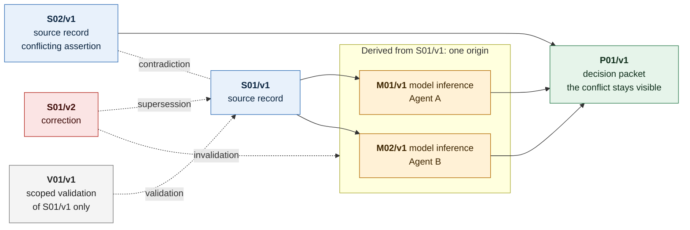

# 03 Lineage and common origin

[← 02 Context and normalization](../02-context-and-normalization/README.md) · [Examples](../README.md) · [Next: 04 Selection and missingness →](../04-selection-and-missingness/README.md)

*Synthetic. The rule, the model names and the summaries are invented.*

## Purpose

Evidence keeps its type and its ancestry. A rule's finding, a model's interpretation and a source's assertion are different kinds of record, and a derived record points at what it was derived from. This folder shows a deterministic finding with three parents and two model summaries that look like two independent opinions but share one origin. The reasoning is in [chapter 4](../../docs/paper/04-evidence-and-lineage.md) and [lineage, selection and disclosure](../../architecture/lineage-selection-disclosure.md).

<!-- figure:F03:start -->
<!-- Generated by scripts/sync_figures.py from figures/figures.json and the figure source. Edit those, not this block. -->

**Figure F03.** Common-source agreement is not corroboration; conflicts, corrections and the scope of validation stay visible.

Text description of Figure F03

Solid arrows are derivation ancestry. Source record S01/v1 is the only parent of two model inferences, M01/v1 from Agent A and M02/v1 from Agent B, which together form one origin. Both feed the decision packet P01/v1. A conflicting source record, S02/v1, also reaches the packet, so the conflict stays visible. Dashed arrows are typed relationships, not ancestry, and each names the actor who asserted it: S02/v1 contradicts S01/v1; a correction, S01/v2, supersedes S01/v1 and invalidates what was derived from it; and a scoped validation, V01/v1, assesses S01/v1 only. In the worked example, S01 is the goods receipt, S02 the invoice, and M01 and M02 the two model summaries.

[All figures and their descriptions](../../figures/README.md#f03-common-source-agreement-is-not-corroboration)

<!-- figure:F03:end -->

In the paper's notation `S01/v1` is the goods receipt `GR-5521` v1, `S02/v1` is the invoice and `M01`, `M02` are the two summaries below (see the [notation table](../README.md#reading-the-papers-abstract-notation)).

## Files

| File | Kind | What it is |
|---|---|---|
| [`c02-M3W-0417-v1.json`](c02-M3W-0417-v1.json) | `deterministic_finding` | The three-way match, rule `M3W-2.0`, tolerance 2%: invoiced 100, received 60, variance 40.0%, **FAIL**. Its parents are the invoice, the purchase order and the goods receipt v1. It carries a scoped validation. |
| [`c02-SUM-A-0417-v1.json`](c02-SUM-A-0417-v1.json) | `model_inference` | "The goods receipt is probably incomplete…". Produced by agent A. Parent: `GR-5521` v1. |
| [`c02-SUM-B-0417-v1.json`](c02-SUM-B-0417-v1.json) | `model_inference` | "The quantity difference is probably a receiving delay…". Produced by agent B, a different model. Parent: `GR-5521` v1. |
| [`c02-ANL-S1042-OTD-v1.json`](c02-ANL-S1042-OTD-v1.json) | `analytical_result` | Supplier delivery reliability: 23 of 25 deliveries on time, with a small-sample uncertainty. The selection excludes it as not a release criterion. |

## Look at

1. **Parents.** `lineage.parent_references` in the match result lists three exact versions. Both summaries list one: `GR-5521` v1. Derivation ancestry is directed and acyclic.
2. **Kinds and producers.** Each producer may submit only its registered kind (see `producers` in the [registry](../registry.json)). Agent A cannot submit a deterministic finding, and a model's output is never promoted to a source record.
3. **Method.** The match result declares `rule_version` `M3W-2.0`; the summaries declare `model_version` and `prompt_version`. The fields that do not apply say `not_applicable`.
4. **Uncertainty.** The match result says it is exactly as reliable as its inputs ("rule_output"); the summaries say "model_generated: not verified against any source".
5. **Common origin.** Agents A and B agree, and a reader might count two sources. Follow each summary's ancestry to its leaves: both end at `GR-5521` v1. They are one source seen twice. The [packet](../05-decision-packet/README.md) lists them as two inferences, and each says so in its limitations.
6. **Scoped validation.** `V-M3W-0417-01` says a reviewer recomputed the arithmetic. Its scope: the arithmetic of the variance only, not the correctness of the input records.
7. **Lifecycle (snapshot).** The match result v1 shows `superseded` and both summaries show `withdrawn`. The summaries stopped being current at 13:45, when their shared origin was corrected, and the match result at 13:51, when its recomputed replacement was admitted ([11](../11-late-correction/README.md)).

## Checks that run here

| Code | Rule | Case that breaks it |
|---|---|---|
| `LIN001` | Derivation ancestry must be acyclic | `CASE-LIN-01` |
| `LIN002` | Relationship types come from the declared vocabulary | `CASE-LIN-02` |
| `LIN003` | A supersession is acknowledged by the older record | `CASE-LIN-03` |
| `KIND001` | A producer submits only its registered kind | `CASE-KIND-01` |
| `KIND004` | A finding declares the rule it applied; an inference declares its model and prompt | (checked on the whole set) |
| `COR001` | Agreement is not called independent corroboration when it is not | `CASE-COR-02` |
| `COR002` | Inferences with one root say they share it | `CASE-COR-01` |

## What this shows, and what it does not

- **Shows:** that a lineage graph can be checked mechanically, so "two agents agree" can be answered with "they share one origin".
- **Does not show:** that real lineage can be captured at this fidelity, what it costs, or that a graph this clean is realistic. Root detection here is a simple walk to the leaves; real derivations may be partial, probabilistic or undocumented.

[← 02 Context and normalization](../02-context-and-normalization/README.md) · [Examples](../README.md) · [Next: 04 Selection and missingness →](../04-selection-and-missingness/README.md)
