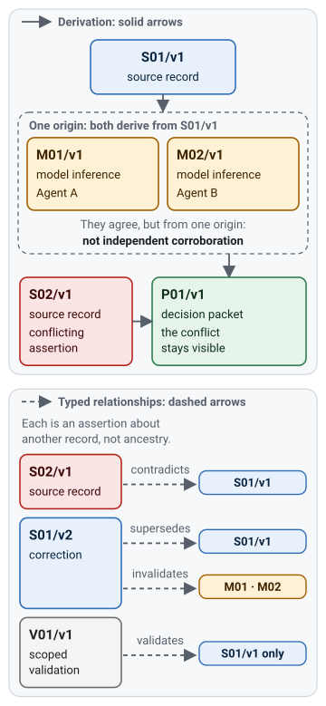

# 03 Lineage and common origin

[← 02 Context and normalization](../02-context-and-normalization/README.md) · [Examples](../README.md) · [Next: 04 Selection and missingness →](../04-selection-and-missingness/README.md)

*Synthetic. The rule, the model names and the summaries are invented.*

## Purpose

Evidence keeps its type and its ancestry. A rule's finding, a model's interpretation and a source's assertion are different kinds of record, and a derived record points at what it was derived from. This folder shows a deterministic finding with three parents and two model summaries that look like two independent opinions but share one origin. The reasoning is in [chapter 4](../../docs/paper/04-evidence-and-lineage.md) and [lineage, selection and disclosure](../../architecture/lineage-selection-disclosure.md).

<!-- figure:F03:start -->
<!-- Generated by scripts/sync_figures.py from figures/figures.json and the figure source. Edit those, not this block. -->

**Figure F03.** Two AI summaries derived from the same goods receipt agree, but from one origin, so their agreement is not independent corroboration. Solid arrows show derivation; dashed arrows show what one record asserts about another: that it contradicts, supersedes, invalidates or validates it.

<picture>
<source media="(prefers-color-scheme: dark)" srcset="../../figures/F03-dark.svg">

</picture>

Text description of Figure F03

Solid arrows show derivation. A goods receipt, version 1, is a source record and the only parent of two model inferences: AI summary A and AI summary B, from two different assistants. Both derive from the receipt, so they have one origin. They agree, but their agreement is not independent corroboration. Both feed a decision packet. So does a conflicting source record, the invoice, and the conflict stays visible in the packet. Dashed arrows show typed relationships. Each is an assertion about another record and does not show ancestry. Each is recorded with the actor who asserted it, which the figure does not draw. The invoice contradicts goods receipt version 1. A corrected receipt, version 2, supersedes version 1 and invalidates both AI summaries. A scoped validation, of this record only, validates receipt version 1.

[All figures and their descriptions](../../figures/README.md#f03-common-source-agreement-is-not-corroboration)

<!-- figure:F03:end -->

## Files

| Record | Kind | File |
|---|---|---|
| **Three-way match.** Rule `M3W-2.0`, tolerance 2%: invoiced 100, received 60, variance 40.0%, **FAIL**. Its parents are the invoice, the purchase order and the goods receipt v1. It carries a scoped validation. | `deterministic_finding` | [`c02-M3W-0417-v1.json`](c02-M3W-0417-v1.json) |
| **AI summary A.** "The goods receipt is probably incomplete…", produced by agent A. Parent: the goods receipt v1. It says nothing about the invoice or the purchase order. | `model_inference` | [`c02-SUM-A-0417-v1.json`](c02-SUM-A-0417-v1.json) |
| **AI summary B.** "Probably a receiving delay…", produced by agent B, a different model. Parent: the goods receipt v1. It says nothing about the invoice or the purchase order. | `model_inference` | [`c02-SUM-B-0417-v1.json`](c02-SUM-B-0417-v1.json) |
| **Delivery reliability.** 23 of 25 deliveries on time, with a small-sample uncertainty. The selection excludes it as not a release criterion. | `analytical_result` | [`c02-ANL-S1042-OTD-v1.json`](c02-ANL-S1042-OTD-v1.json) |

## Look at

1. **Parents.** `lineage.parent_references` in the match result lists three exact versions. Both summaries list one: `GR-5521` v1. Derivation ancestry is directed and acyclic.
2. **Kinds and producers.** Each producer may submit only its registered kind (see `producers` in the [registry](../registry.json)). Agent A cannot submit a deterministic finding, and a model's output is never promoted to a source record.
3. **Method.** The match result declares `rule_version` `M3W-2.0`; the summaries declare `model_version` and `prompt_version`. The fields that do not apply say `not_applicable`.
4. **Uncertainty.** The match result says it is exactly as reliable as its inputs ("rule_output"); the summaries say "model_generated: not verified against any source".
5. **Common origin.** Agents A and B agree, and a reader might count two sources. Follow each summary's ancestry to its leaves: both end at `GR-5521` v1. They are one source seen twice. The [packet](../05-decision-packet/README.md) lists them as two inferences, and each says so in its limitations.
6. **Nothing beyond the ancestry.** A summary may say only what its parents can support. These two rest on the goods receipt alone, so neither states a figure that the receipt does not hold (the 40-unit difference needs the invoice) or compares the receipt with the invoice or the purchase order, and each records that limit: "Makes no comparison with the invoice or the purchase order: they are not among its sources." A summary that did compare would be a statement outside its ancestry, and it would not be fit to be promoted to a supported claim. The validator enforces the part it can: a model inference that states a figure none of its ancestors holds is a finding (`LIN005`). It does not read the rest of the prose.
7. **Scoped validation.** `V-M3W-0417-01` says the requestor, an AP analyst, recomputed the arithmetic. Its scope: the arithmetic of the variance only, not the correctness of the input records.
8. **Lifecycle (snapshot).** The match result v1 shows `superseded` and both summaries show `withdrawn`. The summaries stopped being current at 13:45, when their shared origin was corrected, and the match result at 13:51, when its recomputed replacement was admitted ([11](../11-late-correction/README.md)).

## Checks that run here

| Code | Rule | Case that breaks it |
|---|---|---|
| `LIN001` | Derivation ancestry must be acyclic | `CASE-LIN-01` |
| `LIN002` | Relationship types come from the declared vocabulary | `CASE-LIN-02` |
| `LIN003` | A supersession is acknowledged by the older record | `CASE-LIN-03` |
| `LIN005` | A model inference states no figure that its ancestry does not hold | `tests/test_semantics.py` |
| `KIND001` | A producer submits only its registered kind | `CASE-KIND-01` |
| `KIND004` | A finding declares the rule it applied; an inference declares its model and prompt | (checked on the whole set) |
| `COR001` | Agreement is not called independent corroboration when it is not | `CASE-COR-02` |
| `COR002` | Inferences with one root say they share it | `CASE-COR-01` |

## What this shows, and what it does not

- **Shows:** that a lineage graph can be checked mechanically, so "two agents agree" can be answered with "they share one origin".
- **Does not show:** that real lineage can be captured at this fidelity, what it costs, or that a graph this clean is realistic. Root detection here is a simple walk to the leaves; real derivations may be partial, probabilistic or undocumented.

[← 02 Context and normalization](../02-context-and-normalization/README.md) · [Examples](../README.md) · [Next: 04 Selection and missingness →](../04-selection-and-missingness/README.md)
