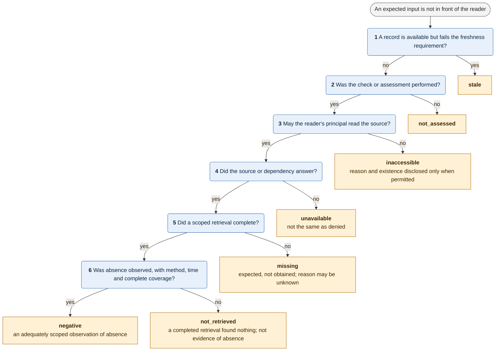

# 04 Selection and missingness

[← 03 Lineage and common origin](../03-lineage-and-common-origin/README.md) · [Examples](../README.md) · [Next: 05 Decision packet →](../05-decision-packet/README.md)

*Synthetic. The retrievals, the outage and the restricted source are invented.*

## Purpose

A selection ([C03](../../contracts/c03-selection.md)) is the manifest of what was retrieved, what was included or left out and why, what is missing and why, which conflicts exist, and what obligations apply. It is where "we could not see X" becomes a recorded, labeled fact instead of silence. One selection here carries **all seven missingness labels**. The reasoning is in [chapter 5](../../docs/paper/05-context-and-attention.md), [chapter 8](../../docs/paper/08-uncertainty.md) and [lineage, selection and disclosure](../../architecture/lineage-selection-disclosure.md).

<!-- figure:F09:start -->
<!-- Generated by scripts/sync_figures.py from figures/figures.json and the figure source. Edit those, not this block. -->

**Figure F09.** Seven labels, six questions, asked in order: an expected input that is not in front of the reader gets exactly one label.

Text description of Figure F09

For an expected input that is not in front of the reader, ask six questions in order. One: is a record available but failing the freshness requirement? If yes, the label is stale. Two: was the check or assessment performed? If not, not_assessed. Three: may the reader's principal read the source? If not, inaccessible, and the reason and existence are disclosed only when permitted. Four: did the source or dependency answer? If not, unavailable, which is not the same as denied. Five: did a scoped retrieval complete? If not, missing: expected, not obtained, reason may be unknown. Six: was absence observed with method, time and complete coverage? If yes, negative. If not, not_retrieved: a completed retrieval found nothing, which is not evidence of absence.

[All figures and their descriptions](../../figures/README.md#f09-which-missingness-label-applies)

<!-- figure:F09:end -->

## Files

| File | What it is |
|---|---|
| [`c03-SEL-0417-v1.json`](c03-SEL-0417-v1.json) | The selection as of 10:00: 9 retrieval units, 10 dispositions, 1 conflict, 1 obligation, 7 gaps, partial coverage. |
| [`c02-SCR-S1042-v1.json`](c02-SCR-S1042-v1.json) | Supplier screening of 2026-11-21: no match. Fresh when produced, 50 hours old at 10:00, against a 24-hour policy. |
| [`c02-DUP-0417-v1.json`](c02-DUP-0417-v1.json) | The duplicate-invoice check: an exact-match query over a declared window found nothing. |
| [`c02-MON-TREASURY-0001-v1.json`](c02-MON-TREASURY-0001-v1.json) | A monitor observation: the cash-position service returned HTTP 503. |

## The seven labels

Each label says something different about why a piece of evidence is not in front of the reviewer, and each needs different supporting evidence.

| Label | In `SEL-0417` v1 | What supports it | What it does **not** mean |
|---|---|---|---|
| `missing` | Carrier proof of delivery for a second pallet | Nothing more is required beyond the common fields: expected, not obtained. | Not that no delivery happened. Search coverage is not established. |
| `not_retrieved` | Open credit notes for the supplier | A **completed** retrieval unit (`RETR-CREDIT-0417`) that returned zero relevant records, with its completion time. | Not that there are none. The retrieval covered one ledger only. |
| `inaccessible` | Evidence outside the reviewer's read scope | A permission decision (`AUTHZ-DENY-RESTRICTED-0417`) and a permission-safe summary. | Nothing about the source: its identity and content are not disclosed. |
| `unavailable` | Treasury cash position | A dependency-failure record (`MON-TREASURY-0001`). | Not a permission problem and not an empty result. |
| `negative` | An earlier invoice with the same supplier, number and amount | An observation (`DUP-0417`), the method, the time and **complete** coverage of a declared scope. | Not "no duplicates anywhere": exact match, one window. |
| `not_assessed` | Early-payment discount eligibility | `assessment_performed: false`. | Not an assessed "no". |
| `stale` | Supplier screening no older than 24 hours | The available record (`SCR-S1042` v1) and a freshness evaluation that fails the policy. | Not wrong, only out of date. |

## Also in the selection

- **Retrieval** shows what was tried and how it ended: `completed`, `failed` (treasury, with an unknown completion time), `not_permitted` (the restricted source, with a permission-safe summary).
- **Disposition** includes nine records (among them the two model summaries, labeled as inferences) and excludes one with a reason: the delivery-reliability result is not a payment-release criterion, and it stays retrievable.
- **Conflict** `CONF-QTY`: the invoice says 100 units, the receipt says 60. Both claims are cited, neither is treated as correct, and there is no "majority" or "latest wins".
- **Obligation** `OBL-0417-REVIEW`: the controller must review before 15:30, with delivery, acknowledgement and escalation states.
- **Coverage** is `partial` with limitations stated. A selection is a scope, not the whole corpus.

## Checks that run here

| Code | Rule | Case that breaks it |
|---|---|---|
| `MISS001` | `not_retrieved` needs a completed retrieval unit | `CASE-MISS-03` |
| `MISS002` | `negative` needs complete coverage of its scope | `CASE-MISS-02` |
| `MISS003` | `stale` must be justified by the freshness policy | `CASE-MISS-01` |
| `MISS004` | `unavailable` points at an observation of the failure | (checked on the whole set) |
| `MISS005` | The packet keeps every gap and conflict of its selection | `CASE-MISS-04` |
| `DISC001` | A derived output does not name what the reviewer may not see | `CASE-DISC-01` |

## What this shows, and what it does not

- **Shows:** that "missing" can be said in seven precise ways, each tied to the evidence that justifies it, and that a conflict can stay a conflict.
- **Does not show:** how relevance or priority is decided (the selection lists what was included, it does not rank), how large a real selection is, or whether people read seven labels. Whether this helps a reviewer is a human-outcome question; see [human-outcome evaluation](../../evaluation/human-outcome-evaluation.md).

[← 03 Lineage and common origin](../03-lineage-and-common-origin/README.md) · [Examples](../README.md) · [Next: 05 Decision packet →](../05-decision-packet/README.md)
