# 04 Selection and missingness

[← 03 Lineage and common origin](../03-lineage-and-common-origin/README.md) · [Examples](../README.md) · [Next: 05 Decision packet →](../05-decision-packet/README.md)

*Synthetic. The retrievals, the outage and the unreadable part of the scope are invented.*

## Purpose

A selection ([C03](../../contracts/c03-selection.md)) is the manifest of what was retrieved, what was included or left out and why, what is missing and why, which conflicts exist, and what obligations apply. It is where "we could not see X" becomes a recorded, labeled fact instead of silence. One selection here carries **all seven missingness labels**. The reasoning is in [chapter 5](../../docs/paper/05-context-and-attention.md), [chapter 8](../../docs/paper/08-uncertainty.md) and [lineage, selection and disclosure](../../architecture/lineage-selection-disclosure.md).

<!-- figure:F09:start -->
<!-- Generated by scripts/sync_figures.py from figures/figures.json and the figure source. Edit those, not this block. -->

**Figure F09.** Permission is asked before anything is classified: an input the reader may not know about shows nothing, and an input the reader may not read shows only the permitted wording.

<picture>
<source media="(prefers-color-scheme: dark)" srcset="../../figures/F09-dark.svg">

</picture>

Text description of Figure F09

For an expected input that is not in front of the reader, ask seven questions in order. The first two are about permission and come before any state is worked out. One: may the reader's principal know that the input exists? If not, nothing is shown for it: no entry, no state, no age and no count. It adds nothing to the coverage statement that every output carries. Two: may the principal read it? If not, the label is inaccessible, shown in the wording that the permission decision allows and in no other: no name, type, count, state or age. Only for an input the principal may read do the remaining questions apply. Three: is a record available but failing the freshness requirement? If yes, the label is stale. Four: was the check or assessment performed? If not, not_assessed. Five: did the source or dependency answer? If not, unavailable, which is not the same as denied. Six: did a scoped retrieval complete? If not, missing: expected, not obtained, reason may be unknown. Seven: was absence observed with method, time and complete coverage? If yes, negative. If not, not_retrieved: a completed retrieval found nothing, which is not evidence of absence. Only negative is evidence of absence: its label is drawn in green. The other six labels are drawn in amber, and no entry in red.

[All figures and their descriptions](../../figures/README.md#f09-which-missingness-label-applies)

<!-- figure:F09:end -->

## Files

| File | What it is |
|---|---|
| [`c03-SEL-0417-v1.json`](c03-SEL-0417-v1.json) | The selection as of 10:00: 9 retrieval units, 10 dispositions, 1 conflict, 1 obligation, 7 gaps, partial coverage. |
| [`c02-SCR-S1042-v1.json`](c02-SCR-S1042-v1.json) | Supplier screening of 2026-11-21: no match. Fresh when produced, 50 hours old at 10:00, against a 24-hour policy. |
| [`c02-DUP-0417-v1.json`](c02-DUP-0417-v1.json) | The duplicate-invoice check: an exact-match query over a declared window found nothing. |
| [`c02-MON-TREASURY-0001-v1.json`](c02-MON-TREASURY-0001-v1.json) | A monitor observation: the cash-position service returned HTTP 503. |

## The seven labels

Each label says something different about why a piece of evidence is not in front of the requestor, and each needs different supporting evidence. The questions that choose a label are asked in the order of the figure above: whether the requestor may know the input exists and may read it come before any state is worked out (see [permission before disclosure](#permission-before-disclosure)).

| Label | In `SEL-0417` v1 | What supports it | What it does **not** mean |
|---|---|---|---|
| `missing` | Carrier proof of delivery for a second pallet | Nothing more is required beyond the common fields: expected, not obtained. | Not that no delivery happened. Search coverage is not established. |
| `not_retrieved` | Open credit notes for the supplier | A **completed** retrieval unit (`RETR-CREDIT-0417`) that returned zero relevant records, with its completion time. | Not that there are none. The retrieval covered one ledger only. |
| `inaccessible` | Part of the requested scope that the requestor may not read | A permission decision (`AUTHZ-READ-LIMIT-0417`) that allows a coverage limitation, and the summary in the decision's words. | Nothing about the source: not its name, type, count, state or age. |
| `unavailable` | Treasury cash position | A dependency-failure record (`MON-TREASURY-0001`). | Not a permission problem and not an empty result. |
| `negative` | An earlier invoice with the same supplier, number and amount | An observation (`DUP-0417`), the method, the time and **complete** coverage of a declared scope. | Not "no duplicates anywhere": exact match, one window. |
| `not_assessed` | Early-payment discount eligibility | `assessment_performed: false`. | Not an assessed "no". |
| `stale` | Supplier screening no older than 24 hours | The available record (`SCR-S1042` v1) and a freshness evaluation that fails the policy. | Not wrong, only out of date. |

## Permission before disclosure

Two permission decisions in [`registry.json`](../registry.json) show the two cases the first questions of the figure separate.

| Decision | The requestor may read it | May the requestor know it exists | What an output may say |
|---|---|---|---|
| `AUTHZ-READ-LIMIT-0417` | No | Yes, as a coverage limitation | "Coverage is limited by access permissions; no protected source identity or content is disclosed." This is the `inaccessible` entry, the `not_permitted` retrieval unit and the summary in the packet. It names no source, count, state or age. |
| `AUTHZ-READ-WITHHELD-0417` | No | **No** | Nothing. No entry, no retrieval unit, no count. The source adds nothing to the coverage statement that every packet carries ("sources outside this principal's permissions … are not covered"), which reads the same whether or not anything is withheld. |

The second decision is used by no instance, on purpose: its source does not appear in the selection or the packet, and a test checks that no output names it. The identifiers follow the same rule: the retrieval unit is `RETR-SCOPE-0417` and the decision is `AUTHZ-READ-LIMIT-0417`, not names that announce a restricted source.

`DISC002` finds an entry for a source whose decision withholds its existence (`CASE-DISC-02`), and `DISC003` finds a coverage limitation that says more than the decision permits (`CASE-DISC-03`). [`tests/test_disclosure.py`](../../tests/test_disclosure.py) shows the property that matters: for every combination of states, a requestor who may not know a record exists receives the same view with the record and without it.

## Also in the selection

- **Retrieval** shows what was tried and how it ended: `completed`, `failed` (treasury, with an unknown completion time), `not_permitted` (the part of the scope the requestor may not read, with the permitted wording).
- **Disposition** includes nine records (among them the two model summaries, labeled as inferences) and excludes one with a reason: the delivery-reliability result is not a payment-release criterion, and it stays retrievable.
- **Conflict** `CONF-QTY`: the invoice says 100 units, the receipt says 60. Both claims are cited, neither is treated as correct, and there is no "majority" or "latest wins".
- **Obligation** `OBL-0417-REVIEW`: the controller must review before 15:30, with delivery, acknowledgement and escalation states.
- **Coverage** is `partial` with limitations stated. A selection is a scope, not the whole corpus.

## Checks that run here

| Code | Rule | Case that breaks it |
|---|---|---|
| `MISS001` | `not_retrieved` needs a completed retrieval unit | `CASE-MISS-03` |
| `MISS002` | `negative` needs complete coverage of its scope | `CASE-MISS-02` |
| `MISS003` | `stale` must be justified by the freshness policy | `CASE-MISS-01` |
| `MISS004` | `unavailable` points at an observation of the failure | (checked on the whole set) |
| `MISS005` | The packet keeps every gap and conflict of its selection | `CASE-MISS-04` |
| `DISC001` | A derived output does not name what the requestor may not see | `CASE-DISC-01` |
| `DISC002` | An entry about an unreadable source needs a decision that lets the requestor know it exists | `CASE-DISC-02` |
| `DISC003` | The entry uses the decision's words and adds nothing | `CASE-DISC-03` |

## What this shows, and what it does not

- **Shows:** that "missing" can be said in seven precise ways, each tied to the evidence that justifies it, and that a conflict can stay a conflict.
- **Does not show:** how relevance or priority is decided (the selection lists what was included, it does not rank), how large a real selection is, or whether people read seven labels. Whether this helps a reader is a human-outcome question; see [human-outcome evaluation](../../evaluation/human-outcome-evaluation.md).

[← 03 Lineage and common origin](../03-lineage-and-common-origin/README.md) · [Examples](../README.md) · [Next: 05 Decision packet →](../05-decision-packet/README.md)
