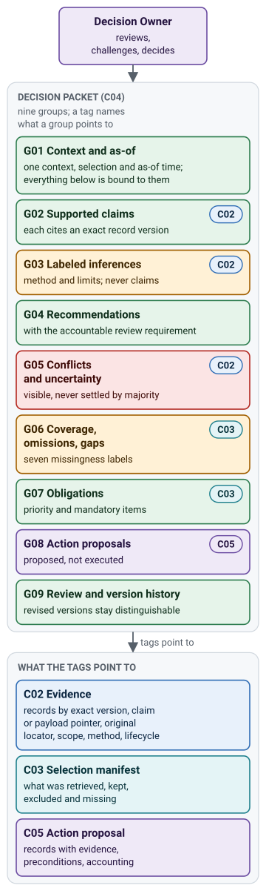

# 05 Decision packet

[← 04 Selection and missingness](../04-selection-and-missingness/README.md) · [Examples](../README.md) · [Next: 06 Assistant response →](../06-assistant-response/README.md)

*Synthetic. The packet, its recommendations and its proposals are invented.*

## Purpose

A decision packet ([C04](../../contracts/c04-decision-packet.md)) is what the reviewer reads. It is bound to one exact context and selection, presents supported claims with the evidence behind each, keeps inferences separate and labelled, shows conflicts, uncertainty and gaps, and lists action proposals that are **proposed, not executed**. A packet is a review object. It is not an approval, not an instruction and not a truth certificate. See [chapter 6](../../docs/paper/06-decision-packet.md).

<!-- figure:F04:start -->
<!-- Generated by scripts/sync_figures.py from figures/figures.json and the figure source. Edit those, not this block. -->

**Figure F04.** A decision packet makes evidence consumable while exposing interpretation, gaps, obligations and unexecuted proposals to an accountable owner.

<picture>
<source media="(prefers-color-scheme: dark)" srcset="../../figures/F04-dark.svg">

</picture>

Text description of Figure F04

The Decision Owner reviews one decision packet (C04), bound to an exact context, selection and as-of time (group G01). The packet has eight further groups: G02 supported claims, each citing an exact record version; G03 labelled inferences, with method and limits, never claims; G04 recommendations, with the accountable review requirement; G05 conflicts and uncertainty, visible and never settled by majority; G06 coverage, omissions and gaps, with seven missingness labels; G07 obligations, priority and mandatory items; G08 action proposals, proposed and not executed; and G09 review and version history. Claims, inferences and conflicts point to evidence records (C02) by exact version, claim or payload pointer and original locator. Coverage and obligations come from the selection manifest (C03). Action proposals point to action proposal records (C05).

[All figures and their descriptions](../../figures/README.md#f04-anatomy-of-a-decision-packet)

<!-- figure:F04:end -->

## Files

| File | What it is |
|---|---|
| [`c04-PKT-0417-v1.json`](c04-PKT-0417-v1.json) | The packet as of 10:00. |
| [`c05-ACT-HOLD-0417-v1.json`](c05-ACT-HOLD-0417-v1.json) | Proposal: place a payment hold on the invoice (low risk, reversible). |
| [`c05-ACT-REL-0417-v1.json`](c05-ACT-REL-0417-v1.json) | Proposal: release EUR 18,400.00 at the 16:00 run, **conditional** on three commit-time preconditions. |

## Reading the packet

| Group | What is in `PKT-0417` v1 |
|---|---|
| G01 Context and as-of | Exact references to `CTX-0417` v1 and `SEL-0417` v1; as-of 2026-11-23T10:00:00Z. |
| G02 Supported claims | Seven claims, `PC-1` to `PC-7`: the invoice, the order, the receipt (60 units), the match result (**FAIL**), the screening, the duplicate check, the policy. Each cites an exact record version and claim, or a payload location. Each says what its record says and no more. |
| G03 Labeled inferences | Two, `M01` and `M02`, one per model summary. Neither is a supported claim. Each states its method and its limitations, including **common origin**. |
| G04 Recommendations | `REC-0417-1` hold the invoice; `REC-0417-1B` release at 16:00 only if the match passes, screening is current and the invoice is held. Each names the accountable review requirement. |
| G05 Conflicts and uncertainty | `CONF-QTY` carried over from the selection, uncertainty "unquantified: the cause is not established". |
| G06 Coverage, omissions, gaps | The seven gaps of the selection, unchanged, and a visible limitation summary. |
| G07 Obligations | Why `CONF-QTY` and the stale screening come first, and a reference to `OBL-0417-REVIEW`. |
| G08 Action proposals | The hold and the release, each `proposed`. |
| G09 Review and version history | `invalidated` at 13:45, with a challenge link to the correction. This is the end-of-day snapshot; at 10:00 it was `awaiting_review`. |

## The proposals

A proposal ([C05](../../contracts/c05-action-proposal.md)) names an exact action, an exact target, typed parameters, the evidence it relies on (exact versions), the policies, the preconditions that must hold **at commit**, the accounting (units and window) and an assessment of risk, effects, limitations and recovery.

- **The hold** relies on the invoice, the goods receipt and the failing match. It does not rely on the screening, so stale screening cannot block a hold. It is covered by a standing class grant ([07](../07-authority-and-delegation/README.md)).
- **The release** was proposed while the match was failing. That is deliberate: a proposal can be conditional, and its three preconditions (`PRE-MATCH-PASS`, `PRE-SCREEN-FRESH`, `PRE-INVOICE-HELD`) are re-evaluated at the moment of execution, not at approval time. It needs an exact approval ([07](../07-authority-and-delegation/README.md)), and it is blocked at 16:00 because the evidence it cites has been superseded ([08](../08-blocked-action/README.md)).

## Checks that run here

| Code | Rule | Case that breaks it |
|---|---|---|
| `PKT001` | A supported claim says what its record says | `CASE-PKT-01` |
| `PKT002` | The packet and its selection bind one context and one as-of time | `CASE-PKT-02` |
| `PKT003` | Coverage points at the packet's own selection | (checked on the whole set) |
| `PKT004` | A listed proposal is bound to this packet | (checked on the whole set) |
| `KIND002` | A model inference is never a supported claim | `CASE-KIND-02` |
| `COR001` / `COR002` | No independent corroboration without independence | `CASE-COR-02`, `CASE-COR-01` |
| `LIFE003` / `LIFE004` | A packet that cites superseded records, or has a newer version, is not active | `CASE-LIFE-02` |

## What this shows, and what it does not

- **Shows:** a packet whose every claim can be followed to a source, where inference, conflict, gap and proposal are visible and separate.
- **Does not show:** that a reviewer finds this readable, that it is faster than the current process, or that the packet is the right size. A real packet would be much larger, and its usability is an open evaluation question.

[← 04 Selection and missingness](../04-selection-and-missingness/README.md) · [Examples](../README.md) · [Next: 06 Assistant response →](../06-assistant-response/README.md)
