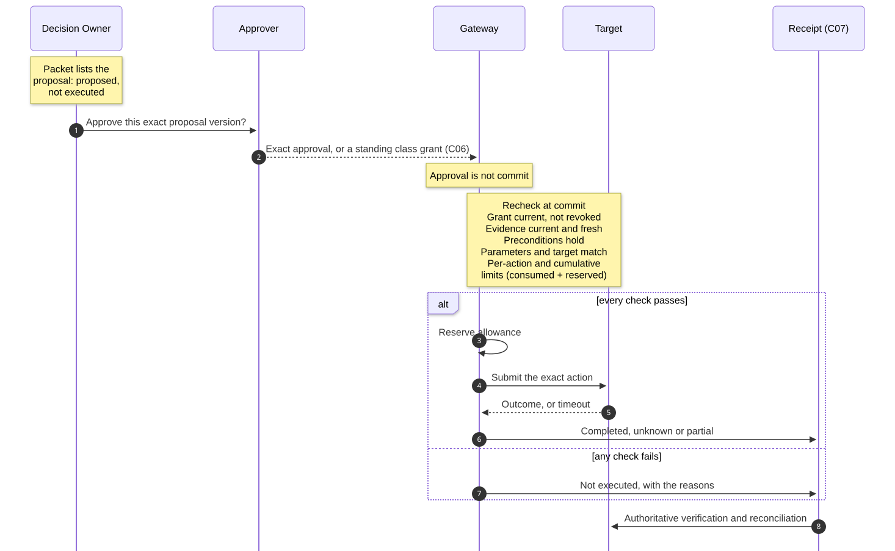

# 07 Authority and delegation

[← 06 Assistant response](../06-assistant-response/README.md) · [Examples](../README.md) · [Next: 08 Blocked action →](../08-blocked-action/README.md)

*Synthetic. The roles, grants and limits are invented.*

## Purpose

A packet is not an approval. Authority to act comes from a **grant** ([C06](../../contracts/c06-delegation.md)), and a grant covers exactly what it names. This folder shows the two ways a grant can be shaped, and what the gateway checks when an action is attempted. The reasoning is in [chapter 9](../../docs/paper/09-authority.md) and [action and degradation](../../architecture/action-and-degradation.md).

<!-- figure:F05:start -->
<!-- Generated by scripts/sync_figures.py from figures/figures.json and the figure source. Edit those, not this block. -->

**Figure F05.** An approver approves one exact proposal, or a grant already covers it. At commit, the executor rechecks the grant, the evidence, the preconditions and the limits, and an authoritative verification confirms the outcome.

<picture>
<source media="(prefers-color-scheme: dark)" srcset="../../figures/F05-dark.svg">

</picture>

Text description of Figure F05

At the top, the packet lists the proposal, marked proposed, not executed. Below it, joined by the word or, are an exact approval and a bounded grant. The exact approval is of this proposal version, given by the approver, a role distinct from the requestor. The bounded grant is a grant for a class of actions that already covers the proposal. Both are recorded in a delegation (C06). A divider reads Approval is not commit. Below the divider, the executor, also called the action gateway, checks the current state at commit against six conditions. The grant is current and not revoked. The evidence is current and fresh. The preconditions hold. The parameters and target match. The per-action limit holds. The cumulative limit holds, counting consumed and reserved capacity. If every check passes, allowance is reserved and the exact action is submitted to the target. The outcome, or a timeout, is recorded. If a check fails, nothing is submitted. The receipt (C07) records the outcome. After a pass, the outcome is completed_verified, unknown, partial or not_executed_verified. After a failed check, it is not_executed_verified, with the reasons. An authoritative verification against the target confirms or reconciles the outcome.

[All figures and their descriptions](../../figures/README.md#f05-from-proposal-to-commit)

<!-- figure:F05:end -->

## Files

| File | What it is |
|---|---|
| [`c06-GRT-CLASS-HOLD-v1.json`](c06-GRT-CLASS-HOLD-v1.json) | A **bounded grant**: the AP assistant may place reversible holds on open invoices, up to 20 a day. |
| [`c06-GRT-APPR-0417-A-v1.json`](c06-GRT-APPR-0417-A-v1.json) | An **exact approval** by the controller for one proposal, `ACT-REL-0417` v1, at the 16:00 payment run. |
| [`c07-RCP-HOLD-0417-v1.json`](c07-RCP-HOLD-0417-v1.json) | The receipt of the hold, executed at 10:03 under the bounded grant. |
| [`c02-ERP-HOLD-QUERY-0417-v1.json`](c02-ERP-HOLD-QUERY-0417-v1.json) | The authoritative ERP query that shows the invoice is held. It is what verifies the receipt. |
| [`gateway-scenarios.json`](gateway-scenarios.json) | Eight stored what-if evaluations of the commit check. |

The proposals these grants refer to are in [05](../05-decision-packet/README.md).

## Two shapes of grant

| | Bounded grant `GRT-CLASS-HOLD` | Exact approval `GRT-APPR-0417-A` |
|---|---|---|
| Binding | `bounded_class`: class `CLASS-AP-HOLD`, bounds "reversible payment holds on open invoices; no funds move; at most 20 per day" | `exact_proposal`: bound to `ACT-REL-0417` v1 and nothing else |
| Issuer → grantee | role `ap-controller` → workload `ap-assistant` | person `ap-controller-01` → workload `payment-executor` |
| Actions · targets | `hold_payment` · any invoice (`*`) | `release_payment` · invoice `INV-2026-0417` |
| Parameters | `reason_code`, `block_code` | `amount_eur` (exactly 18,400), `currency`, `payment_run` |
| Limits | 1 hold per action, 20 per day | EUR 18,400 per action and in total: **one execution** |
| Evidence constraints | the policy record `AP-POLICY-4` | the six records the proposal relied on, by exact version |
| Expiry | end of day | 17:00 |
| Atomic accounting | `shared_atomic`: the hold and its allowance live in one system | `unsupported`: the allowance ledger and the bank cannot be updated in one step. Weaker guarantees, race windows and residual risk are written down, with the domain owner's acceptance |
| Revocation | `not_revoked` | `revoked` at 13:45 (end-of-day snapshot; see [11](../11-late-correction/README.md)) |

A class is for actions that are low-risk, reversible and bounded. An exact approval is for anything that is not. Neither is an instruction to act: each is a ceiling the gateway enforces at the moment of execution.

## What happened at 10:03

The assistant proposed a hold ([05](../05-decision-packet/README.md)). No person approved it, because the bounded grant already covers it. At commit the gateway re-checked the grant, the evidence the proposal cites, the precondition (the invoice is still open), the parameters, the target and the allowance, and allowed it. It judged each of them as of 10:03:00: the match result it relies on had been admitted at 09:36, and the revocation check was made at 07:45. The receipt records the effect, the authoritative verification (the ERP query), the settled accounting and `retry_disposition` `not_applicable_completed`.

## The commit check, eight times

[`gateway-scenarios.json`](gateway-scenarios.json) stores these evaluations; `python scripts/validate_examples.py` replays them and fails if a decision changes. The codes are explained in [08](../08-blocked-action/README.md#the-commit-time-reason-codes).

| What is attempted | Decision | Codes | Why |
|---|---|---|---|
| Hold at 10:03 under the hold grant | ALLOW | none | Inside the class: permitted action, any invoice, permitted parameters, allowance unused. |
| A second hold of the same invoice at 10:10 | BLOCK | `PRECONDITION_FAILED` | The first hold already moved the invoice out of the open state. |
| The **hold** grant used to release a payment at 10:45 | BLOCK | `ACTION_NOT_PERMITTED`, `PARAMETER_NOT_PERMITTED`, `EVIDENCE_STALE`, `PRECONDITION_FAILED` | A grant covers exactly what it names. Release is not a hold, and its parameters are not the grant's parameters. |
| A hold on a purchase order | BLOCK | `TARGET_NOT_PERMITTED` | The class covers invoices; a different kind of target is outside it. |
| A hold whose precondition has no defined rule | BLOCK | `PRECONDITION_UNDEFINED` | A precondition that cannot be evaluated cannot be shown to hold. |
| An attempt timed before the grant was issued (05:59) | BLOCK | `REVOCATION_NOT_YET_OBSERVED`, `GRANT_NOT_YET_VALID`, `EVIDENCE_NOT_YET_ADMITTED`, `PRECONDITION_FAILED` | Everything the attempt rests on comes later than the attempt: the grant's issuance, its revocation check and the evidence admitted afterwards. Nothing that happens after an attempt can authorize it. |
| A hold at 09:30, before the match result was admitted | BLOCK | `EVIDENCE_NOT_YET_ADMITTED` | The match result was admitted at 09:36. An event is not available to the gateway until a record of it is admitted: an attempt at 09:35:30, after the rule ran at 09:35, is blocked too. |
| A hold at 10:03 when the only revocation check was made at 10:04 | BLOCK | `REVOCATION_NOT_YET_OBSERVED` | A check that says the grant is unrevoked cannot authorize an attempt made before the check was recorded. |

## Checks that run here

The receipt is recomputed: stage 3 asks the same commit check what it would have decided at the time of the attempt and requires the receipt to agree (`AUTH004`, `AUTH005`, `AUTH007`). Related cases: `CASE-AUTH-01` to `CASE-AUTH-04`.

## What this shows, and what it does not

- **Shows:** two shapes of authority, a gateway that re-decides at commit, and a receipt that can be compared with that decision.
- **Does not show:** how grants are issued, signed, stored or revoked, how a real gateway is built, or whether a person can approve at the pace this assumes. The commit check here is a small reference function with no state, no concurrency control and no connection to a target. It is not an implementation of a gateway.

[← 06 Assistant response](../06-assistant-response/README.md) · [Examples](../README.md) · [Next: 08 Blocked action →](../08-blocked-action/README.md)
