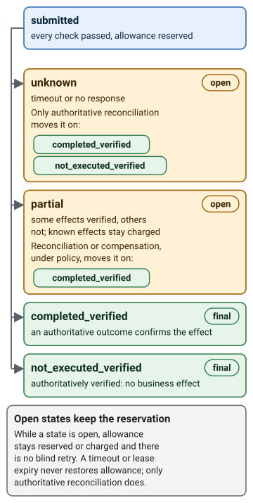

# 09 Unknown outcome

[← 08 Blocked action](../08-blocked-action/README.md) · [Examples](../README.md) · [Next: 10 Degraded modes →](../10-degraded-modes/README.md)

*Synthetic. The bank interface, the payment and the statement are invented.*

## Purpose

Sometimes the system cannot tell whether an action happened. A timeout is not a failure and not a success. This folder follows the corrected release (job B) from the commit check, through a bank timeout that leaves the outcome **unknown**, to authoritative reconciliation. The point: the allowance stays reserved, nothing is retried blindly, and the receipt says only what has been verified. The reasoning is in [chapter 9](../../docs/paper/09-authority.md) and [action and degradation](../../architecture/action-and-degradation.md).

<!-- figure:F06:start -->
<!-- Generated by scripts/sync_figures.py from figures/figures.json and the figure source. Edit those, not this block. -->

**Figure F06.** An unknown outcome keeps its reservation: only authoritative reconciliation settles it, and a timeout never restores allowance.

<picture>
<source media="(prefers-color-scheme: dark)" srcset="../../figures/F06-dark.svg">

</picture>

Text description of Figure F06

An action starts as submitted, after the gateway has passed every check and reserved allowance. Four cards follow, with an arrow from submitted to each. Unknown (a timeout or no response) and partial (some effects verified, others not; known effects stay charged) are open, tagged open and drawn in amber: allowance stays reserved or charged, there is no blind retry, and a timeout or lease expiry never restores allowance. Completed_verified (an authoritative outcome confirms the effect) and not_executed_verified (authoritatively verified: no business effect) are final, tagged final and drawn in green. Inside the unknown card, green labels show where it can go: only authoritative reconciliation moves it to completed_verified or not_executed_verified. Inside the partial card, a label shows that reconciliation or compensation, under policy, moves it to completed_verified. Allowance is restored only on authoritative reconciliation, never by assuming that silence means no effect.

[All figures and their descriptions](../../figures/README.md#f06-receipt-states-and-recovery)

<!-- figure:F06:end -->

## Files

| File | What it is |
|---|---|
| [`c07-RCP-REL-0417-B-v1.json`](c07-RCP-REL-0417-B-v1.json) | The receipt at 16:00:05: `unknown`, allowance `reserved`. |
| [`c07-RCP-REL-0417-B-v2.json`](c07-RCP-REL-0417-B-v2.json) | The same attempt after reconciliation: `completed_verified`, accounting `reconciled`. |
| [`c02-BANK-STMT-0042-v1.json`](c02-BANK-STMT-0042-v1.json) | The bank statement line that is the authoritative reference: payment `PAY-88421` of EUR 18,400.00 booked at 16:07. |
| [`c02-EXE-REL-0417-B-v1.json`](c02-EXE-REL-0417-B-v1.json) | An `execution_record`: it documents the observed effect. It validates no earlier observation. |
| [`gateway-scenarios.json`](gateway-scenarios.json) | Three stored evaluations: the allowed attempt and two retries. |

Approval B (`GRT-APPR-0417-B`), the corrected proposal and the packet it relies on are in [11](../11-late-correction/README.md).

## What happened

| Time | What | State |
|---|---|---|
| 16:00:05 | The commit check passes every check and **reserves** EUR 18,400 of the approval's allowance. The instruction is submitted to the bank. | submitted |
| 16:00:05 + | The bank interface times out. No response. Receipt v1: `outcome.state` `unknown`; `unresolved_conditions` says whether the instruction was accepted is not known; verification is `pending`; reconciliation `required`; `retry_disposition` `blocked_pending_reconciliation`; accounting `reserved`. | unknown |
| 16:07 | (Unknown to the system.) The bank books the payment. | |
| 16:10 | A retry is attempted. The gateway blocks it: the reservation still counts. | unknown |
| 16:20 | Reconciliation against the bank statement finds the booking. Receipt v2: `completed_verified`, authoritatively verified against `BANK-STMT-0042`, accounting `reconciled`. The ERP marks the invoice paid. | completed_verified |

Both versions describe **the same attempt** (`ATT-REL-0417-B-1`). A later version changes what is known about it, not which attempt it is.

## Receipt states and what each permits

| State | Means | Retry | Allowance |
|---|---|---|---|
| `submitted` | Sent; no outcome yet | no | reserved |
| `unknown` | Sent; cannot tell whether it took effect | **no blind retry** | stays reserved or conservatively accounted |
| `partial` | Some effects verified, others not | **no blind retry** | known partial effects stay charged |
| `completed_verified` | Authoritatively confirmed | not applicable | reconciled |
| `not_executed_verified` | Authoritatively confirmed that nothing happened | a new proposal and approval | reconciled, nothing charged |

The contract encodes the rules that matter: `unknown` and `partial` must keep a reservation or conservative accounting, must not offer `blind_retry` or `retry_without_reconciliation`, and must not mark reconciliation as `none`. `completed_verified` and `not_executed_verified` need authoritative verification. The `confirmed_effect_policy` in every accounting block says it plainly: authoritative reconciliation is required; **a timeout alone does not restore the allowance; a lease expiry alone does not restore it; partial effects stay charged.**

## The three stored evaluations

| What is attempted | Decision | Codes | Why |
|---|---|---|---|
| Job B at 16:00:05 | ALLOW | none | Every check passes. |
| A retry at 16:10 while the outcome is unknown | BLOCK | `CUMULATIVE_LIMIT` | The reservation from the unknown attempt still counts: EUR 18,400 already held, EUR 18,400 requested, limit EUR 18,400. |
| A retry at 16:30 after reconciliation | BLOCK | `PRECONDITION_FAILED`, `CUMULATIVE_LIMIT` | The payment is confirmed: the allowance is consumed and the invoice is no longer held. |

## A weaker guarantee, declared

The allowance ledger and the bank cannot be updated in one atomic step. The grant says so: `enforcement` `unsupported`; weaker guarantees, race windows and residual risk are written down; unattended operation is limited to the exact approved amount; and the domain owner's acceptance is referenced. An architecture that does not state where its guarantees are weaker invites trust it has not earned.

## Checks that run here

Stage 3 requires an unresolved outcome to keep its accounting (`ACC001`), a later version to describe the same attempt (`ACC004`), a verified outcome to settle its accounting (`ACC003`), and allowance to be restored only on authoritative reconciliation (`ACC002`). The schema alone rejects an unknown outcome that claims reconciliation. Related cases: `CASE-SCH-04`, `CASE-ACC-01`, `CASE-ACC-02`.

## What this shows, and what it does not

- **Shows:** an honest receipt for an uncertain outcome, an allowance that cannot be quietly released, and reconciliation that upgrades the record rather than overwriting it.
- **Does not show:** how reconciliation is run or how long it takes, how a real bank interface behaves, or what a duplicated payment would cost. The retry rule is only as good as the reservation: a second system with its own idempotency story could still double-pay.

[← 08 Blocked action](../08-blocked-action/README.md) · [Examples](../README.md) · [Next: 10 Degraded modes →](../10-degraded-modes/README.md)
