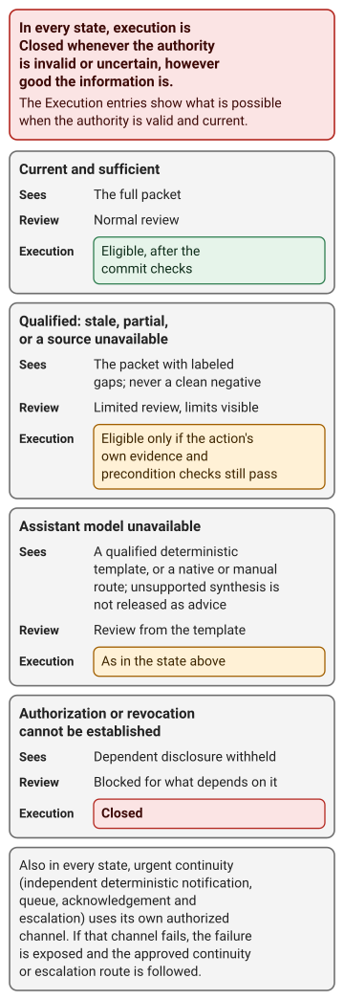

# 10 Degraded modes

[← 09 Unknown outcome](../09-unknown-outcome/README.md) · [Examples](../README.md) · [Next: 11 Late correction →](../11-late-correction/README.md)

*Synthetic. The outages and failures are invented.*

## Purpose

Real systems are partly broken most of the time. A source is down, a model is unavailable, a check cannot reach its data. The architecture's answer is **reduced capability with the reduction made visible, never silent substitution**. Reading can degrade to a labeled gap. Acting degrades to *no action*: the commit check fails closed. This folder collects where each degradation shows up and replays the commit check with parts of its input missing. The reasoning is in [chapter 10](../../docs/paper/10-degraded-operation.md) and [action and degradation](../../architecture/action-and-degradation.md).

<!-- figure:F07:start -->
<!-- Generated by scripts/sync_figures.py from figures/figures.json and the figure source. Edit those, not this block. -->

**Figure F07.** Four information states show what the reader sees, what review is possible and whether execution is eligible. In every state, execution is closed when authority is invalid or uncertain, and urgent continuity uses its own authorized channel.

<picture>
<source media="(prefers-color-scheme: dark)" srcset="../../figures/F07-dark.svg">

</picture>

Text description of Figure F07

A note at the top says that in every state execution is closed whenever the authority is invalid or uncertain, however good the information is. It adds that the Execution entries show what is possible when the authority is valid and current. Four information states follow, from top to bottom. Each one gives what the reader sees, what review is possible and whether execution is eligible. The states are current and sufficient; qualified, meaning stale, partial or a source unavailable; assistant model unavailable; and authorization or revocation cannot be established. In the last state, where authorization or revocation cannot be established, the execution entry is Closed. A note at the bottom says that urgent continuity (independent deterministic notification, queue, acknowledgement and escalation) uses its own authorized channel in every state. If that channel fails, the failure is exposed and the approved continuity or escalation route is followed. The table below gives the same content.

| Information state | What the reader sees | Review | Execution |
|---|---|---|---|
| Current and sufficient | The full packet | Normal review | Eligible, after the commit checks |
| Qualified: stale, partial, or a source unavailable | The packet with labeled gaps; never a clean negative | Limited review, limits visible | Eligible only if the action's own evidence and precondition checks still pass |
| Assistant model unavailable | A qualified deterministic template, or a native or manual route; unsupported synthesis is not released as advice | Review from the template | As in the state above |
| Authorization or revocation cannot be established | Dependent disclosure withheld | Blocked for what depends on it | **Closed** |

In every state, execution is **Closed** whenever the authority is invalid or uncertain, however good the information is. The Execution entries show what is possible when the authority is valid and current.

Also in every state, urgent continuity (independent deterministic notification, queue, acknowledgement and escalation) uses its own authorized channel. If that channel fails, the failure is exposed and the approved continuity or escalation route is followed.

[All figures and their descriptions](../../figures/README.md#f07-degraded-information-closed-execution)

<!-- figure:F07:end -->

## Files

| File | What it is |
|---|---|
| [`gateway-scenarios.json`](gateway-scenarios.json) | Three stored evaluations of the commit check, each with part of its input broken in memory. |

There is no data of its own: the rest of the degraded behavior is in the other folders, and this page is the map.

## What degrades, and what happens

| What fails | What the architecture does | Where it is shown |
|---|---|---|
| A source cannot be read (an outage) | The gap is labeled `unavailable`, tied to a record of the failure. The packet is still produced and says so. Nothing is assumed. | [04](../04-selection-and-missingness/README.md), [05](../05-decision-packet/README.md) |
| A source is outside the reader's permissions | If the reader may know that it exists, the gap is labeled `inaccessible`, in the wording the permission decision allows and with no identity or content. If not, nothing is shown for it. | [04](../04-selection-and-missingness/README.md) |
| Evidence is older than policy allows | The gap is labeled `stale`; at commit the check refuses to rely on it. | [04](../04-selection-and-missingness/README.md), [08](../08-blocked-action/README.md) |
| The assistant model is unavailable | A deterministic template writes the response from the packet. It is less fluent, and it is faithful. | [06](../06-assistant-response/README.md) |
| A correction arrives late | Everything derived from the corrected record stops being current, and so does every approval that rested on it. | [11](../11-late-correction/README.md) |
| The outcome of an action is unknown | The allowance stays reserved; no blind retry; reconciliation is required. | [09](../09-unknown-outcome/README.md) |
| Revocation cannot be established | The action does not proceed (`REVOCATION_UNVERIFIED`). | here |
| A cited record cannot be resolved | The action does not proceed (`EVIDENCE_UNRESOLVED`). | here |
| The executor starts late | An approval is time-bound; it does not stretch (`GRANT_EXPIRED`). | here |
| The ledger and the target cannot be updated atomically | The weaker guarantee is declared in the grant, with the residual risk and the constraint on unattended operation. | [09](../09-unknown-outcome/README.md) |

## The three fail-closed evaluations

Each takes job B, which passes the commit check in [09](../09-unknown-outcome/README.md), and breaks one input in memory. The files on disk do not change.

| What is broken | Decision | Codes | Why |
|---|---|---|---|
| The revocation state is `check_unavailable` | BLOCK | `REVOCATION_UNVERIFIED` | If the check cannot show that the grant is unrevoked, the action does not proceed. |
| One cited evidence record names a version that does not exist (`v9`) | BLOCK | `EVIDENCE_UNRESOLVED` | Evidence that cannot be resolved is not evidence that is current. |
| The approval's expiry is moved to 16:00:00, before the run starts | BLOCK | `GRANT_EXPIRED` | A delayed executor does not extend an approval. |

## Checks that run here

Stage 4 replays the stored evaluations and fails if a decision changes. Stage 3 checks the read-side degradations on the packet: each gap keeps its label and its supporting evidence, and the packet keeps every gap of its selection (`MISS001`–`MISS005`).

## What this shows, and what it does not

- **Shows:** that each degradation has a named, visible, checkable behavior, and that the write side fails closed.
- **Does not show:** how a real deployment detects the degradation in time, how often it happens, what failing closed costs the business, or whether people trust a system that says "I could not check". Those are operational and human-outcome questions: see [evaluation](../../evaluation/README.md).

[← 09 Unknown outcome](../09-unknown-outcome/README.md) · [Examples](../README.md) · [Next: 11 Late correction →](../11-late-correction/README.md)
