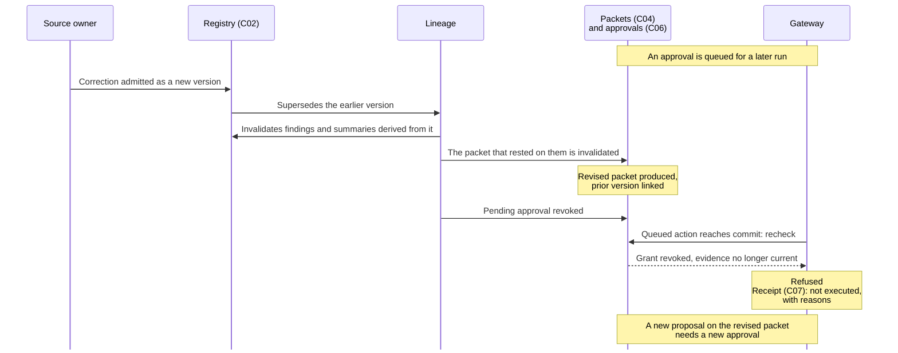

# 11 Late correction

[← 10 Degraded modes](../10-degraded-modes/README.md) · [Examples](../README.md) · [Next: 12 Controlled change →](../12-controlled-change/README.md)

*Synthetic. The warehouse, the scan and the re-approval are invented.*

## Purpose

A correction arrives after an approval but before execution. The corrected record supersedes the old one, and **everything built on the old one stops being current**: derived findings, model summaries, the packet, and the approval that rested on the packet. Nothing is edited. New versions are written; old versions keep their content, and only their lifecycle state changes. The reasoning is in [chapter 4](../../docs/paper/04-evidence-and-lineage.md) and [chapter 14](../../docs/paper/14-start-monday.md).

<!-- figure:F10:start -->
<!-- Generated by scripts/sync_figures.py from figures/figures.json and the figure source. Edit those, not this block. -->

**Figure F10.** A late correction reaches a pending approval: derivatives and approvals stop being current, and the queued action is refused at commit.

*Open at full size: [light](../../figures/F10-light.svg) · [dark](../../figures/F10-dark.svg).*

Text description of Figure F10

Five participants: the source owner, the evidence registry (C02), the lineage service, the packets (C04) and approvals (C06), and the gateway. An approval is already queued for a later run. The source owner admits a correction as a new version. The registry records that it supersedes the earlier version. The lineage service invalidates the findings and summaries derived from it, then invalidates the packet that rested on them. A revised packet is produced with its prior version linked, and the pending approval is revoked. When the queued action reaches commit, the gateway rechecks and finds the grant revoked and the evidence no longer current; it refuses, and the receipt (C07) records not executed, with the reasons. A new proposal on the revised packet needs a new approval.

[All figures and their descriptions](../../figures/README.md#f10-a-late-correction-reaches-a-pending-approval)

<!-- figure:F10:end -->

## Files

| File | What it is |
|---|---|
| [`c02-GR-5521-v2.json`](c02-GR-5521-v2.json) | The corrected goods receipt: 100 units (60 on 11-18, 40 on 11-20, scanned on 11-23). Supersedes v1 and invalidates three derivatives. |
| [`c02-M3W-0417-v2.json`](c02-M3W-0417-v2.json) | The three-way match recomputed from the corrected receipt: invoiced 100, received 100, variance 0.0%, **PASS**. |
| [`c02-SCR-S1042-v2.json`](c02-SCR-S1042-v2.json) | Supplier screening re-run at 13:30. Replaces the stale v1. |
| [`c03-SEL-0417-v2.json`](c03-SEL-0417-v2.json) | The selection as of 14:10: no conflict, six gaps (the stale label is gone), unchanged retrievals marked "carried over". |
| [`c04-PKT-0417-v2.json`](c04-PKT-0417-v2.json) | The revised packet: seven supported claims, no inferences, six gaps, reviewed at 15:10. Lists `PKT-0417` v1 as its prior version. |
| [`c05-ACT-REL-0417-v2.json`](c05-ACT-REL-0417-v2.json) | The release proposal re-bound to the revised packet and citing the corrected evidence. |
| [`c06-GRT-APPR-0417-B-v1.json`](c06-GRT-APPR-0417-B-v1.json) | A second exact approval, at 15:20, bound to proposal v2 only. |

The raw second-pallet receipt is in [01](../01-source-records/README.md), the context v2 in [02](../02-context-and-normalization/README.md).

## What happened

| Time | Event |
|---|---|
| 13:30 | Screening re-run. `SCR-S1042` v2 is admitted; v1 is superseded. |
| 13:40 | The warehouse supervisor admits `GR-5521` v2. The record asserts four typed relationships, each naming who asserted it: **supersession** of v1 (by the supervisor) and **invalidation** of `M3W-0417` v1, `SUM-A-0417` v1 and `SUM-B-0417` v1 (by the lineage service). |
| 13:45 | The invalidations take effect. The packet that rested on them, `PKT-0417` v1, is invalidated, with a challenge link to the correction. The approval that relied on that packet, `GRT-APPR-0417-A`, is revoked. |
| 13:50 | The three-way match is recomputed from the corrected receipt. `M3W-0417` v2 (PASS) is admitted at 13:51, and v1 is superseded. |
| 14:10 | A new context, selection, packet and proposal are produced from the corrected record. |
| 15:10 | The reviewer reviews packet v2. |
| 15:20 | The controller gives a new exact approval, bound to proposal v2. |

## What changed, record by record

| Record | Before | After (as the files show it) | Why |
|---|---|---|---|
| `SCR-S1042` v1 | current, 50 h old at 10:00 | `superseded` at 13:30, replacement v2 | re-screened |
| `GR-5521` v1 | current | `superseded` at 13:40, replacement v2 | correction |
| `M3W-0417` v1 (FAIL) | current | `superseded` at 13:51, replacement v2 (PASS) | its input was corrected, and the match was recomputed |
| `SUM-A-0417` v1, `SUM-B-0417` v1 | current | `withdrawn` at 13:45 | their only basis was superseded; they are not recomputed |
| `PKT-0417` v1 | `awaiting_review` | `invalidated` at 13:45 | it cites superseded records |
| `GRT-APPR-0417-A` | not revoked | `revoked` at 13:45 | its basis packet was invalidated |
| `ACT-REL-0417` v1 | proposed | unchanged, history | still describes what was proposed on v1 evidence |
| (new) `PKT-0417` v2, `ACT-REL-0417` v2, `GRT-APPR-0417-B` | | current | built on the corrected record |

The earlier versions are not rewritten to look as though they were always right. That would destroy the answer to "what did the reviewer see at 10:00?"

## Why the first approval did not carry over

The corrected receipt makes the release legitimate, and approval A is still refused ([08](../08-blocked-action/README.md)): it was given for a proposal built on evidence that is no longer current. The cost is a second approval. What the second approval buys is that no approval outlives the facts it rested on. Whether that cost is acceptable in a given process is a design choice; see [ownership and tradeoffs](../../architecture/ownership-and-tradeoffs.md).

## Checks that run here

| Code | Rule | Case that breaks it |
|---|---|---|
| `LIFE001` | A superseded record names a later version of itself as its replacement | (checked on the whole set) |
| `LIFE002` | A record derived from a non-current record is not current | `CASE-LIFE-01` |
| `LIFE003` / `LIFE004` | An active packet cites no non-current record and has no newer version | `CASE-LIFE-02` |
| `LIFE005` | An approval whose packet is invalidated is revoked | `CASE-LIFE-03` |
| `LIN003` | A supersession is acknowledged by the older record | `CASE-LIN-03` |
| `REF001` | References name exact versions that exist | `CASE-REF-01` |

## What this shows, and what it does not

- **Shows:** invalidation that follows lineage, a revoked approval, a revised packet that remembers its predecessor, and a refusal that is correct although the business outcome would have been fine.
- **Does not show:** that real lineage is complete enough to find every derivative, how quickly invalidation propagates in a running system, or how often late corrections occur. Both ways of finding derivatives used here, the typed invalidation relationships and the walk down the lineage, are assumptions of the example.

[← 10 Degraded modes](../10-degraded-modes/README.md) · [Examples](../README.md) · [Next: 12 Controlled change →](../12-controlled-change/README.md)
