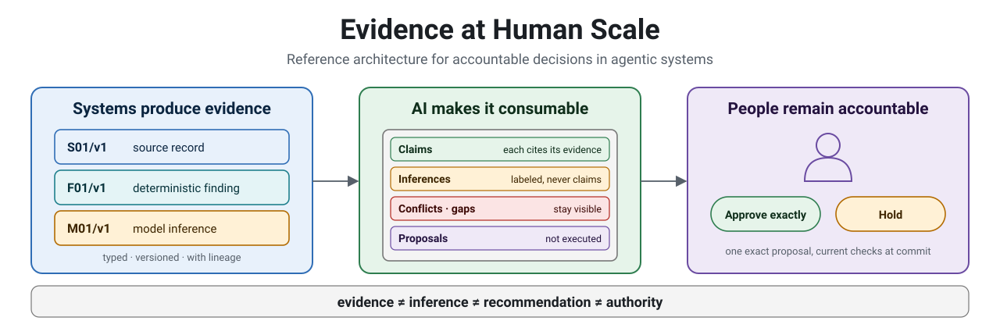
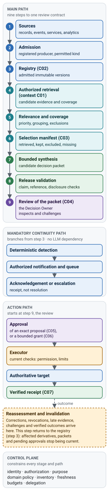
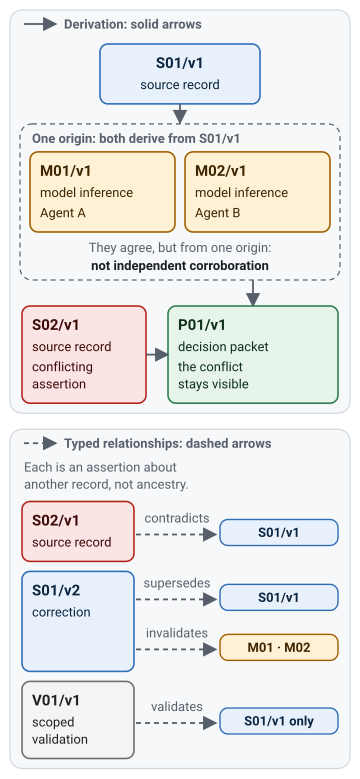
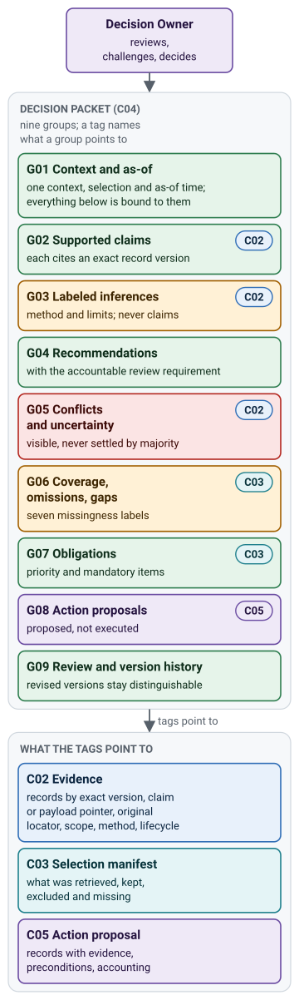
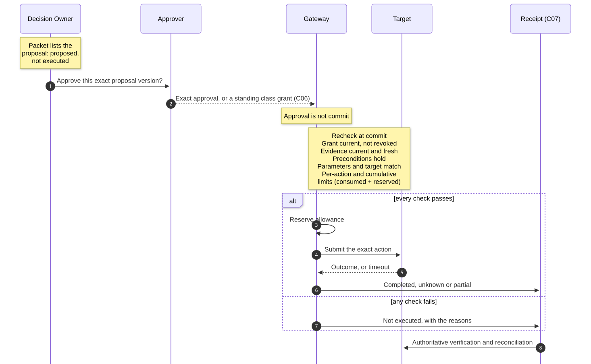
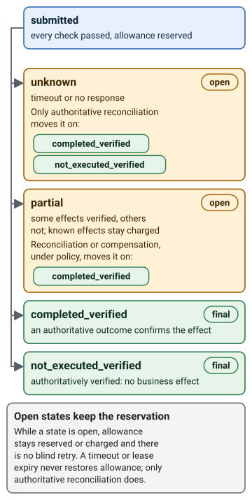
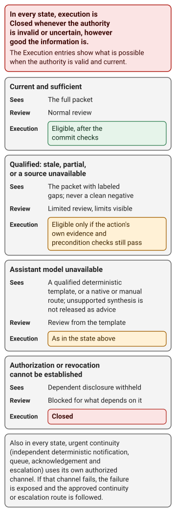
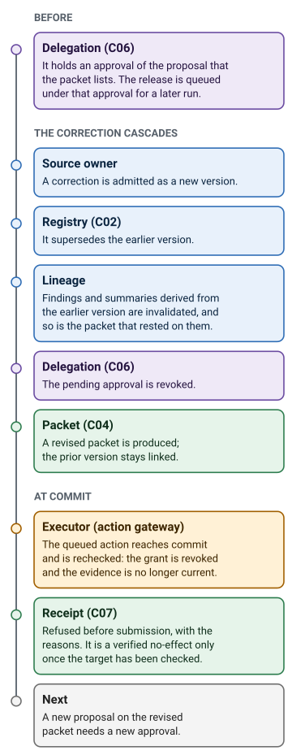

# Figures

Eleven figures and a banner. They are simplified views of the architecture, drawn to be read, not alternative specifications: the [contracts](../contracts/README.md) and the prose carry the semantics, and every figure points back to them. No figure shows a result; where a figure mentions evaluation, it says NOT RUN.

Each figure has a caption, a short alt text and a long description. They appear where they are discussed, in the [paper](../docs/paper/README.md) and in the [examples](../examples/README.md), and are collected here.

## How the figures are made

A script, [`figures/src/svg_figures.py`](src/svg_figures.py), draws every picture, with its helpers in [`figures/src/kit.py`](src/kit.py). It writes a light and a dark SVG for each, on an opaque background, so a picture stays legible on any page and in either theme. The drawing is deterministic, and a check fails if a committed SVG differs from what the script draws. The title and description inside each file come from [`figures/figures.json`](figures.json), the same place as the alt text. A Mermaid block would take its colors, its text size and its layout from the reader's renderer, which is why none is used.

**F07 is drawn from a table.** Its data is in `figures/figures.json`, and the same table is written under the picture, inside the text description, so a reader who wants rows and columns, or a screen reader, has them. A wide table does not fit a phone: its last column, the one that says execution is closed, would be off the screen.

**Made to be read on a phone.** Each figure is drawn 360 px wide, in one column that grows downward, and its text is never smaller than 13 px, so a phone shows it at about its natural size. Text is wrapped to a width that fits the widest of Segoe UI, Arial and Verdana, so a substituted font does not overflow a box. Two pictures read better side by side, so they also have a wide drawing, 880 px wide: the architecture overview F02, and the banner. A window of at least 900 px shows the wide drawing; a narrower window, and any browser that does not switch, shows the narrow one. The wide drawing follows the color scheme of the reader's system. The narrow drawings also follow the theme a reader chose in GitHub's settings, so a reader whose GitHub theme differs from their system's may see a wide drawing in the other scheme; it stays legible, because every drawing has its own opaque background. The wide dark source is written `prefers-color-scheme:dark`, without a space: for a reader who chose a theme in GitHub's settings, GitHub's script replaces the whole media condition of a source written with the space, the width included, and a phone would be shown the wide drawing. [`scripts/check_figures.py`](../scripts/check_figures.py) rejects that form.

All colors are paired with a text label. No meaning is carried by color alone, and every fill is paired with dark text of high contrast.

**Reading a figure.** The text description under each figure carries the same content as the picture. A picture is an SVG file, which GitHub shows on its own page if you open it, where you can zoom.

## Gallery

<!-- gallery:start -->
<!-- Generated by scripts/sync_figures.py from figures/figures.json and the figure source. Edit those, not this block. -->

### Repository banner

<picture>
<source media="(min-width: 900px) and (prefers-color-scheme:dark)" srcset="banner-wide-dark.svg">
<source media="(min-width: 900px)" srcset="banner-wide-light.svg">
<source media="(prefers-color-scheme: dark)" srcset="banner-dark.svg">

</picture>

**Alt text.** Evidence at Human Scale. Systems produce evidence, AI makes it consumable, people remain accountable. Evidence is not inference, not recommendation, not authority.

Source: [`figures/src/svg_figures.py`](src/svg_figures.py). Files: [light](banner-light.svg) · [dark](banner-dark.svg); wide drawing: [light](banner-wide-light.svg) · [dark](banner-wide-dark.svg).

### F01 Information production can outgrow human inspection

<picture>
<source media="(prefers-color-scheme: dark)" srcset="F01-dark.svg">

</picture>

**Caption.** Information production can outgrow human inspection; a governed decision context preserves what could change a decision.

**Alt text.** Three cards of decreasing width: a wide band of growing records, events, findings and model interpretations narrows, through a governed decision context, into one accountable Decision Owner with finite attention.

**Description.** Three cards, drawn top to bottom, each narrower than the one before. At the top: information production keeps growing, as records, events, deterministic findings, analytical results and model interpretations. In the middle, the governed decision context, which keeps what could change a decision and shows its source, scope, gaps and owner. At the bottom, the Decision Owner, who has finite attention and is accountable. The arrow from the first card to the second is labeled authorize, select, label; the arrow from the second to the third is labeled one decision packet.

**Used in:** [1. The scarce resource is human attention](../docs/paper/01-human-attention.md).

**Source:** [`figures/src/svg_figures.py`](src/svg_figures.py). Files: [light](F01-light.svg) · [dark](F01-dark.svg).

### F02 Reference architecture

<picture>
<source media="(min-width: 900px) and (prefers-color-scheme:dark)" srcset="F02-wide-dark.svg">
<source media="(min-width: 900px)" srcset="F02-wide-light.svg">
<source media="(prefers-color-scheme: dark)" srcset="F02-dark.svg">

</picture>

**Caption.** Nine steps on the main path lead to one review contract; mandatory continuity and execution authority retain separate, governed paths.

**Alt text.** A main path of nine numbered steps from sources to review of one decision packet; a separate mandatory continuity path that branches from the registry; a separate action path that starts from the review; a reassessment and invalidation step that receives corrections and outcomes; and a control plane that constrains every stage.

**Description.** The main path has nine steps: sources, admission, the registry of immutable versions (C02), authorized retrieval in a context (C01), relevance and coverage, the selection manifest (C03), bounded synthesis, release validation, and review of the decision packet (C04) by the Decision Owner. A separate mandatory continuity path branches from the registry (step 3) and runs through deterministic detection and an authorized notification queue to acknowledgement or escalation; acknowledgement is receipt, not resolution, and the path has no LLM dependency. A separate action path starts from the review step: an approval of an exact proposal (C05), or a bounded grant (C06), reaches the executor, or action gateway, which checks permission and limits at the time, then an authoritative target, then a verified receipt (C07). The outcome returns to a reassessment and invalidation step, which also receives corrections, revocations, late evidence and challenges, and returns to the registry; the derivatives, packets and pending approvals that it affects stop being current. A control plane constrains every stage and path: identity, authorization, purpose, domain policy, inventory, freshness, budgets and delegation. On a wide screen the two paths sit beside the main path, level with the step they start from, and a key names the colors and the two kinds of line; on a narrow screen the paths are stacked below it.

**Used in:** [3. A governed context, not an agent hierarchy](../docs/paper/03-governed-context.md).

**Source:** [`figures/src/svg_figures.py`](src/svg_figures.py). Files: [light](F02-light.svg) · [dark](F02-dark.svg); wide drawing: [light](F02-wide-light.svg) · [dark](F02-wide-dark.svg).

### F03 Common-source agreement is not corroboration

<picture>
<source media="(prefers-color-scheme: dark)" srcset="F03-dark.svg">

</picture>

**Caption.** Common-source agreement is not corroboration; conflicts, corrections and the scope of validation stay visible. Solid arrows show derivation; dashed arrows are assertions about another record, not ancestry.

**Alt text.** Source record S01 version 1 is the single parent of model inferences M01 and M02, which both feed decision packet P01 together with a conflicting record S02: their agreement is common origin, not corroboration. Dashed arrows are assertions, not ancestry: S02 contradicts S01; S01 version 2 supersedes S01 version 1 and invalidates M01 and M02; V01 validates S01 version 1 only.

**Description.** Solid arrows are derivation ancestry. Source record S01/v1 is the only parent of two model inferences, M01/v1 from Agent A and M02/v1 from Agent B, which together form one origin: they agree, but not as independent corroboration. Both feed the decision packet P01/v1, and so does a conflicting source record, S02/v1, so the conflict stays visible. Dashed arrows are typed relationships, not ancestry. Each is recorded with the actor who asserted it, which the figure does not draw: S02/v1 contradicts S01/v1; a correction, S01/v2, supersedes S01/v1 and invalidates M01 and M02; and a scoped validation, V01/v1, validates S01/v1 only. In the worked example, which the figure does not label, S01 is the goods receipt, S02 the invoice, and M01 and M02 the two model summaries.

**Used in:** [4. Evidence keeps its type and its ancestry](../docs/paper/04-evidence-and-lineage.md); [03 Lineage and common origin](../examples/03-lineage-and-common-origin/README.md).

**Source:** [`figures/src/svg_figures.py`](src/svg_figures.py). Files: [light](F03-light.svg) · [dark](F03-dark.svg).

### F04 Anatomy of a decision packet

<picture>
<source media="(prefers-color-scheme: dark)" srcset="F04-dark.svg">

</picture>

**Caption.** A decision packet makes evidence consumable while exposing interpretation, gaps, obligations and unexecuted proposals to an accountable owner.

**Alt text.** The Decision Owner reviews a decision packet of nine groups, G01 to G09. Tags show that claims, inferences and conflicts point to evidence records (C02), coverage and obligations to the selection manifest (C03), and action proposals to action proposal records (C05).

**Description.** The Decision Owner reviews one decision packet (C04). It has nine groups: G01, which binds it to one context, selection and as-of time; G02 supported claims, each citing an exact record version; G03 labeled inferences, with method and limits, never claims; G04 recommendations, with the accountable review requirement; G05 conflicts and uncertainty, visible and never settled by majority; G06 coverage, omissions and gaps, with seven missingness labels; G07 obligations, priority and mandatory items; G08 action proposals, proposed and not executed; and G09 review and version history, where revised versions stay distinguishable. A tag on a group names what it points to: G02, G03 and G05 to evidence records (C02), by exact version, claim or payload pointer, original locator, scope, method and lifecycle; G06 and G07 to the selection manifest (C03), which records what was retrieved, kept, excluded and missing; and G08 to action proposal records (C05), with evidence, preconditions and accounting. A band under the packet shows the three contracts that the tags name.

**Used in:** [6. The decision packet compresses presentation](../docs/paper/06-decision-packet.md); [05 Decision packet](../examples/05-decision-packet/README.md).

**Source:** [`figures/src/svg_figures.py`](src/svg_figures.py). Files: [light](F04-light.svg) · [dark](F04-dark.svg).

### F05 From proposal to commit

<picture>
<source media="(prefers-color-scheme: dark)" srcset="F05-dark.svg">

</picture>

**Caption.** Approval is not commit: at commit the gateway rechecks the grant, the evidence, the preconditions and the limits, and an authoritative verification confirms the outcome.

**Alt text.** A packet lists a proposal. An accountable approver, distinct from the requestor, approves the exact proposal version, or a bounded grant covers it. Approval is not commit: the executor rechecks six conditions. If all pass, it reserves allowance and submits, and the receipt records the outcome; if one fails, the receipt is not_executed_verified. An authoritative verification confirms the outcome.

**Description.** Top to bottom: the packet lists a proposal as proposed, not executed. Either the accountable approver approves this exact proposal version, a role distinct from the requestor, or a bounded grant already covers it; both are recorded in a delegation (C06) that names scope, limits and expiry. A divider says that approval is not commit. At commit, the executor, or action gateway, rechecks six conditions: the grant is current and not revoked, the evidence is current and fresh, the preconditions hold, the parameters and target match, the per-action limit holds, and the cumulative limit holds, counting consumed and reserved capacity. If every check passes, it reserves allowance, submits the exact action to the target and records the outcome or a timeout. If a check fails, nothing is submitted. The receipt (C07) then records the outcome as completed_verified, unknown, partial or not_executed_verified after a pass, and not_executed_verified, with the reasons, after a failed check. An authoritative verification against the target confirms or reconciles the outcome.

**Used in:** [9. Authority remains a separate boundary](../docs/paper/09-authority.md); [07 Authority and delegation](../examples/07-authority-and-delegation/README.md).

**Source:** [`figures/src/svg_figures.py`](src/svg_figures.py). Files: [light](F05-light.svg) · [dark](F05-dark.svg).

### F06 Receipt states and recovery

<picture>
<source media="(prefers-color-scheme: dark)" srcset="F06-dark.svg">

</picture>

**Caption.** An unknown outcome keeps its reservation: only authoritative reconciliation settles it, and a timeout never restores allowance.

**Alt text.** A submitted action leads to four states. Unknown and partial (amber) are open: allowance stays reserved or charged, and each lists how it can move on. Completed_verified and not_executed_verified (green) are final. Unknown becomes completed or not executed, and partial becomes completed, only through reconciliation or compensation under policy.

**Description.** An action starts as submitted, after the gateway has passed every check and reserved allowance. Four cards follow, with an arrow from submitted to each. Unknown (a timeout or no response) and partial (some effects verified, others not; known effects stay charged) are open, tagged open and drawn in amber: allowance stays reserved or charged, there is no blind retry, and a timeout or lease expiry never restores allowance. Completed_verified (an authoritative outcome confirms the effect) and not_executed_verified (authoritatively verified: no business effect) are final, tagged final and drawn in green. Inside the unknown card, green labels show where it can go: only authoritative reconciliation moves it to completed_verified or not_executed_verified. Inside the partial card, a label shows that reconciliation or compensation, under policy, moves it to completed_verified. Allowance is restored only on authoritative reconciliation, never by assuming that silence means no effect.

**Used in:** [9. Authority remains a separate boundary](../docs/paper/09-authority.md); [09 Unknown outcome](../examples/09-unknown-outcome/README.md).

**Source:** [`figures/src/svg_figures.py`](src/svg_figures.py). Files: [light](F06-light.svg) · [dark](F06-dark.svg).

### F07 Degraded information, closed execution

<picture>
<source media="(prefers-color-scheme: dark)" srcset="F07-dark.svg">

</picture>

**Caption.** Information limitations are explicit, while invalid authority blocks execution in every state; urgent continuity uses its own authorized route.

**Alt text.** Four information states, each with what the reader sees, what review is possible and whether execution is eligible. Execution is eligible only after the commit checks, and only when authority is valid; it is closed whenever authority is invalid or uncertain, and outright in the last state, where authorization cannot be established.

**Description.** Information availability and authority validity are separate axes. Four information states are drawn top to bottom, each with what the reader sees, what review is possible and whether execution is eligible when authority is valid and current; the table below gives the same content. In every state, execution is closed whenever authority is invalid or uncertain, even when information is available and the recommendation sounds compelling; in the last state it is closed outright, because authorization or revocation cannot be established. Urgent continuity runs on its own authorized channel in every state.

| Information state | What the reader sees | Review | Execution |
|---|---|---|---|
| Current and sufficient | The full packet | Normal review | Eligible, after the commit checks |
| Qualified: stale, partial, or a source unavailable | The packet with labeled gaps; never a clean negative | Limited review, limits visible | Eligible only if the action's own evidence and precondition checks still pass |
| Assistant model unavailable | A qualified deterministic template, or a native or manual route; unsupported synthesis is not released as advice | Review from the template | As in the state above |
| Authorization or revocation cannot be established | Dependent disclosure withheld | Blocked for what depends on it | **Closed** |

In every state, execution is **Closed** whenever the authority is invalid or uncertain, however good the information is. The Execution entries show what is possible when the authority is valid and current.

Also in every state, urgent continuity (independent deterministic notification, queue, acknowledgement and escalation) uses its own authorized channel. If that channel fails, the failure is exposed and the approved continuity or escalation route is followed.

**Used in:** [10. Information can degrade without widening authority](../docs/paper/10-degraded-operation.md); [10 Degraded modes](../examples/10-degraded-modes/README.md).

**Source:** [`figures/src/svg_figures.py`](src/svg_figures.py). Files: [light](F07-light.svg) · [dark](F07-dark.svg).

### F08 Complexity must earn its place

<picture>
<source media="(prefers-color-scheme: dark)" srcset="F08-dark.svg">

</picture>

**Caption.** Complexity must earn its place against matched native, deterministic and zero-specialist baselines; no evaluation result is claimed.

**Alt text.** Four steps in order: native or current workflow, deterministic grouping and templates, simple synthesis with zero specialists, optional specialists. Each step is compared with the one before on matched tasks. A note lists the measures and says every comparison is not run.

**Description.** Four steps in order. Each arrow between two steps asks whether the next step is better on matched tasks, and the last asks whether there is a measured, matched need. First the native or current workflow; then deterministic grouping and templates; then simple synthesis with zero specialists, which is a complete architecture on its own; and only then optional specialists, admitted only for a documented task, permission or isolation need. The measures are correctness, omissions, evidence actually inspected, decision quality, time and workload: not fluency, and not how many agents agree. No evaluation result is claimed; every comparison is not run.

**Used in:** [12. Evaluate simpler baselines before multi-agent value](../docs/paper/12-evaluation.md); [Evaluation guide](../evaluation/README.md).

**Source:** [`figures/src/svg_figures.py`](src/svg_figures.py). Files: [light](F08-light.svg) · [dark](F08-dark.svg).

### F09 Which missingness label applies?

<picture>
<source media="(prefers-color-scheme: dark)" srcset="F09-dark.svg">

</picture>

**Caption.** Seven labels, six questions, asked in order: an expected input that is not in front of the reader gets exactly one label.

**Alt text.** A decision list. A stale record gives stale. Otherwise a check not performed gives not_assessed, a principal not permitted gives inaccessible, no answer from the source gives unavailable, no completed scoped retrieval gives missing, an observed absence with method, time and complete coverage gives negative, and otherwise not_retrieved.

**Description.** For an expected input that is not in front of the reader, ask six questions in order. One: is a record available but failing the freshness requirement? If yes, the label is stale. Two: was the check or assessment performed? If not, not_assessed. Three: may the reader's principal read the source? If not, inaccessible, and the reason and existence are disclosed only when permitted. Four: did the source or dependency answer? If not, unavailable, which is not the same as denied. Five: did a scoped retrieval complete? If not, missing: expected, not obtained, reason may be unknown. Six: was absence observed with method, time and complete coverage? If yes, negative. If not, not_retrieved: a completed retrieval found nothing, which is not evidence of absence. Only negative is evidence of absence: its label is drawn in green, and the other six labels in amber.

**Used in:** [8. Uncertainty is part of the result](../docs/paper/08-uncertainty.md); [04 Selection and missingness](../examples/04-selection-and-missingness/README.md).

**Source:** [`figures/src/svg_figures.py`](src/svg_figures.py). Files: [light](F09-light.svg) · [dark](F09-dark.svg).

### F10 A late correction reaches a pending approval

<picture>
<source media="(prefers-color-scheme: dark)" srcset="F10-dark.svg">

</picture>

**Caption.** A late correction reaches a pending approval: derivatives and approvals stop being current, and the queued action is refused at commit.

**Alt text.** A vertical timeline in which a correction is admitted, supersedes the earlier record and invalidates what was derived from it; the packet is invalidated, a revised packet is produced and the pending approval is revoked; the queued action is then refused by the executor (action gateway) and a not_executed_verified receipt records why.

**Description.** A vertical timeline in three phases, each event tagged with the actor that performs it. Before: an approval is queued for a later run, held by the packet (C04) and the delegation (C06). The correction cascades: the source owner admits a correction as a new version; the registry (C02) records that it supersedes the earlier version; lineage invalidates the findings and summaries derived from the earlier version, and the packet that rested on them; the packet (C04) is revised, with the prior version linked; and the delegation (C06) revokes the pending approval. At commit: the executor, or action gateway, rechecks the queued action and finds the grant revoked and the evidence no longer current; it refuses, and the receipt (C07) records not_executed_verified, with the reasons. A new proposal on the revised packet needs a new approval.

**Used in:** [14. Start with one decision, not a platform](../docs/paper/14-start-monday.md); [11 Late correction](../examples/11-late-correction/README.md).

**Source:** [`figures/src/svg_figures.py`](src/svg_figures.py). Files: [light](F10-light.svg) · [dark](F10-dark.svg).

### F11 How the seven contracts refer to each other

<picture>
<source media="(prefers-color-scheme: dark)" srcset="F11-dark.svg">

</picture>

**Caption.** Context, selection, packet, proposal, delegation and receipt chain forward; evidence is referenced by exact version from the others.

**Alt text.** Contracts C01 context, C03 selection, C04 decision packet, C05 action proposal, C06 delegation and C07 execution receipt chain downward, each referencing the ones before it; C07 references one proposal and one grant. C02 evidence is drawn at the top, with dashed arrows to C03, C04, C05, C06 and C07 for references by exact version.

**Description.** C01 context is referenced by C03 selection. C03 is referenced by C04 decision packet, together with the context. C04 is referenced by C05 action proposal, together with the context. A C06 delegation is bound to an exact C05 proposal or to a bounded class. A C07 execution receipt references one proposal and one grant: a solid arrow runs from C05 to C07 beside C06, and C06 points to C07. C02 evidence records are referenced, by exact version, claim or pointer, from the selection, the packet, the proposal, the delegation and the receipt; these references are drawn as dashed arrows from the C02 card at the top. Solid arrows carry forward; dashed arrows reference an exact evidence version.

**Used in:** [Contracts](../contracts/README.md).

**Source:** [`figures/src/svg_figures.py`](src/svg_figures.py). Files: [light](F11-light.svg) · [dark](F11-dark.svg).

<!-- gallery:end -->

## Changing a figure

Edit the source, never the generated blocks in the documents.

1. Change the drawing code in `figures/src/svg_figures.py`, or the caption, alt text, description or table in `figures/figures.json`.
2. Redraw the SVGs: `python figures/src/svg_figures.py`.
3. Rewrite the blocks, the README banner and this gallery: `python scripts/sync_figures.py`.
4. Check everything: `python scripts/check_figures.py`.

Every figure needs a caption, alt text and a description. The check fails if one is missing, if a block in a document differs from its source, if a committed SVG is out of date, if a default drawing is wider than 380 px or has text below 13 px, or if a document contains a Mermaid block.
