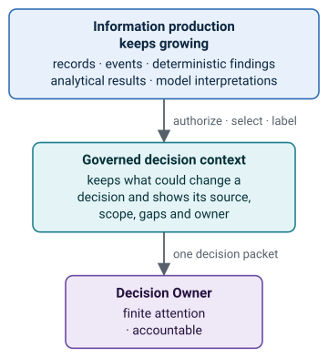
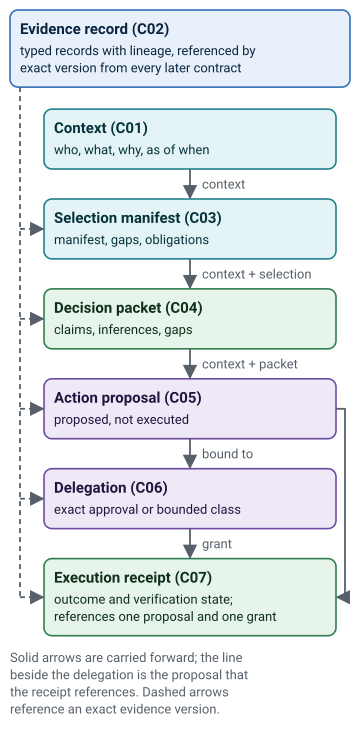

# Figures

Eleven figures and a banner. They are simplified views of the architecture, drawn to be read, not alternative specifications: the [contracts](../contracts/README.md) and the prose carry the semantics, and every figure points back to them. No figure shows a result; where a figure mentions evaluation, it says that none has been run.

Each figure has a caption, a short alt text and a long description. They appear where they are discussed, in the [paper](../docs/paper/README.md) and in the [examples](../examples/README.md), and are collected here.

## How the figures are made

A script, [`figures/src/svg_figures.py`](src/svg_figures.py), draws every picture, with its helpers in [`figures/src/kit.py`](src/kit.py). It writes a light and a dark SVG for each, on an opaque background, so a picture stays legible on any page and in either theme. The drawing is deterministic, and a check fails if a committed SVG differs from what the script draws. The title and description inside each file come from [`figures/figures.json`](figures.json), the same place as the alt text. A Mermaid block would take its colors, its text size and its layout from the reader's renderer, which is why none is used.

**F07 is drawn from a table.** Its data is in `figures/figures.json`, and the same table is written under the picture, inside the text description, so a reader who wants rows and columns, or a screen reader, has them. A wide table does not fit a phone: its last column, the one that says execution is closed, would be off the screen.

**Designed for a phone.** Each figure is drawn 360 px wide, in one column that grows downward, and its text is never smaller than 13 px, so a phone shows it at about its natural size. These are design choices and automated limits. The figures were not tested on phones with people, and accessibility conformance is NOT ASSESSED. Text is wrapped to a width that fits the widest of Segoe UI, Arial and Verdana, so a substituted font does not overflow a box. Two pictures read better side by side, so they also have a wide drawing, 880 px wide: the architecture overview F02, and the banner. A window of at least 900 px shows the wide drawing; a narrower window, and any browser that does not switch, shows the narrow one. The wide drawing follows the color scheme of the reader's system. The narrow drawings also follow the theme a reader chose in GitHub's settings, so a reader whose GitHub theme differs from their system's may see a wide drawing in the other scheme; it stays legible, because every drawing has its own opaque background. The wide dark source is written `prefers-color-scheme:dark`, without a space: for a reader who chose a theme in GitHub's settings, GitHub's script replaces the whole media condition of a source written with the space, the width included, and a phone would be shown the wide drawing. [`scripts/check_figures.py`](../scripts/check_figures.py) rejects that form.

All colors are paired with a text label. No meaning is carried by color alone, and every fill is paired with dark text of high contrast.

**Reading a figure.** The text description under each figure carries the same content as the picture. A picture is an SVG file, which GitHub shows on its own page if you open it, where you can zoom.

## Gallery

<!-- gallery:start -->
<!-- Generated by scripts/sync_figures.py from figures/figures.json and the figure source. Edit those, not this block. -->

### Repository banner

<picture>
<source media="(min-width: 900px) and (prefers-color-scheme:dark)" srcset="banner-wide-dark.svg">
<source media="(min-width: 900px)" srcset="banner-wide-light.svg">
<source media="(prefers-color-scheme: dark)" srcset="banner-dark.svg">

</picture>

**Alt text.** Evidence at Human Scale, a reference architecture for accountable decisions in agentic systems. Three steps: versioned records, one decision packet, and a person who approves one exact proposal or holds it. Every item carries its type: record, finding, inference or proposal.

Source: [`figures/src/svg_figures.py`](src/svg_figures.py). Files: [light](banner-light.svg) · [dark](banner-dark.svg); wide drawing: [light](banner-wide-light.svg) · [dark](banner-wide-dark.svg).

### F01 Information production can outgrow human inspection

<picture>
<source media="(prefers-color-scheme: dark)" srcset="F01-dark.svg">

</picture>

**Caption.** Information production keeps growing, while the Decision Owner has finite attention. Between them, the decision context keeps what could change a decision, shows its source, scope, gaps and owner, and hands over one decision packet.

**Alt text.** Three cards, each narrower than the one above. Information production keeps growing: records, events, deterministic findings, analytical results and model interpretations. An arrow labeled authorize, select, label leads to the decision context card. An arrow labeled one decision packet leads to the Decision Owner card, labeled finite attention and accountable.

**Description.** Three cards are drawn top to bottom, each narrower than the one above. The top card says that information production keeps growing. It lists records, events, deterministic findings, analytical results and model interpretations. An arrow labeled authorize, select, label leads to the middle card, the decision context. This card keeps what could change a decision and shows its source, scope, gaps and owner. An arrow labeled one decision packet leads to the bottom card. The bottom card is the Decision Owner, labeled finite attention and accountable.

**Used in:** [1. The scarce resource is human attention](../docs/paper/01-human-attention.md).

**Source:** [`figures/src/svg_figures.py`](src/svg_figures.py). Files: [light](F01-light.svg) · [dark](F01-dark.svg).

### F02 Reference architecture

<picture>
<source media="(min-width: 900px) and (prefers-color-scheme:dark)" srcset="F02-wide-dark.svg">
<source media="(min-width: 900px)" srcset="F02-wide-light.svg">
<source media="(prefers-color-scheme: dark)" srcset="F02-dark.svg">

</picture>

**Caption.** Nine steps lead from sources to the review of one decision packet (C04). A separate mandatory continuity path, for notification and escalation, branches from the registry, and a separate action path starts at the review.

**Alt text.** Nine numbered steps run from sources to the review of one decision packet. A separate mandatory continuity path branches from the registry. A separate action path starts at the review. A reassessment and invalidation step receives corrections and outcomes and returns to the registry. A control plane constrains every stage and path.

**Description.** The main path has nine steps: sources, admission, the registry of immutable versions (C02), authorized retrieval in a context (C01), relevance and coverage, the selection manifest (C03), bounded synthesis, release validation, and review of the decision packet (C04) by the Decision Owner. A separate mandatory continuity path branches from the registry, step 3. It runs from deterministic detection through an authorized notification and queue to acknowledgement or escalation. It has no LLM dependency. The acknowledgement step is labeled receipt, not resolution. A separate action path starts at the review. An exact approval of one proposal (C05), or a bounded grant, is recorded in a delegation (C06) and reaches the executor, also called the action gateway. At commit, the executor rechecks the grant, the evidence, the preconditions and the limits. The path continues to an authoritative target and then to a verified receipt (C07). The outcome returns to a reassessment and invalidation step. That step also receives corrections, revocations, late evidence and challenges, and it returns to the registry. The derivatives, packets and pending approvals that it affects stop being current. A control plane constrains every stage and path: identity, authorization, purpose, domain policy, inventory, freshness, budgets and delegation. On a wide screen, the two paths sit beside the main path, level with the step each starts from, and a key names the colors and the two kinds of line. On a narrow screen, the paths are stacked below the main path.

**Used in:** [3. The reference architecture](../docs/paper/03-governed-context.md).

**Source:** [`figures/src/svg_figures.py`](src/svg_figures.py). Files: [light](F02-light.svg) · [dark](F02-dark.svg); wide drawing: [light](F02-wide-light.svg) · [dark](F02-wide-dark.svg).

### F03 Common-source agreement is not corroboration

<picture>
<source media="(prefers-color-scheme: dark)" srcset="F03-dark.svg">

</picture>

**Caption.** Two model inferences derived from the same source record agree, but from one origin, so their agreement is not independent corroboration. Solid arrows show derivation; dashed arrows show what one record asserts about another: that it contradicts, supersedes, invalidates or validates it.

**Alt text.** Solid arrows show derivation. Source record S01/v1 is the only parent of model inferences M01/v1 and M02/v1, which agree from one origin. Both feed decision packet P01/v1, as does a conflicting source record, S02/v1. Dashed arrows show assertions about another record: S02/v1 contradicts S01/v1; S01/v2 supersedes S01/v1 and invalidates M01 and M02; V01/v1 validates S01/v1 only.

**Description.** Solid arrows show derivation. Source record S01/v1 is the only parent of two model inferences: M01/v1, from Agent A, and M02/v1, from Agent B. Both derive from S01/v1, so they have one origin. They agree, but their agreement is not independent corroboration. Both feed decision packet P01/v1. So does a conflicting source record, S02/v1, and the conflict stays visible in the packet. Dashed arrows show typed relationships. Each is an assertion about another record and does not show ancestry. Each is recorded with the actor who asserted it, which the figure does not draw. S02/v1 contradicts S01/v1. A correction, S01/v2, supersedes S01/v1 and invalidates M01 and M02. A scoped validation, V01/v1, validates S01/v1 only. In the worked example, which the figure does not label, S01 is the goods receipt, S02 is the invoice, and M01 and M02 are the two model summaries.

**Used in:** [4. Evidence keeps its type and its ancestry](../docs/paper/04-evidence-and-lineage.md); [03 Lineage and common origin](../examples/03-lineage-and-common-origin/README.md).

**Source:** [`figures/src/svg_figures.py`](src/svg_figures.py). Files: [light](F03-light.svg) · [dark](F03-dark.svg).

### F04 Anatomy of a decision packet

<picture>
<source media="(prefers-color-scheme: dark)" srcset="F04-dark.svg">

</picture>

**Caption.** A decision packet has nine groups, G01 to G09, among them supported claims, labeled inferences, conflicts, gaps, obligations and action proposals that are not executed. Tags show which groups point to evidence records (C02), the selection manifest (C03) and action proposal records (C05).

**Alt text.** The Decision Owner reviews a decision packet (C04) of nine groups, G01 to G09. Tags show that the groups for claims, inferences and conflicts point to evidence records (C02), the groups for coverage and obligations to the selection manifest (C03), and the group for action proposals to action proposal records (C05). A band below names the three contracts that the tags point to.

**Description.** At the top, the Decision Owner reviews, challenges and decides. Below is one decision packet (C04) with nine groups. G01 binds the packet to one context, selection and as-of time, and everything below is bound to them. G02 holds supported claims, each citing an exact record version. G03 holds labeled inferences, with method and limits. They are never claims. G04 holds recommendations, with the accountable review requirement. G05 holds conflicts and uncertainty, which stay visible and are never settled by majority. G06 holds coverage, omissions and gaps, with seven missingness labels. G07 holds obligations, with priority and mandatory items. G08 holds action proposals, which are proposed and not executed. G09 holds the review and version history, where revised versions stay distinguishable. A tag on a group names what it points to. G02, G03 and G05 point to evidence records (C02), by exact version, claim or payload pointer, original locator, scope, method and lifecycle. G06 and G07 point to the selection manifest (C03), which records what was retrieved, kept, excluded and missing. G08 points to action proposal records (C05), with evidence, preconditions and accounting. A band under the packet shows the three contracts that the tags name.

**Used in:** [6. The decision packet](../docs/paper/06-decision-packet.md); [05 Decision packet](../examples/05-decision-packet/README.md).

**Source:** [`figures/src/svg_figures.py`](src/svg_figures.py). Files: [light](F04-light.svg) · [dark](F04-dark.svg).

### F05 From proposal to commit

<picture>
<source media="(prefers-color-scheme: dark)" srcset="F05-dark.svg">

</picture>

**Caption.** An approver approves one exact proposal, or a grant already covers it. At commit, the executor rechecks the grant, the evidence, the preconditions and the limits, and an authoritative verification confirms the outcome.

**Alt text.** A packet lists a proposal. An approver, a role distinct from the requestor, approves the exact proposal version, or a bounded grant covers it. A divider reads Approval is not commit. At commit, the executor rechecks six conditions. If all pass, it reserves allowance and submits; if one fails, nothing is submitted and the receipt is not_executed_verified. An authoritative verification confirms the outcome.

**Description.** At the top, the packet lists the proposal, marked proposed, not executed. Below it, joined by the word or, are an exact approval and a bounded grant. The exact approval is of this proposal version, given by the approver, a role distinct from the requestor. The bounded grant is a grant for a class of actions that already covers the proposal. Both are recorded in a delegation (C06). A divider reads Approval is not commit. Below the divider, the executor, also called the action gateway, checks the current state at commit against six conditions. The grant is current and not revoked. The evidence is current and fresh. The preconditions hold. The parameters and target match. The per-action limit holds. The cumulative limit holds, counting consumed and reserved capacity. If every check passes, allowance is reserved and the exact action is submitted to the target. The outcome, or a timeout, is recorded. If a check fails, nothing is submitted. The receipt (C07) records the outcome. After a pass, the outcome is completed_verified, unknown, partial or not_executed_verified. After a failed check, it is not_executed_verified, with the reasons. An authoritative verification against the target confirms or reconciles the outcome.

**Used in:** [9. Authority remains a separate boundary](../docs/paper/09-authority.md); [07 Authority and delegation](../examples/07-authority-and-delegation/README.md).

**Source:** [`figures/src/svg_figures.py`](src/svg_figures.py). Files: [light](F05-light.svg) · [dark](F05-dark.svg).

### F06 Receipt states and recovery

<picture>
<source media="(prefers-color-scheme: dark)" srcset="F06-dark.svg">

</picture>

**Caption.** A submitted action reaches one of four receipt states: unknown and partial are open, and completed_verified and not_executed_verified are final. While a state is open, allowance stays reserved or charged until authoritative reconciliation, and a timeout never restores it.

**Alt text.** A submitted action leads to four states. Unknown and partial are open, drawn in amber: allowance stays reserved or charged. Only authoritative reconciliation moves unknown to completed_verified or not_executed_verified. Reconciliation or compensation, under policy, moves partial to completed_verified. The states completed_verified and not_executed_verified are final, drawn in green.

**Description.** An action is submitted after every check has passed and allowance has been reserved. Four cards follow, each reached by an arrow from submitted. Unknown means a timeout or no response. Partial means that some effects are verified and others are not, and the known effects stay charged. Both are open, tagged open and drawn in amber. In completed_verified, an authoritative outcome confirms the effect. In not_executed_verified, the outcome is authoritatively verified as no business effect. Both are final, tagged final and drawn in green. Inside the unknown card, green labels show where it can go. Only authoritative reconciliation moves it to completed_verified or not_executed_verified. Inside the partial card, a label shows that reconciliation or compensation, under policy, moves it to completed_verified. A note at the bottom says that while a state is open, allowance stays reserved or charged and there is no blind retry. A timeout or lease expiry never restores allowance. Only authoritative reconciliation does.

**Used in:** [9. Authority remains a separate boundary](../docs/paper/09-authority.md); [09 Unknown outcome](../examples/09-unknown-outcome/README.md).

**Source:** [`figures/src/svg_figures.py`](src/svg_figures.py). Files: [light](F06-light.svg) · [dark](F06-dark.svg).

### F07 Degraded information, closed execution

<picture>
<source media="(prefers-color-scheme: dark)" srcset="F07-dark.svg">

</picture>

**Caption.** Four information states show what the reader sees, what review is possible and whether execution is eligible. In every state, execution is closed when authority is invalid or uncertain, and urgent continuity uses its own authorized channel.

**Alt text.** A note says execution is closed in every state when authority is invalid or uncertain. Four information states follow. Each gives what the reader sees, what review is possible and whether execution is eligible when authority is valid and current. In the last state, where authorization or revocation cannot be established, execution is Closed. A last note says urgent continuity uses its own authorized channel.

**Description.** A note at the top says that in every state execution is closed whenever the authority is invalid or uncertain, however good the information is. It adds that the Execution entries show what is possible when the authority is valid and current. Four information states follow, from top to bottom. Each one gives what the reader sees, what review is possible and whether execution is eligible. The states are current and sufficient; qualified, meaning stale, partial or a source unavailable; assistant model unavailable; and authorization or revocation cannot be established. In the last state, where authorization or revocation cannot be established, the execution entry is Closed. A note at the bottom says that urgent continuity (independent deterministic notification, queue, acknowledgement and escalation) uses its own authorized channel in every state. If that channel fails, the failure is exposed and the approved continuity or escalation route is followed. The table below gives the same content.

| Information state | What the reader sees | Review | Execution |
|---|---|---|---|
| Current and sufficient | The full packet | Normal review | Eligible, after the commit checks |
| Qualified: stale, partial, or a source unavailable | The packet with labeled gaps; never a clean negative | Limited review, limits visible | Eligible only if the action's own evidence and precondition checks still pass |
| Assistant model unavailable | A qualified deterministic template, or a native or manual route; unsupported synthesis is not released as advice | Review from the template | As in the state above |
| Authorization or revocation cannot be established | Dependent disclosure withheld | Blocked for what depends on it | **Closed** |

In every state, execution is **Closed** whenever the authority is invalid or uncertain, however good the information is. The Execution entries show what is possible when the authority is valid and current.

Also in every state, urgent continuity (independent deterministic notification, queue, acknowledgement and escalation) uses its own authorized channel. If that channel fails, the failure is exposed and the approved continuity or escalation route is followed.

**Used in:** [10. Information can degrade without widening authority](../docs/paper/10-degraded-operation.md); [10 Degraded modes](../examples/10-degraded-modes/README.md).

**Source:** [`figures/src/svg_figures.py`](src/svg_figures.py). Files: [light](F07-light.svg) · [dark](F07-dark.svg).

### F08 Simpler baselines before specialists

<picture>
<source media="(prefers-color-scheme: dark)" srcset="F08-dark.svg">

</picture>

**Caption.** Each step up, from the native or current workflow to optional specialists, is to be compared with the step before it on matched tasks. No evaluation result is claimed, and no comparison has been run.

**Alt text.** Four numbered steps in order: native or current workflow, deterministic grouping and templates, simple synthesis with zero specialists, optional specialists. Arrows between them ask whether the next step is better on matched tasks, and whether there is a measured, matched need. Two cards follow: one lists the measures, the other says no evaluation result is claimed and no comparison has been run.

**Description.** Four numbered steps are drawn top to bottom. The first is the native or current workflow. The second is deterministic grouping and templates. The third is simple synthesis with zero specialists, which is a complete architecture on its own. The fourth is optional specialists, admitted only for a documented task, permission or isolation need. An arrow between two steps carries a question. The first two arrows ask whether the next step is better on matched tasks. The third asks whether there is a measured, matched need. A card lists the measures: correctness, omissions, evidence actually inspected, decision quality, time and workload. Fluency and how many agents agree are not measures. A last card says: No evaluation result is claimed. No comparison has been run.

**Used in:** [12. Evaluate simpler baselines before multi-agent value](../docs/paper/12-evaluation.md); [Evaluation guide](../evaluation/README.md).

**Source:** [`figures/src/svg_figures.py`](src/svg_figures.py). Files: [light](F08-light.svg) · [dark](F08-dark.svg).

### F09 Which missingness label applies?

<picture>
<source media="(prefers-color-scheme: dark)" srcset="F09-dark.svg">

</picture>

**Caption.** Seven questions, asked in order, decide which missingness label applies to an expected input. The first two are about permission: an input the reader may not know about shows nothing, and an input the reader may not read shows only the permitted wording.

**Alt text.** Seven questions, asked in order. If the reader's principal may not know the input exists, nothing is shown. If it may not read the input, the label is inaccessible, in the permitted wording only. The remaining questions give stale, not_assessed, unavailable, missing or negative; otherwise the label is not_retrieved.

**Description.** For an expected input that is not in front of the reader, ask seven questions in order. The first two are about permission. They come before any state is worked out. One: may the reader's principal know that the input exists? If not, the result is no entry, and nothing about it is shown: no state, no age and no count. Two: may the principal read it? If not, the label is inaccessible. It is shown in the permitted wording only, with no name, type, count, state or age. The remaining questions apply only to an input the principal may read. Three: is a record available but failing the freshness requirement? If yes, the label is stale. Four: was the check or assessment performed? If not, the label is not_assessed. Five: did the source or dependency answer? If not, the label is unavailable, which is not the same as denied. Six: did a scoped retrieval complete? If not, the label is missing: the input was expected but not obtained, and the reason may be unknown. Seven: was absence observed, with method, time and complete coverage? If yes, the label is negative. If not, the label is not_retrieved: a completed retrieval found nothing, which is not evidence of absence. Only negative is evidence of absence, and its label is drawn in green. The other six labels are drawn in amber, and the result no entry is drawn in red.

**Used in:** [8. Uncertainty is part of the result](../docs/paper/08-uncertainty.md); [04 Selection and missingness](../examples/04-selection-and-missingness/README.md).

**Source:** [`figures/src/svg_figures.py`](src/svg_figures.py). Files: [light](F09-light.svg) · [dark](F09-dark.svg).

### F10 A late correction reaches a pending approval

<picture>
<source media="(prefers-color-scheme: dark)" srcset="F10-dark.svg">

</picture>

**Caption.** A correction to a source record invalidates what was derived from the earlier version and revokes a pending approval. At commit, the executor rechecks the queued action, finds the grant revoked and the evidence no longer current, and refuses it.

**Alt text.** A vertical timeline in three phases. Before: an approval is queued for a later run. Then a correction is admitted as a new version. It supersedes the earlier version and invalidates what was derived from it, the packet included. A revised packet is produced and the pending approval is revoked. At commit: the executor (action gateway) refuses the queued action, and a not_executed_verified receipt records why.

**Description.** A vertical timeline in three phases. Each event is headed by the actor or record that performs it. Before: the packet (C04) and the delegation (C06) hold an approval that is queued for a later run. The correction cascades. The source owner admits a correction as a new version. The registry (C02) records that it supersedes the earlier version. Lineage invalidates the findings and summaries derived from the earlier version, and the packet that rested on them. The packet (C04) is revised, and the prior version stays linked. The delegation (C06) revokes the pending approval. At commit: the executor, also called the action gateway, rechecks the queued action. It finds that the grant is revoked and the evidence is no longer current. The action is refused, and the receipt (C07) records not_executed_verified, with the reasons. A last card says that a new proposal on the revised packet needs a new approval.

**Used in:** [14. Starting with one decision](../docs/paper/14-start-monday.md); [11 Late correction](../examples/11-late-correction/README.md).

**Source:** [`figures/src/svg_figures.py`](src/svg_figures.py). Files: [light](F10-light.svg) · [dark](F10-dark.svg).

### F11 How the seven contracts refer to each other

<picture>
<source media="(prefers-color-scheme: dark)" srcset="F11-dark.svg">

</picture>

**Caption.** Context (C01), selection (C03), decision packet (C04), action proposal (C05), delegation (C06) and execution receipt (C07) form a chain, and each later contract refers to earlier ones. Evidence (C02) is referenced by exact version from C03, C04, C05, C06 and C07.

**Alt text.** C02 evidence is drawn at the top, with dashed arrows to C03, C04, C05, C06 and C07 for references by exact version. Below it, solid arrows run down a chain: C01 context, C03 selection, C04 decision packet, C05 action proposal, C06 delegation and C07 execution receipt. C07 references one proposal and one grant.

**Description.** C02 evidence is the card at the top. It holds typed records with lineage. Dashed arrows run from it to C03, C04, C05, C06 and C07. Below it, solid arrows run down a chain: C01 context, C03 selection, C04 decision packet, C05 action proposal, C06 delegation and C07 execution receipt. C03 references the context. C04 references the context and the selection. C05 references the context and the packet. A C06 delegation is bound to an exact C05 proposal or to a bounded class. A C07 execution receipt references one proposal and one grant. A solid line runs from C05 to C07 beside C06. It shows the proposal that C07 references. C06 points to C07. Solid arrows point forward along the chain. Dashed arrows reference an exact evidence version.

**Used in:** [Contracts](../contracts/README.md).

**Source:** [`figures/src/svg_figures.py`](src/svg_figures.py). Files: [light](F11-light.svg) · [dark](F11-dark.svg).

<!-- gallery:end -->

## Changing a figure

Edit the source, never the generated blocks in the documents.

1. Change the drawing code in `figures/src/svg_figures.py`, or the caption, alt text, description or table in `figures/figures.json`.
2. Redraw the SVGs: `python figures/src/svg_figures.py`.
3. Rewrite the blocks, the README banner and this gallery: `python scripts/sync_figures.py`.
4. Check everything: `python scripts/check_figures.py`.

Every figure needs a caption, alt text and a description. The check fails if one is missing, if a block in a document differs from its source, if a committed SVG is out of date, if a default drawing is wider than 380 px or has text below 13 px, or if a document contains a Mermaid block.
